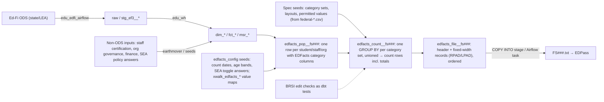

# EDFacts Files from Ed-Fi + EDU/Stadium — Execution Plan

> **Split 2026-10-12.** Carved out of `GenerateExplorer`. The P0 mapping registers and the
> Generate hidden-logic register were deleted, not moved. GenerateExplorer itself (and its git
> history, which had no remote) was deleted on 2026-10-13 after its wiki and SQL cache moved
> here; the registers are **not recoverable** and must be re-derived if needed.

Status: Draft for owner review, 2026-10-07; §4a Proposed Plan 1 added 2026-10-21, awaiting decision E6
Baselines: Generate `37108eb4` (read-only lineage), Ed-Fi Data Standard 6.1.0 (pinned), EDFacts
SY 2026-27 catalog (frozen 2026-10-07; SY 2025-26 retained as lineage)

## 1. Objective

Produce EDPass-submittable EDFacts files from an EDU warehouse (`edu_wh` dims/facts over Ed-Fi
ODS data), deployable to any Stadium partner as a dbt extension package plus one file-export task.
CEDS Generate is used only as a **reading source**: it tells us which business rules a working
EDFacts producer applies that the federal file specifications do not state. Nothing from Generate
runs at runtime.

The EDFacts file specifications (the per-FS DOCX documents linked from the SY 2026-27 file
specifications page, plus the EDFacts Workbook, the Business Rules Single Inventory (BRSI), and the
EDPass metadata guides linked from the EDFacts Resources page) are the authority on **what** a file
contains. Generate is the authority on **how a state has actually computed it** where the spec is
silent.

## 2. What this repo already settles

| Asset | Where | Reuse |
|---|---|---|
| Spec-derived category sets, record layouts and permitted values (SY 2026-27, from the Pandoc cells) | `edu_ext_edfacts/seeds/` via `tasks/build_edfacts_seeds.py` | the count engine's metadata, the fixed-width writer, `accepted_values` tests and xwalk targets (the SY 2025-26 `federal-normalized-*.csv` lineage was removed 2026-10-17; git history keeps it) |
| Element-level Ed-Fi gap clusters: staff qualifications, org governance/finance, foster care | `wiki/analysis/EDFacts-EdFi-Gap-Analysis.md` | scope of side-door data |
| 24 domain notes: every Generate wrapper's inputs, filters, report codes | `wiki/generate/domains/` | the per-collection rule inventory |
| Verified Generate defects and dead paths | `wiki/generate/repo/Source-Code-Oddities.md` | what **not** to port |
| Pandoc extraction for DOCX specs | `tasks/extract_federal_table_cells.py` | every catalog spec of a year to `tasks/reports/<year>/`; the 2025-26 normalizer was P0 tooling and is gone |
| EDU warehouse model map (sibling vault) | `/mnt/c/Repos/EDUAPIExplorer/wiki/repos/edu-wh/` | source models per EDFacts input |

The seam thesis from the P0 work carries over unchanged: Generate's `App` metadata half
(category sets, layouts, permitted values) is standard-agnostic and is **regenerated from the
specs**, not ported. Generate's `Staging`/IDS half is replaced by `edu_wh` + xwalk seeds.

## 3. Target architecture (lazy version)

One dbt package, working name `edu_ext_edfacts`, following the `edu_ext_*` extension pattern
(reads `edu_wh` marts and its own seeds, defines no sources). Three model layers per file spec,
one macro family, four seed families, and a single export task. Deliberate omissions:

- **No generic count-SQL generator.** One `GROUP BY` per category set from the seed, unioned with
  its zero-fill, produces every combination and total natively (GROUPING SETS was the first cut;
  the per-set union is shorter and labels each row directly). Generate's 7,706-line
  `RDS.Get_CountSQL` exists because SQL Server 2008-era code built the SQL text by hand.
- **No report-row star schema.** `edfacts_count__*` tables are the report rows. No equivalent of
  `RDS.ReportEDFacts*` is needed because nothing else reads them.
- **No app shell, no toggle UI.** SEA policy answers are seed rows (they are EDPass metadata
  survey answers already, so the state has them in writing).
- **No XML rendering** until a spec requires it (SY 2025-26 specs are fixed-width or delimited).

## 4. Phases

Each phase ends with a commit and a one-line entry in `.planning/STATE.md`. Phases 1 and 2 run in
parallel; 3 depends on both; 4+ repeat 3's shape.

### Phase 0 — Freeze the SY 2026-27 federal baseline (done 2026-10-07)

`www.ed.gov` returns 403 to every non-browser client (curl, PowerShell, headless Chrome) and the
Wayback Machine held no capture. A real Chrome window driven over the DevTools protocol
(`tasks/fetch_edgov_via_chrome.ps1`, run from WSL via `powershell.exe`) fetched the pages and every
linked document; `tasks/freeze_edfacts_catalog.py 2026-27` renamed, checksummed and inventoried
them into `wiki/reference/edfacts/2026-27/` (94 DOCX, 43 companion documents, `MANIFEST.csv`).

**Outcome:** 93 FS ids, all v23.x, all Inactive at freeze; FS112 dropped, none added; 83 specs
editorial-only, 11 with guidance changes, no record-layout changes. Full account:
`wiki/analysis/EDFacts-2026-27-Delta.md`. Both years are now extracted in full under
`tasks/reports/2025-26/` and `tasks/reports/2026-27/` (`extract_federal_table_cells.py --year …`).

**New fact that reshapes Phase 2:** the specs now cite EDPass metadata *collections* FS5002–FS5029
instead of a survey. The SEA policy answers Generate held as toggles are themselves EDFacts files;
`edfacts_config` should be shaped to those collections.

### Phase 1 — Final Generate pass: business logic not evident in the specs (done 2026-10-07)

Six parallel reads of Generate's SQL, one per domain group (IDEA student, CCD/outcomes, programs,
Directory+Staff, Assessments+legacy inlet, shared machinery), consolidated into a register of rules
with a reimplement decision each (`adopt`, `adopt-as-config`, `follow-spec-instead`, `drop`).

**Outcome (2026-10-07):** 336 rules — 91 spec-silent, 54 implied, 28 stated-differently,
67 contradicting, 96 defects; decisions 71 adopt / 90 adopt-as-config / 108 follow-spec-instead /
67 drop. 39 SEA policy toggles catalogued (13 of them dead in Generate but still needed by the
spec). Headline for the architecture: **a port is not possible** — Generate has no single-
organization assignment for IDEA counts, no reporting-period filters for exiting or discipline,
no highest-score selection for assessments, and dropout/graduate/ACGR/chronic definitions that
collapse to source codes.

**Register deleted 2026-10-12** (owner decision at the repo split). The headline above stands; the
per-rule rows do not. Re-derive individual rules from the Generate wiki
(`wiki/generate/`) and the specs as each collection is built.

### Phase 2 — Spec-driven metadata seeds and the count/write macros

1. `tasks/build_edfacts_seeds.py` — derive four seed CSV families from `federal-*.csv`:
   `edfacts_category_sets` (FS, org level, category set, category, data group), `edfacts_layouts`
   (FS, org level, position, length, type, element), `edfacts_permitted_values` (FS, category,
   code, label), `edfacts_file_headers` (File Type, reporting period, identifier rules). Re-runnable
   for any reporting year.
2. `edfacts_config` seed schema, shaped to the FS5002–FS5029 metadata collections: count dates per collection (child count date,
   membership date, EL date, effective date, state school-year start/end, inclusion period),
   age-band answers (DD age band, homeless ages), per-state yes/no toggles, CTE program-year
   window, assessment-type answers.
3. `xwalk_edfacts_*` seeds: Ed-Fi descriptor value → EDFacts permitted value, one per category
   family (race/ethnicity, sex, grade level, disability category, educational environment, exit
   basis, EL status, discipline action, removal reason, staff classification …). Pre-fill from
   the Ed-Fi 6.1 default descriptor sets (`wiki/reference/ed-fi/6.1.0/`); leave state-specific
   rows blank for the partner.
4. Macros: `edfacts_counts(pop_model, fs, org_level)` emitting one GROUP BY per category set from the
   category-set seed, including zero-fill for required combinations and the Total Indicator rows;
   `edfacts_record(fs, org_level)` emitting the fixed-width concatenation from the layout seed;
   `edfacts_header(fs)`.
5. Tests: `accepted_values` against permitted values; BRSI checks that are expressible in SQL
   (subtotal = sum of parts, required categories present, no negative counts).

**Done when:** `dbt seed && dbt run-operation` renders a count query and a record for FS052 from
seeds alone, and the seeds rebuild byte-identical from the federal CSVs.

### Phase 3 — Vertical slices

Three population models, chosen to exercise the three input shapes:

| Slice | Specs | Input shape | edu_wh sources |
|---|---|---|---|
| Membership | FS052 (+FS039 Grades Offered, which FS052 depends on) | point-in-time student enrollment on a count date | `fct_student_school_association`, `dim_student`, `dim_school`, `bld_ef3__stu_grade_level`, school grade spans |
| IDEA Child Count | FS002, FS089 | student × program eligibility on a count date, with policy exclusions | `fct_student_special_education_program_association` (`is_idea_eligible`, `primary_disability_type`, `special_education_setting`), `dim_student` (birth date → age), `fct_student_school_association` |
| Directory | FS029 (SEA/LEA/school) | organization attributes, operational status transitions | `dim_lea`, `dim_school`, `bld_ef3__wide_ids_*`, calendar windows |

For each slice: population model → counts → record → file in a local dbt project against sample
Ed-Fi data (the Ed-Fi "Grand Bend" sample ODS loaded through `edu_edfi_source`/`edu_wh` is enough;
no partner data needed). Validate the file with the BRSI tests and, where a partner can supply one,
a Generate-produced or previously-submitted file for the same year.

**Done when:** the three files pass every SQL-expressible BRSI rule, record lengths match the
layout seed, and the slice's Phase-1 rules are each either implemented or logged as
`follow-spec-instead` with the spec citation.

### Phase 4 — Roll out by collection, in EDPass unlock order

Group the remaining Generate-covered specs by shared population model and ship a group per wave,
reusing the Phase 3 shape. Suggested order, by the SY 2025-26 catalog's Active set and by shared
inputs:

1. CCD organization: FS129, FS130, FS131, FS190, FS196–FS198, FS207, FS163, FS170, FS205, FS206,
   FS212, FS223 (Directory population + org status side-door).
2. IDEA student: FS009 Exiting; FS005/FS006/FS007/FS088/FS143/FS144 Discipline; FS086 Firearms.
3. CCD staff: FS059, FS203; IDEA staff FS070, FS099, FS067 (FS112 left the catalog in SY 2026-27) — **gated on a staff
   qualification side-door** (Ed-Fi core has no certified/qualified determination).
4. Program participation: FS118/FS194 Homeless, FS045/FS165 Immigrant, FS054/FS121/FS145 MEP,
   FS134/FS137 Title I, FS116/FS126/FS141/FS210/FS211 Title III, FS113/FS119/FS125/FS127/
   FS218–FS221 N-or-D, FS222 Foster care, FS226 Economically disadvantaged, FS033 FRL.
5. Outcomes: FS032 Dropout, FS040 Graduates, FS150/FS151 ACGR (implement the adjusted cohort from
   the spec; Generate never did), FS160 Postsecondary enrollment, FS195 Chronic absenteeism (from
   `msr_student_cumulative_attendance`; threshold from the spec, not Generate).
6. Assessment: FS175/FS178/FS179/FS185/FS188/FS189, FS137–FS139, FS050, FS224/FS225.
7. Finance and governance: FS035, FS132, FS193 (amounts are non-Ed-Fi inputs → seeds or side-door).

The 12 specs Generate never covered (FS227–FS230 dispute resolution, FS901–FS908 Part C) have no
Ed-Fi student data behind them at all; they are SEA administrative counts and belong in a plain
seed-to-file path, last.

**Done when (per wave):** every spec in the wave has a population model, passes BRSI tests, and
its Phase-1 rules are dispositioned.

### Phase 5 — Stadium deployment

1. Publish `edu_ext_edfacts` as a versioned dbt package; a partner adds it to `packages.yml` and
   fills `edfacts_config` and `xwalk_edfacts_*` seeds (same mechanics as every other `xwalk_*`).
2. One Airflow task in the partner's `stadium_*` DAG repo: run the `edfacts` tag, then export each
   `edfacts_file__*` model to the state's drop location (Snowflake `COPY INTO @stage` with
   `FILE_FORMAT = (TYPE = CSV FIELD_DELIMITER = NONE …)` for fixed-width, or a small Python
   export for Databricks).
3. Submission-year rollover: a single `edfacts:reporting_year` var selects the seed year.

**Done when:** one partner produces its Active-set files from its own warehouse and they pass
EDPass validation.

## 4a. Proposed Plan 1 — Directory precursor, FS039, FS052 (proposed 2026-10-21)

**Status: proposed. Blocked on decision E6 (§5) at start gate G1 (`.planning/ROADMAP.md`).**
Nothing below is executed until E6 is recorded. Graphic runbook with the per-element evaluation:
`wiki/analysis/EDFacts-Plan1-FS039-FS052-Runbook.html` (also at
https://claude.ai/artifact/UmXSAqF6Pq5Dbv4isRctD4).

**Why these two files.** Of the 20 Active/Optional specs, FS039 and FS052 are the only ones whose
every element is Direct or trivially Derivable in core Ed-Fi *and* already lands in an `edu_wh` or
`edu_edfi_source` model. Everything else they need is an SEA policy answer, not data. FS029 is not
a target here but is the precursor: EDPass rejects any LEA or school row without a directory record,
so Plan 1 builds the directory population once and reuses its unit list in both target files.

### Sequence

| # | Lane | Step | Output |
|---|---|---|---|
| A1 | manual | Freeze the SY specs (Chrome fetch + freeze); regenerate the four spec seeds | `edfacts_*` seeds |
| A2 | manual | Answer FS5017: does the state use Ungraded, Grade 13, Adult Education | `edfacts_config` |
| A3 | manual | Set the membership count date (Oct 1 or closest school day) | `edfacts_config.member_date` |
| A4 | manual | State code, abbreviation, agency number 01, submission id, file identifier | dbt vars |
| A5 | manual | Review the descriptor crosswalks pre-filled from Ed-Fi 6.1 defaults: grade level, sex, race, school type, operational status, LEA category, charter status | `xwalk_edfacts_*` |
| A6 | manual | Collect the FS029 facts core Ed-Fi lacks: charter authorizer ids, reconstituted status, dated operational-status changes, prior ids | `edfacts_directory_overrides` |
| B7 | EDPass | SEA directory rolls over; confirm present | — |
| B8 | Ed-Fi | Read `dim_lea`, `dim_school`, `stg_ef3__*__addresses`, `stg_ef3__*__identification_codes` | — |
| B9 | build | FS029 LEA directory population and file | `ssLEADIRECTORYv.txt` |
| B10 | EDPass | Upload LEA directory (supervisory unions first) | — |
| B11 | manual | FS190 charter authorizer roster, by hand, only if any school is a charter | FS190 file |
| B12 | build | FS029 school directory population and file | `ssSCHDIRECTORYv.txt` |
| B13 | EDPass | Upload school directory; download the Directory and Grades Offered report and reconcile the unit list | — |
| C14 | Ed-Fi | Read `stg_ef3__schools__grade_levels` + `dim_school` + `dim_lea` | — |
| C15 | build | Grades-offered population: operational units, not reportable programs, grades through the xwalk minus unused UG/13/AE; LEA = union of its schools else `NOGRADES` | one row per unit per grade |
| C16 | build | `edfacts_file` + spec tests + `brsi_*` tests | `ssLEAGRADESOFFv.txt`, `ssSCHGRADESOFFv.txt` |
| C17 | EDPass | Upload FS039; type FS5017 (separate submission since SY 2025-26) | — |
| D18 | Ed-Fi | Read `fct_student_school_association` + `dim_student` | — |
| D19 | build | Membership population: entry ≤ count date < exit (inclusivity per `edu:enroll:exit_withdraw_date_inclusive`); one school per student via `is_primary_school` then latest entry; grade from the counted enrollment's `entry_grade_level`; units from B12 minus `NOGRADES` | population model |
| D20 | build | `edfacts_counts`: Category Set A, subtotals 1–4, unit total; zero-fill only grades the unit reported in FS039 | counts |
| D21 | build | `edfacts_file` + `edfacts_conforms`, `edfacts_sets_sum_to_total`, `edfacts_record_lengths`, FS052 `brsi_*`, cross-file FS039→FS052 grade check | `ssSEAMEMBERv.txt`, `ssLEAMEMBERv.txt`, `ssSCHMEMBERv.txt` |
| D22 | manual | FS5024 narrative answers (grades offered vs enrolled, PK contents, level differences) | EDPass text |
| D23 | EDPass | Enter FS5024, upload FS052, submit as one package; resolve rule errors (45–60 min processing) | submission |

### Completeness against the current EDU structure (evaluated 2026-10-21)

Graded against the model SQL on `main` of `edanalytics/edu_wh` and `edanalytics/edu_edfi_source`
and the Ed-Fi 6.1 default descriptors in `wiki/reference/ed-fi/6.1.0/Descriptors/`. 40 element
groups across the four files:

| Status | Count | Meaning |
|---|---:|---|
| Ready | 20 | column exists with the right meaning |
| Crosswalk | 10 | column exists; only a descriptor→permitted-value seed is missing |
| Build gap | 5 | small warehouse or extension addition |
| Manual | 5 | no core Ed-Fi source; overrides seed or typed into EDPass |

- **FS039 and FS052 need no `edu_wh` change.** Grade levels are in `stg_ef3__schools__grade_levels`
  at the file's grain (not on `dim_school`); `bld_ef3__stu_race_ethnicity` already applies the
  federal Hispanic-first, then two-or-more rule with the three sentinel codes as project vars.
- **Ed-Fi 6.1 defaults carry the EDFacts vocabulary.** `SchoolType` includes "Reportable Program",
  `OperationalStatus` has the same eight values as DG16/DG531 (Active = Open), and
  `LocalEducationAgencyCategory` names the nine DG453 types verbatim. Those xwalks are near 1:1.
- **Crosswalk decisions (10):** LEA type, LEA and school operational status, charter LEA status
  DG653, school type, school charter YES/NO, grades offered (settle Preschool, Early Education,
  Transitional Kindergarten; drop Infant/toddler and postsecondary levels), membership grade, sex
  (Ed-Fi Non-binary and Not Selected have no FS052 value beyond MISSING), race.
- **Build gaps (5):** institution telephones are in `base_ef3__*.v_institution_telephones` but no
  staging model flattens them and telephone is mandatory in both FS029 files (one `json_flatten`
  model in `edu_edfi_source`); "opened after the count date" has no Ed-Fi date (proxy from
  enrollment/calendar or the overrides seed); the FS052 macro must zero-fill only the FS039 grade
  set per unit; `-1` missing counts are not implemented.
- **Manual (5), all in FS029:** charter authorizer ids (DG804, `charter_approval_agency` is a
  type, not an organization), reconstituted status DG743, dated operational-status changes
  (DG16N/DG531N + DG571) for LEA and school, prior state ids. The dated-status items and the
  "opened after count date" gap are the subject of decision E7; see
  `wiki/analysis/Status-and-Year-Change-Tracking.md` for the rules (DG16 is a transition against
  the prior filing; N fields are one net change) and the ranked designs.
- **Two warehouse behaviours to design around:** org staging dedupes to the latest API year, so a
  rerun for a prior year reports today's operational status; `dim_student` carries the latest grade
  of the year, so Membership takes grade from the enrollment it counts.

### Deliverables if E6 accepts

1. Seeds: `xwalk_edfacts_{grade_level,sex,race,school_type,operational_status,lea_category,charter_status}`
   pre-filled from Ed-Fi 6.1 defaults; `edfacts_directory_overrides`; `edfacts_config` columns
   `member_date`, `uses_ungraded`, `uses_grade_13`, `uses_adult_ed`.
2. `edu_edfi_source`: `stg_ef3__schools__institution_telephones` and the LEA twin (upstream PR).
3. `edu_ext_edfacts`: directory population + FS029 LEA/school files; FS039 population + files;
   FS052 population over `fct_student_school_association`, FS039 grade gate in `edfacts_counts`,
   `-1` rule; `SPECS` allowlist widened to FS029, FS039, FS052; `brsi_*` tests for the three.
4. Validation on the Grand Bend sample ODS (E2 default), then one partner.

## 5. Decisions needed from the owner

| # | Decision | Default if silent |
|---|---|---|
| E1 | Package home: public EDU org (PolyForm) vs. Stadium-private | Stadium-private until Phase 3 proves the shape, then propose publishing |
| E2 | First partner / first state for Phase 3 validation data | Grand Bend sample ODS only; no partner data |
| E3 | Where non-Ed-Fi inputs (staff certification, org governance, finance, SEA policy answers) enter | seeds for SEA-level answers; earthmover bundles for anything per-staff or per-org |
| E4 | ~~Baseline: wait for SY 2026-27 artifacts~~ resolved: SY 2026-27 frozen 2026-10-07 | — |
| E5 | Fate of the P0 register waves (Phases 4+ of the old plan: 4,731 unadjudicated rows) | stop; spec seeds replace them. Registers deleted 2026-10-12 |
| E6 | **Start gate G1.** Adopt, amend or reject Proposed Plan 1 (§4a): FS029 precursor → FS039 → FS052 as the first slice, with its five build gaps and five manual inputs accepted as scope | **No default.** Phase 07 (vertical slices) does not start until this is recorded here and in `HANDOFF.md` |
| E7 | **Status and year-change tracking approach** for FS029 DG16/DG16N/DG571 and other as-of-date needs. Fifteen candidate designs ranked in `wiki/analysis/Status-and-Year-Change-Tracking.md`; recommendation there is solution 2 (filing ledger + declarations) plus solution 7 (by-year org builds), with solution 9 deferred. Decide with E6; the choice changes Plan 1's manual items and the "opened after count date" gap | **No default.** Same gate as E6 |

## 6. Out of scope

- Running Generate, SQL Server, or any CEDS artifact at runtime.
- EDPass submission automation beyond producing the file (EDPass has no public API).
- State-specific files that are not EDFacts (those stay in each `stadium_*` repo's `state_files`).
- Ed-Fi ODS/API changes; if a state's ODS lacks an element, the side-door path supplies it.

## 7. Repo housekeeping

- 2026-10-12: split out of GenerateExplorer into this repo. `.planning/` phases continue at `06`;
  phases `01`–`03` (P0) and the P0 archive were deleted.
- Decisions: E1–E5 in §5; record new ones there and in `HANDOFF.md`.
