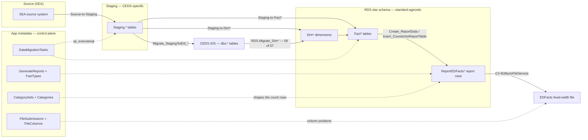

# CEDS Generate — EDFacts Pipeline Wiki

CEDS **Generate** is a T-SQL application that state education agencies use to turn their own K-12
data into **EDFacts submission files**. This vault documents how it does that. The pipeline is
`Staging → RDS star schema → report rows → EDFacts file`, driven end-to-end by metadata in the
`App` schema. Almost all of the logic is SQL; the C# is a shell.

The whole extraction turns on one seam: the `Staging.*` tables and the `Staging-to-*` procedures
are **CEDS-specific and replaceable**; the `RDS` star schema and the `App` report metadata are
**standard-agnostic and reusable**. A note that blurs the two hides the thing being extracted.

> [!warning] The seam is not the only inlet — verified in Phase D
> "Replace the staging mapping and everything downstream still works" is **true for the 20 modern
> domains and false for the rest**. Generate has a second, older inlet: `Staging` →
> `Staging.Migrate_StagingToIDS_*` → the CEDS **IDS** (the `dbo.*` normalized tables) →
> `RDS.Migrate_Dim*` → `RDS`. **58 of the 67 `RDS.Migrate_Dim*` procedures read `dbo.*` only and
> never touch `Staging.*`** (4 read both; none read `Staging` alone). That layer populates most
> reference dimensions, the four legacy domains ([[CTE]], [[Other]], [[SPPAPR]],
> [[StudentCounts]]), and the `organizationstatus` fact type behind FS199–FS202. For those, there
> is no CEDS-aligned staging table to re-point — an Ed-Fi binding has to supply the IDS shape or
> replace `RDS.Migrate_Dim*` outright. See [[Source-Code-Oddities]].

---

## Conventions

Every note in this vault follows these, verbatim.

**Seam callout.** Every note declares which side of the CEDS seam it documents, as an Obsidian
callout immediately under the H1:

```markdown
> [!info] Seam: CEDS-specific
> The staging tables and their load procedures are the replaceable half.
```

Use exactly one of `Seam: CEDS-specific`, `Seam: standard-agnostic`, or `Seam: both` (for `both`,
say in one line which parts fall on which side).

**Diagrams.** One mermaid `flowchart LR` per note, no more. Quote every node label
(`A["Staging.K12Enrollment"]`) so schema dots and parentheses do not break the parser. Keep to
roughly a dozen nodes; a diagram that needs scrolling is a diagram that needs splitting.

**Links.** Cross-reference with double-bracket wikilinks, e.g. [[Staging-Layer]],
[[App-Metadata-Layer]].
Link on first mention of another component or domain, not on every mention.

**Citations.** Cite as `generate.database/<path>@develop`, path relative to the `generate.database/`
project root. Files live locally under `sources/generate/` with the same relative layout, so
`sources/generate/Views/Create/Debug.vwChildCount_StagingTables.View.sql` is cited as
`generate.database/Views/Create/Debug.vwChildCount_StagingTables.View.sql@develop`. Each note ends
with a `## Citations` list. Cite only files that actually exist in the local cache.

**Register.** Concise. Present tense, declarative. No hedging, no restating the diagram in prose.
Component notes ~60–120 lines; domain notes ~50–100 lines.

**Category codes.** `App.Categories.CategoryCode` values are **purpose-suffixed**, not generic:
`DISABCATIDEA`, `DISABSTATIDEA`, `DISABCATIDEAEXIT`, `AGEEXITSPED`, `AGESA`, `GRADELVMEM`,
`GRADELDROP`, `RACEETHNIC`, `SEX` ("Sex (Membership)"), `LEPONLY`, `BASISEXIT`. There is no bare
`RACE`, `AGE`, or `ELSTATUS` code. **`IDEADISAB` is not a `CategoryCode` at all** — it is an
`App.TableTypes.TableTypeAbbrv` (a file-spec grouping). Where a note writes a short label such as
`category: RACE`, read it as a descriptive *role*, not a literal code; verified literal codes are
written as they appear in `App.Categories`.

**Report codes.** Generate's `ReportCode` is `c` + the EDFacts file-spec number:
`c002` ⟷ **FS002**. `App.GenerateReports` stores both (`ReportShortName = 'C002'`,
`ReportShortNameAlt = 'FS002'`). Write EDFacts specs as `FS###` and Generate report codes as
`c###`, and say which you mean.

---

## The pipeline



The dotted edges are the point: nothing in this pipeline is statically wired. `App.Migrate_Data`
reads procedure names out of `App.DataMigrationTasks` and calls them with `sp_executesql`;
`RDS.Create_ReportData` reads category sets out of `App.CategorySets` and builds the counting SQL
per set. See [[App-Metadata-Layer]].

---

## Map of content

### Folder guides

Every vault folder has a guide note describing its files: [[Components-Guide]],
[[Domains-Guide]], [[Repo-Guide]].

`sources/` sits outside the vault: the grep-able Generate SQL cache cited by every note.

### Repo
- [[Generate-Repo-and-Branches]] — where the canonical logic lives, the duplicate trees, branch state.
- [[Source-Code-Oddities]] — verified anomalies found during review. Read before trusting any single
  procedure.

### Components
- [[Staging-Layer]] — the CEDS-aligned landing tables. *CEDS-specific.*
- [[App-Metadata-Layer]] — the control plane: reports, category sets, file layouts. *Standard-agnostic.*
- [[RDS-Star-Schema]] — dimensions, facts, and report tables. *Standard-agnostic.*
- [[Staging-to-RDS-Migration]] — the 24 wrappers and the procs they orchestrate. *Both.*
- [[Report-Data-Generation]] — facts → EDFacts count rows. *Standard-agnostic.*
- [[File-Generation]] — report rows → fixed-width submission file. *Standard-agnostic.*
- [[App-Shell]] — the C#. *Out of scope for extraction.*

### Domains
One note per EDFacts collection. Each covers its wrapper, fact procedure, report codes, data
elements, and preliminary Ed-Fi coverage.

| | | | |
|---|---|---|---|
| [[Assessments]] | [[CTE]] | [[ChildCount]] | [[Chronic]] |
| [[DataPopulation]] | [[Directory]] | [[Discipline]] | [[Dropout]] |
| [[Exiting]] | [[GraduatesCompleters]] | [[Graduationrate]] | [[Homeless]] |
| [[HsGradPSEnroll]] | [[Immigrant]] | [[Membership]] | [[MigrantEducationProgram]] |
| [[NeglectedOrDelinquent]] | [[Other]] | [[SPPAPR]] | [[Staff]] |
| [[StudentCounts]] | [[TitleI]] | [[TitleIIIELOct]] | [[TitleIIIELSY]] |

### Known source-code oddities

All verified against `develop` during review; each is written up in [[Source-Code-Oddities]].

- **The CEDS IDS is a second inlet** — 58 of 67 `RDS.Migrate_Dim*` procedures read `dbo.*`, never
  `Staging.*`. Qualifies the seam claim above.
- **Unimplemented logic** — adjusted-cohort ([[Graduationrate]]), the postsecondary filter
  ([[HsGradPSEnroll]]), the chronic-absence threshold ([[Chronic]]), Title III teacher status
  ([[Staff]]), several funding amounts ([[Directory]]).
- **`C225` is gated on `c226`'s lock flag** — a copy-paste bug in `RDS.Create_Reports`
  ([[Assessments]]).
- **`c045` is dispatched under two fact types** — [[GraduatesCompleters]] and [[TitleIIIELSY]].
- **`App.CedsConnections` titles disagree with the code** — FS165 "Migratory", FS045 "Immigrant"
  ([[Immigrant]]).
- **`IDEADISAB` is not a category code** — it is a `TableTypeAbbrv`; see the convention above.

---

## Reading order

New to this: [[Generate-Repo-and-Branches]] → this page's diagram → [[App-Metadata-Layer]] (the
control plane explains everything else) → [[Staging-to-RDS-Migration]] → [[ChildCount]] as the
worked example.
