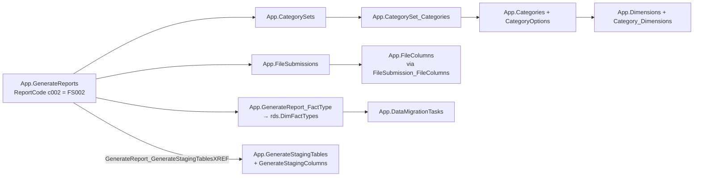

# App Metadata Layer

> [!info] Seam: standard-agnostic
> The most reusable thing in Generate. It knows about EDFacts file specs and about a staging
> *contract*; it knows nothing about CEDS. A second source standard reuses this whole schema.

Generate is a metadata-driven application. `App` is the control plane: it declares which EDFacts
reports exist, which fact type each is built from, which category sets it must be disaggregated
by, which physical columns its file has and at which byte offsets, and which stored procedures run
in which order. Change a file spec and you change rows, not code.

## The join path

This is the query that ties a report code to everything it needs. Workers documenting a domain
walk it in both directions.

**Report code → fact type.** `App.GenerateReports.ReportCode` → `App.GenerateReport_FactType` →
`rds.DimFactTypes.FactTypeCode`. Wrapped as `RDS.Get_FactTypeByReport(@reportCode)`. The fact type
code (`childcount`, `discipline`, `titleI`, …) is the domain key used by `RDS.Empty_RDS` and
`RDS.Create_Reports`.

**Report code → category sets → category options.** `App.GenerateReports` → `App.CategorySets`
(scoped by `SubmissionYear` and `OrganizationLevelId`) → `App.CategorySet_Categories` →
`App.Categories` → `App.CategoryOptions`. A *category set* is an EDFacts table-type group — `TOT`,
`CSA`, `CSB`, `ST1` — and its member *categories* are the disaggregations. Category codes are
**purpose-suffixed**, mirroring ED's own EDENDB vocabulary: `DISABCATIDEA` ("Disability Category
(IDEA)"), `DISABSTATIDEA`, `DISABCATIDEAEXIT`, `AGEEXITSPED`, `AGESA`, `GRADELVMEM`, `GRADELDROP`,
`RACEETHNIC`, `SEX` ("Sex (Membership)"), `LEPONLY`, `BASISEXIT`. There is no bare `RACE`, `AGE`, or
`ELSTATUS` code, and **`IDEADISAB` is not a category code** — it is an
`App.TableTypes.TableTypeAbbrv`, a file-spec grouping in a different table.
`App.vwReportCode_CategoryOptions` is this join pre-built;
`App.CategoryCodeOptionsByReportAndYear` is the schemabound, indexed form used at generation time
to enumerate permitted option codes.

**Category → RDS column.** `App.Category_Dimensions` → `App.Dimensions.DimensionFieldName`, and
`App.FactTable_DimensionTables` / `App.DimensionTables` say which dimension tables a fact table can
be sliced by. `RDS.Create_ReportData` turns `DimensionFieldName` into two physical column names by
suffix: `<field>Code` for the source-standard value and `<field>EdFactsCode` for the EDFacts
reporting value. That suffix convention is how the star schema stays neutral while still emitting
EDFacts codes.

**Report code → file layout.** `App.GenerateReports` → `App.FileSubmissions` (per `SubmissionYear`
and `OrganizationLevelId`) → `App.FileSubmission_FileColumns` → `App.FileColumns`.
`FileSubmission_FileColumns` carries `SequenceNumber`, `StartPosition`, `EndPosition`,
`IsOptional`; `FileColumns` carries `ColumnName`, `ColumnLength`, `DataType`, `XMLElementName`.
`App.vwReportCode_FileColumns` is this join pre-built. See [[File-Generation]].

**Report code → staging tables.** `App.GenerateReport_GenerateStagingTablesXREF` →
`App.GenerateStagingTables` → `App.GenerateStagingColumns`. Exposed as
`App.vwReportCode_StagingTables` and, at column granularity, `App.vwStagingRelationships`. See
[[Staging-Layer]].

**Fact type → procedures.** `App.DataMigrationTasks` holds `StoredProcedureName`, `FactTypeId`,
`TaskSequence`, and the flags `IsActive` / `IsSelected` / `RunBeforeGenerateMigration` /
`RunAfterGenerateMigration`. This is the table `App.Migrate_Data` cursors over. See
[[Staging-to-RDS-Migration]].

Scheduling state lives alongside: `App.DataMigrations`, `DataMigrationTypes`
(`ods` / `StagingValidation` / `rds` / `report`), `DataMigrationStatuses`, `DataMigrationHistories`,
and `rds.DimSchoolYearDataMigrationTypes` (`IsSelected` marks the school years in scope).
`App.GenerateReports.IsLocked` gates a report into the current run; `UseLegacyReportMigration`
picks between the two report generators.

## Where the metadata comes from

`Metadata/` holds 14 seed scripts. Most are two files in one: a commented-out generator that runs
against ED's **EDENDB** file-spec database, followed by its generated output.

- **`App.GenerateReports.Metadata.sql`** derives the report list from `FileSpecificationDocument`:
  `ReportCode = 'c' + substring(FileSpecificationDocumentNumber, 2, 3)`,
  `ReportShortName = 'C###'`, `ReportShortNameAlt = 'FS###'`. **This is the c### ⟷ FS### identity.**
- **`App.CategorySets.Metadata.sql`** (23,554 lines) and `App.CategorySets_FS_No_CategorySet.Metadata.sql`
  seed category sets from EDENDB `TableTypeGroup` / `TableTypeGroup_x_CategoryCode`.
  `App.AddCategorySets.Metadata.sql` inserts a default `CSA` for the twelve directory-ish specs that
  have no table-type groups upstream.
- **`App.Categories.Metadata.sql`** seeds `CategoryCode` / `CategoryName` / `EdFactsCategoryId`.
- **`App.FileSubmissions.Metadata.sql`** (12,598 lines) seeds file layouts;
  `App.FileColumns.Metadata.sql` de-duplicates `FileColumns` and normalizes data types;
  `App.FileHeader.Metadata.sql` defines the 7-column, 586-byte header record.
- **`App.CedsConnections.Metadata.sql`** (16,197 lines) seeds `App.CedsConnections`
  (`CedsConnectionName`, `CedsConnectionDescription`, `CedsConnectionSource`, `CedsUseCaseId`) from
  the CEDS **DAT** `UseCase` table — 75 distinct `FS###` connections.

> [!warning] `App.CedsConnections` is not an element-level mapping
> Its rows are CEDS Connect *use cases* — documentation links, e.g. `'FS002 Children with
> Disabilities (IDEA) School Age SY 2021-22 (Generate)'` — attached to a report via
> `GenerateReports.CedsConnectionId`, matched by `CedsConnectionName like '%C002%' or '%FS002%'`.
> It is a citation, not a bridge. The CEDS element ↔ staging column bridge is
> `App.GenerateStagingColumns` plus the `CEDS_Element` / `CEDS_GlobalId` extended properties surfaced
> by `dbo.vwCEDSMapping` and `dbo.vwCEDSElementDetails`.

`App.ViewDefinitions.Metadata.sql` and `App.UpdateViewDefinitions` store view SQL as data so the
app can rebuild the `Debug.*` lineage views; `App.ToggleQuestions` / `App.ToggleResponses` hold
SEA-specific EMAPS answers (child-count date, age ranges) that the domain logic reads directly.

## Citations

- `generate.database/Metadata/App.GenerateReports.Metadata.sql@develop` lines 163–166 — the c### ⟷ FS### derivation
- `generate.database/Views/Create/App.vwReportCode_CategoryOptions.View.sql@develop`
- `generate.database/Views/Create/App.vwReportCode_FileColumns.View.sql@develop`
- `generate.database/Views/Create/App.vwReportCode_StagingTables.View.sql@develop`
- `generate.database/Views/Create/App.vwStagingRelationships.View.sql@develop`
- `generate.database/Views/Create/App.CategoryCodeOptionsByReportAndYear.View.sql@develop`
- `generate.database/Functions/Create/RDS.Get_FactTypeByReport.UserDefinedFunction.sql@develop`
- `generate.database/StoredProcedures/Create/RDS.Create_ReportData.StoredProcedure.sql@develop` lines 173–189 — the `Code` / `EdFactsCode` suffix rule
- `generate.database/Metadata/App.CedsConnections.Metadata.sql@develop`
- `generate.database/Views/Create/dbo.vwCEDSMapping.View.sql@develop`
