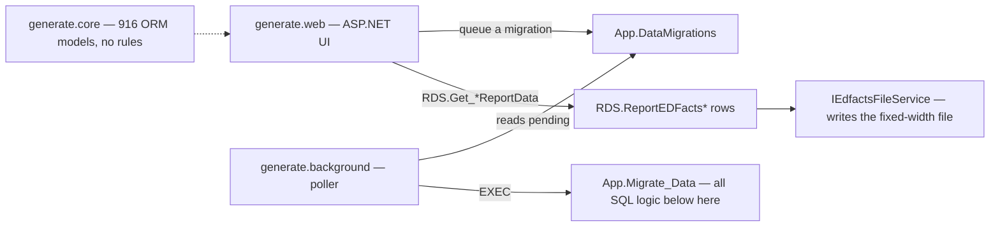

# App Shell

> [!info] Seam: neither — out of scope
> The C# carries no reporting rules and is **not** a target for extraction. This note exists so
> nobody goes looking.

Twelve C# projects wrap the database. **`generate.web`** is the ASP.NET application: pick school
years and report codes, load staging data, trigger a migration, review counts, download files. It
also carries `DatabaseScripts/`, a near-mirror of `generate.database/`; see
[[Generate-Repo-and-Branches]]. **`generate.core`** is the domain and ORM layer — 916 model classes
(`Models/IDS` 757, `Models/RDS` 75, `Models/Staging` 43, `Models/App` 41), DTOs, view models, and
service interfaces including `Interfaces/Services/IEdfactsFileService.cs`. The `Models/IDS` bulk is
the CEDS Integrated Data Store and holds no reporting rules; `Models/Staging` is the only definition
of several staging tables. **`generate.background`** polls `App.DataMigrations` for a `pending` row
and calls `App.Migrate_Data`. The rest — `infrastructure`, `shared`, `filestorage`, `console`,
`update`, `test`, `testdata`, `overnighttest` — are plumbing and test scaffolding; the substantive
tests are SQL, in `generate.database/TestCases/App.FS###_TestCase.StoredProcedure.sql`.

Three things the C# does that the SQL does not: it **writes the EDFacts file**
(`IEdfactsFileService` formats report rows using the `App.FileColumns` byte positions — see
[[File-Generation]]); it **schedules**, since nothing in SQL decides when a migration runs; and it
**populates the staging contract**, because `App.GenerateStagingTables` and `GenerateStagingColumns`
have DDL but no seed script. Everything else that matters is in `generate.database/`.

## Citations

- `generate.database/StoredProcedures/Create/App.Migrate_Data.StoredProcedure.sql@develop` lines 18–25 — the `pending` poll the background service satisfies
- `generate.database/Tables/Create/App.GenerateStagingTables.Table.sql@develop` — DDL with no seed
- `sources/gen_tree_develop.txt` — project inventory: `generate.core/Models/IDS` 757 files, `generate.core/Interfaces/Services/IEdfactsFileService.cs`, `generate.database/Jobs/MigrateData.Job.Create.sql`
