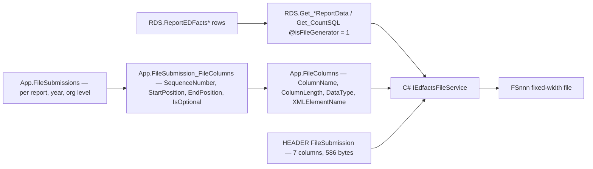

# File Generation

> [!info] Seam: standard-agnostic
> The layout metadata and the report rows are both source-neutral. Nothing in this stage touches
> `Staging` or CEDS.

The last stage turns `RDS.ReportEDFacts*` rows into the physical EDFacts submission file: a
fixed-width, position-delimited text file with a header record and one detail record per report
row. **The writing itself is C#** — the SQL side supplies the rows and the layout, and stops there.



## The layout metadata

Three tables define every EDFacts file Generate can produce.

`App.FileSubmissions` is one row per *(report, organization level, submission year)* with a
`FileSubmissionDescription` — the EDFacts file-record-layout name, e.g.
`'SEA CHILDREN WITH DISABILITIES'` for `c002` at `OrganizationLevelId = 1`, year `'2021-22'`. A
single report code therefore has separate SEA, LEA, and SCH layouts, and separate layouts per year.

`App.FileColumns` is one row per physical column: `ColumnLength`, `ColumnName`, `DataType`,
`DisplayName`, `XMLElementName`. `App.FileSubmission_FileColumns` binds a column into a layout with
`SequenceNumber`, `StartPosition`, `EndPosition`, and `IsOptional`. Positions are absolute byte
offsets, so the record is written by seeking, not by concatenation:

```sql
INSERT INTO App.FileColumns ([ColumnLength],[ColumnName],[DataType],[DisplayName],[XMLElementName])
VALUES (10, 'Amount','String', 'Amount', 'AMOUNT')
INSERT INTO App.FileSubmission_FileColumns
  ([FileSubmissionId],[FileColumnId],[EndPosition],[IsOptional],[SequenceNumber],[StartPosition])
VALUES (@fileSubmissionId, @fileColumnId, 504, 'false', 24, 495)
```

`App.vwReportCode_FileColumns` joins all three back to `App.GenerateReports` and is the single view
to read when you want "what does file FS### look like this year". `DataType = 'Control Character'`
marks the `CarriageReturn/LineFeed` column, which is the record terminator, not data.
`XMLElementName` (`CATEGORY`, `AMOUNT`, `FILELAYOUTTYPE`, `FILEID`) exists because the same metadata
also drives an XML rendering.

`App.FileHeader.Metadata.sql` defines one shared `FileSubmissions` row with
`FileSubmissionDescription = 'HEADER'` and seven columns totalling **586 bytes**: `FileType` (1–50),
`TotalRecords` (51–60), `FileName` (61–85), `FileIdentifier`, `FileReportingPeriod` (118–126),
`Filler`, and `CarriageReturn/LineFeed` at 585–586. Every submission file gets this header.

## Where SQL ends

`RDS.Get_CountSQL` takes an `@isFileGenerator` flag, and `RDS.Get_ReportData` and its per-domain
siblings take `@isOnlineReport` — these are the same procedures the UI uses, called in file mode.
They return the report rows already shaped for output. **No T-SQL procedure in
`generate.database/` opens a file.** The formatting-and-writing step is
`generate.core/Interfaces/Services/IEdfactsFileService.cs` and its implementation in the C# app; see
[[App-Shell]].

Two SQL utilities sit *around* file generation rather than in it.
`Utilities.CreateSubmissionFileTable` reads the same `FileSubmissions` / `FileColumns` metadata and
emits a `CREATE TABLE [schema].[c002_SEA_2023]` matching the layout;
`Utilities.LoadSubmissionFileTable` `BULK INSERT`s a produced file back into it. Together with
`Utilities.CompareSubmissionFiles` and the `Utilities.Compare_<DOMAIN>` procedures, they are the
regression harness: generate a file, load it back, diff it against a prior run.

> [!warning] `EDENDB.dbo.Generate_ExportMetadata_OneFile` is not a file exporter
> Its header says it "should NOT be installed on a CEDS/Generate database" — it runs on ED's
> **EDENDB** file-specification database. It reads `FileSpecificationDocument`, `FileRecordLayout`,
> `TableType`, `TableTypeGroup`, and `CategoryCode`, and writes `dbo.GenerateOptions` and
> `dbo.GenerateColumns` — the staging tables for the `Metadata/` seed scripts. It is how file-spec
> metadata gets *into* Generate, the inbound counterpart of everything above. `generate.web` reaches
> it through a synonym, `dbo.EDENDB_dbo_Generate_ExportMetadata_OneFile`.

## Citations

- `generate.database/Views/Create/App.vwReportCode_FileColumns.View.sql@develop`
- `generate.database/Metadata/App.FileSubmissions.Metadata.sql@develop` — the `c002` layout block
- `generate.database/Metadata/App.FileHeader.Metadata.sql@develop` — the 586-byte header
- `generate.database/Metadata/App.FileColumns.Metadata.sql@develop` — de-duplication and `Control Character` typing
- `generate.database/StoredProcedures/Create/EDENDB.dbo.Generate_ExportMetadata_OneFile.StoredProcedure.sql@develop` lines 1–4, 86–128
- `generate.database/StoredProcedures/Create/Utilities.CreateSubmissionFileTable.StoredProcedure.sql@develop`
- `generate.database/StoredProcedures/Create/Utilities.LoadSubmissionFileTable.StoredProcedure.sql@develop`
- `generate.database/Functions/Create/RDS.Get_CountSQL.UserDefinedFunction.sql@develop` — `@isFileGenerator`
