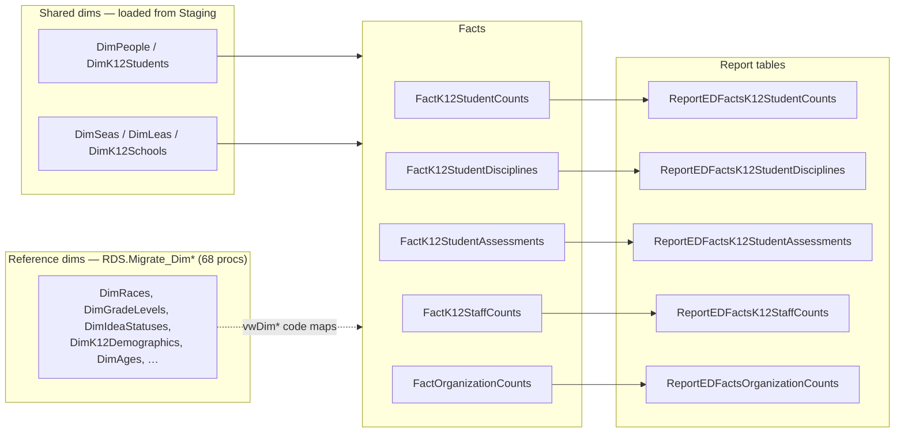

# RDS Star Schema

> [!info] Seam: standard-agnostic
> `RDS` is the CEDS **Reporting Data Store** — a conformed star schema that Generate reads and
> writes but does not define. It is the target a second source standard must land in, and it is
> reusable as-is.

`RDS` has three layers: dimensions, facts, and report tables. Domain loads write facts; report
generation reads facts and writes report rows. Everything is scoped by `SchoolYearId` and, for
student/staff counts, by `FactTypeId` — which is why one physical fact table serves seventeen
EDFacts domains.

> [!warning] No DDL in this repo
> There is not a single `Tables/Create/RDS.*.sql`. The `RDS` schema ships with the CEDS Data
> Warehouse and is installed separately. Its shape has to be read out of the procedures, the
> `RDS.vwDim*` views, and `RDS.vwCEDS_DataWarehouse_Extended_Properties`, which surfaces
> `CEDS_ElementTechnicalName` and `CEDS_GlobalId` extended properties per column.

## Dimensions — two layers, not one

**Shared organizational and person dimensions** are loaded from `Staging` by four procedures that
every domain wrapper calls first: `Staging.Staging-to-DimSeas`, `Staging-to-DimLeas`,
`Staging-to-DimK12Schools`, and `Staging-to-DimPeople_K12Students` (or `_K12Staff` for the Staff
domain). Sixteen more `Staging-to-Dim*` procedures are domain-scoped —
`Staging-to-DimAssessments`, `DimAssessmentAdministrations`, `DimAssessmentPerformanceLevels`,
`DimCharterSchoolAuthorizers`, `DimCharterSchoolManagementOrganizations`, and so on. Twenty in all.

**Reference / code-table dimensions** are the other layer: **67** `RDS.Migrate_Dim*` procedures
that populate the coded dimensions (`DimRaces`, `DimGradeLevels`, `DimIdeaStatuses`,
`DimK12Demographics`, `DimAges`, `DimDisabilityStatuses`, …) with the cross-product of CEDS option
codes and their EDFacts equivalents.

> [!warning] This layer reads the CEDS IDS, not `Staging`
> **58 of the 67 read `dbo.*` only; 4 read both `dbo.*` and `Staging.*`; none read `Staging.*`
> alone.** The `dbo.*` tables are the CEDS Integrated Data Store — their names map 1:1 onto
> `generate.core/Models/IDS/*.cs` — populated from `Staging` by the separate
> `Staging.Migrate_StagingToIDS_*` procedures. So the reference-dimension layer sits downstream of
> the IDS, not downstream of the staging contract, and an Ed-Fi binding that replaces only
> `Staging.*` leaves it unfed. See [[Source-Code-Oddities]].

> [!warning] "Never called by wrappers" is wrong for four domains
> Twenty of the 24 wrappers use the modern `Staging-to-Dim*` procedures. **CTE, Other, SPPAPR, and
> StudentCounts still call `rds.Migrate_DimK12Students`, `rds.Migrate_DimSeas`,
> `rds.Migrate_DimLeas`, and `rds.Migrate_DimK12Schools` directly** — the previous generation of the
> same load. See [[Staging-to-RDS-Migration]].

Fact-loading procedures do not join the reference dimensions directly. They pull `RDS.vwDim*` views
into indexed temp tables first — `RDS.vwDimGradeLevels`, `vwDimRaces`, `vwDimIdeaStatuses`,
`vwUnduplicatedRaceMap`, `vwDimEnglishLearnerStatuses` — filtered to the school year. Each view
exposes `*Map` columns that match a staging value to a dimension row, so the fact load becomes a
join against a lookup rather than a `CASE` ladder. **These views are where CEDS option codes turn
into EDFacts codes**, and they are the highest-value thing to re-point at a new source standard.

## Facts

Twenty-one `RDS.Fact*` tables, of which five carry the EDFacts load:

| Fact table | Loaded by | Serves |
|---|---|---|
| `RDS.FactK12StudentCounts` | 13 `Staging-to-FactK12StudentCounts_<Domain>` procs + legacy `RDS.Migrate_StudentCounts` | ChildCount, Exiting, Membership, Dropout, GraduatesCompleters, GraduationRate, HsGradPSEnroll, Homeless, Chronic, Immigrant, MigrantEducationProgram, NeglectedOrDelinquent, TitleI, TitleIIIELOct, TitleIIIELSY, DataPopulation, CTE, Other, SPPAPR, StudentCounts |
| `RDS.FactK12StudentDisciplines` | `Staging-to-FactK12StudentDisciplines` | Discipline |
| `RDS.FactK12StudentAssessments` | `Staging-to-FactK12StudentAssessments` | Assessments |
| `RDS.FactK12StaffCounts` | `Staging-to-FactK12StaffCounts` | Staff |
| `RDS.FactOrganizationCounts` | `Staging-to-FactOrganizationCounts` | Directory |

Also present and loaded, but not on a wrapper path: `FactK12StudentEnrollments`,
`FactK12ProgramParticipations`, `FactSpecialEducation`, `FactK12SeclusionsOrRestraints`,
`FactK12StudentCourseSections`, `FactOrganizationStatusCounts`, `FactCustomCounts`, and the
postsecondary `FactPsStudent*` family.

Fourteen `RDS.Bridge*` tables carry the many-to-many edges that would otherwise break a count —
`BridgeK12StudentEnrollmentRaces`, `BridgeK12StudentAssessmentAccommodations`,
`BridgeSpecialEducationIdeaDisabilityTypes`. `RDS.Empty_RDS @factTypeCode` clears a domain's prior
load, and it is the one place that names the fact table per domain explicitly, including deleting
the assessment bridges before the fact rows.

## Report tables

Aggregation output lands in `RDS.ReportEDFacts*`, one per fact family. Their column set is uniform:
`ReportCode`, `ReportYear`, `ReportLevel` (`SEA`/`LEA`/`SCH`), `CategorySetCode`, `Categories`,
`StateANSICode`, `StateAbbreviationCode`, `OrganizationIdentifierNces`, `OrganizationIdentifierSea`,
`OrganizationName`, `ParentOrganizationIdentifierSea`, `TableTypeAbbrv`, `TotalIndicator`, one
column per `App.Dimensions.DimensionFieldName` used by that category set, and the count column.
`App.FactTables` maps report code → `FactTableName` / `FactFieldName` / `FactReportTableName`. See
[[Report-Data-Generation]].

## Citations

- `generate.database/StoredProcedures/Create/RDS.Empty_RDS.StoredProcedure.sql@develop` — fact table per fact type
- `generate.database/StoredProcedures/Create/App.Wrapper_Migrate_CTE_to_RDS.StoredProcedure.sql@develop` — the legacy `rds.Migrate_Dim*` path
- `generate.database/StoredProcedures/Create/Staging.Staging-to-FactK12StudentCounts_ChildCount.StoredProcedure.sql@develop` lines 50–80 — `vwDim*` temp-table pattern
- `generate.database/Views/Create/RDS.vwDimIdeaStatuses.View.sql@develop`
- `generate.database/Views/Create/RDS.vwCEDS_DataWarehouse_Extended_Properties.View.sql@develop`
- `generate.database/StoredProcedures/Create/RDS.Insert_CountsIntoReportTable.StoredProcedure.sql@develop` lines 43–62 — report table column set
