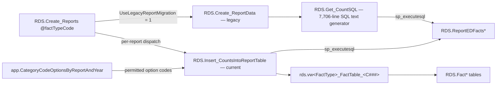

# Report Data Generation

> [!info] Seam: standard-agnostic
> Nothing here reads `Staging` or knows what CEDS is. It reads `RDS` facts and `App` metadata and
> writes `RDS.ReportEDFacts*` rows. Fully reusable.

This stage turns per-student fact rows into the aggregated count rows an EDFacts file is made of.
One report row = one (report code, year, organization level, organization, category set, category
option combination) with a count. There are **two generations** of the code that does it, both
live, selected per report by `App.GenerateReports.UseLegacyReportMigration`.



## The dispatcher

`RDS.Create_Reports @factTypeCode, @runAsTest` is a 1,368-line static `if @factTypeCode = '…'`
chain — the authoritative **fact type to report codes** map. Each branch checks
`IsLocked = 1 AND UseLegacyReportMigration = 1`, logs to `app.DataMigrationHistories`, and calls one
of several builders: `RDS.Create_ReportData` (the default), `Create_OrganizationReportData`
(Directory), `Create_OrganizationStatusReportData`, `Create_CustomReportData` (cohort graduation
rate, disciplinary removals), `Create_StudentFederalProgramsReportData`,
`Create_YeartoYearAttendanceReportData`, or — for the newest report codes —
`Insert_CountsIntoReportTable`.

## Legacy path: Create_ReportData to Get_CountSQL

`RDS.Create_ReportData @reportCode, @dimFactTypeCode, @runAsTest`:

1. Resolve `@factTable` / `@factField` / `@factReportTable` from `app.FactTables`.
2. Cursor over submission years where `rds.DimSchoolYearDataMigrationTypes.IsSelected = 1`.
3. For each year, load the report's category sets from `app.CategorySets`, calling
   `app.Get_CategoriesByCategorySet(@CategorySetId, 1, 0)` for the pipe-wrapped category code list
   (`|RACE|,|SEX|`) and `(…, 1, 1)` for the matching `App.Dimensions.DimensionFieldName` list.
   `TotalIndicator` is `'Y'` when the category set name contains `total`.
4. Build the set of categories the fact table *can* be sliced by, via
   `App.Category_Dimensions` to `App.Dimensions` to `App.DimensionTables` to
   `App.FactTable_DimensionTables`, projecting each dimension into `<field>Code` and
   `<field>EdFactsCode`.
5. Cursor over category sets and, for each, ask `RDS.Get_CountSQL` for the SQL and run it:

```sql
select @sql = [RDS].[Get_CountSQL] (@reportCode, @reportLevel, @reportYear, @categorySetCode,
        'actual', 1, 0, @tableTypeAbbrvs, @totalIndicators, @dimFactTypeCode)
...
SET @ParmDefinition = N'@dimFactTypeId int, @dimSchoolYearId int, @reportLevel varchar(50)';
EXECUTE sp_executesql @sql, @ParmDefinition, @dimFactTypeId = @dimFactTypeId,
        @dimSchoolYearId = @dimSchoolYearId, @reportLevel = @reportLevel;
```

`RDS.Get_CountSQL` is a 7,706-line scalar function that returns nvarchar SQL text. It is the
largest single object in the repo and the real home of the legacy per-report rules — school-year
date arithmetic, cohort years, catchment area, per-report `WHERE` clauses. `@sqlType` selects the
variant: `'actual'`, `'zero'` (the zero-count backfill), `'performanceLevels'`,
`'zero-discipline'`, `'zero-educenv'`, `'zero-performance'`. `@isFileGenerator` switches it into
the shape [[File-Generation]] consumes.

## Current path: Insert_CountsIntoReportTable

`RDS.Insert_CountsIntoReportTable @ReportCode, @SubmissionYear, @IdentifierToCount, @IsDistinctCount, @Debug`
is the replacement, used for `c218`–`c222`, `c224`–`c226`. It generates SQL by
`STRING_AGG` over the metadata rather than by string-concatenating hand-written blocks, and it runs
three cursor passes:

1. **Counts.** Build a `PermittedValues` CTE by cross-joining `app.CategoryCodeOptionsByReportAndYear`
   once per category in the set, then
   `select … count(DISTINCT cs.<identifier>) FROM rds.vw<FactTypeCode>_FactTable_<ReportCode> cs
   JOIN PermittedValues pv ON cs.<Dim>EdFactsCode = pv.<CategoryCode> …` grouped by organization and
   category columns. `ReportLevel` decides the organization columns (`SeaOrganizationIdentifierSea` /
   `LeaIdentifierSea` / `SchoolIdentifierSea`) and the `WHERE … IS NOT NULL` guard.
2. **`MISSING` cleanup.** For each dimension, if any non-`MISSING` value exists for that
   report/year/category-set/level, delete the `MISSING` rows.
3. **Zero-count backfill.** Cross-join permitted values against every LEA or school in
   `RDS.FactOrganizationCounts` for the year, left-join the report table, and insert `0` where no row
   exists.

This is the important structural difference: the legacy path counts straight off the fact table with
hand-built SQL; the current path counts off a **per-report-code view**
(`rds.vwChildCount_FactTable_C002`, `rds.vwTitleI_FactTable_C222`, `rds.vwMembership_FactTable_C226`,
`rds.vwNeglectedOrDelinquent_FactTable_C218`–`C221`, `rds.vwAssessment_FactTable_C224`/`C225`,
`rds.vwK12Staff_FactTable_C070`/`C099`/`C112`). Those views hold the report's eligibility filters —
age ranges, developmental-delay exclusions read from `app.ToggleResponses`, grade-level rules — and
they read from `Debug.vw<Domain>_FactTable`. **A per-report-code view is the cleanest statement of a
report's rules that exists in this codebase.** More of them exist in `generate.web/DatabaseScripts/`
than in `generate.database/`; see [[Generate-Repo-and-Branches]].

## How category sets shape the rows

A category set is one output block of an EDFacts file. `TOT` / `EU` produce a single
organization-level total with `TotalIndicator = 'Y'` and no category columns. `CSA`, `CSB`, … produce
the cross-product of their member categories' option codes, one row per combination, with
`Categories` holding the pipe-wrapped list (`|RACE|,|SEX|`) and one column per dimension carrying
the EDFacts code. `ST1`, `ST2` … are subtotals and are also flagged `TotalIndicator = 'Y'`. Option
codes come from `App.CategoryOptions`, filtered per report and year by
`App.CategoryCodeOptionsByReportAndYear`, which is why an option valid for one file spec cannot leak
into another.

## The read path

`RDS.Get_ReportData` (753 lines) and its siblings — `Get_MembershipReportData`,
`Get_OrganizationReportData`, `Get_StudentFederalProgramsReportData`,
`Get_StateAssessmentProficiencyReportData`, `Get_StudentDisciplinaryRemovalsReportData`,
`Get_StudentEducationEnvironmentDisabilitiesReportData`, and the `Get_YearToYear*` family — serve
the UI and the file generator rather than writing report rows. They take
`@includeZeroCounts`, `@includeFriendlyCaptions`, `@obscureMissingCategoryCounts`, `@isOnlineReport`,
resolve the same `app.FactTables` metadata, and call `Get_CountSQL` for zero and performance-level
variants. They explicitly skip the zero-count logic for the new-path report codes
(`c218`–`c222`, `c224`–`c226`), which already have zeros materialized.

## Citations

- `generate.database/StoredProcedures/Create/RDS.Create_Reports.StoredProcedure.sql@develop` — fact type to report code map
- `generate.database/StoredProcedures/Create/RDS.Create_ReportData.StoredProcedure.sql@develop` lines 140–158, 258, 293–295
- `generate.database/Functions/Create/RDS.Get_CountSQL.UserDefinedFunction.sql@develop` lines 13–24 — signature
- `generate.database/StoredProcedures/Create/RDS.Insert_CountsIntoReportTable.StoredProcedure.sql@develop` lines 32–127, 240–320
- `generate.database/Views/Create/RDS.vwChildCount_FactTable_C002.sql@develop` — a report's rules as a view
- `generate.database/Views/Create/App.CategoryCodeOptionsByReportAndYear.View.sql@develop`
- `generate.database/StoredProcedures/Create/RDS.Get_ReportData.StoredProcedure.sql@develop` lines 40–60
- `generate.database/Functions/Create/App.Get_CategoriesByCategorySet.UserDefinedFunction.sql@develop`
