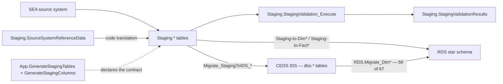

# Staging Layer

> [!info] Seam: CEDS-specific
> This is the replaceable half. An Ed-Fi binding replaces the population of these tables — and,
> in practice, the tables themselves — while everything downstream of [[RDS-Star-Schema]] stays.

`Staging` is the SEA-facing landing zone. An SEA loads its data here (by ETL, by the Data
Integration Toolkit, or by hand), Generate validates it, and then two consumers read it: the modern
EDFacts path (`Staging-to-Dim*` / `Staging-to-Fact*` → `RDS`, see [[Staging-to-RDS-Migration]]) and
the CEDS **IDS** path (`Staging.Migrate_StagingToIDS_*` → the normalized CEDS Integrated Data Store,
the `dbo.*` tables).

> [!warning] The IDS path also feeds EDFacts
> Both routes end in `RDS`. **58 of the 67 `RDS.Migrate_Dim*` procedures read `dbo.*` only and never
> read `Staging.*`** — so the IDS is the source for most reference dimensions, for the four legacy
> domains, and for the `organizationstatus` fact type. Elements arriving that way never pass through
> a `Staging.*` table, and re-pointing the staging mapping alone would not replace them. See
> [[Source-Code-Oddities]].

## The tables

`generate.database/Tables/Create/` holds 34 `Staging.*` DDL files. The ones the domain notes
actually hit:

| Table | Carries |
|---|---|
| `Staging.K12Enrollment` | The spine — one row per student per school per enrollment span. Identifiers, name, birthdate, sex, ethnicity, grade level, entry/exit dates and exit type, cohort year, diploma type, days absent, attendance rate |
| `Staging.PersonStatus` | Dated status flags per student: English learner, homeless, migrant, foster care, military, economically disadvantaged, Title I |
| `Staging.ProgramParticipationSpecialEducation` | IDEA indicator, participation begin/end, IDEA educational environment (early childhood and school age) |
| `Staging.IdeaDisabilityType` | Disability codes, with `IsPrimaryDisability` |
| `Staging.K12PersonRace` | One row per student per race, dated |
| `Staging.ProgramParticipationTitleI` / `TitleIII` / `NorD` / `CTE` | Federal program participation |
| `Staging.Migrant` | Migrant education program qualification and continuation |
| `Staging.Discipline` | Disciplinary actions, removals, firearm incidents |
| `Staging.Assessment`, `Staging.AssessmentResult` | Assessment definitions and per-student results |
| `Staging.K12StaffAssignment` | Staff assignments and FTE — the sole input to `Staging-to-FactK12StaffCounts` |
| `Staging.K12Organization`, `Staging.OrganizationAddress`, `OrganizationPhone`, `OrganizationGradesOffered`, `OrganizationFederalFunding`, `Staging.StateDetail` | Directory |
| `Staging.SourceSystemReferenceData` | The SEA's own code values mapped to CEDS option sets |

> [!warning] The DDL in `Tables/Create/` is stale
> `Staging.K12Enrollment.sql` declares `Student_Identifier_State` / `LEA_Identifier_State`. Every
> current procedure and view uses `StudentIdentifierState` and `LEAIdentifierSeaAccountability`.
> Four heavily-used tables — `Staging.IdeaDisabilityType`, `Staging.K12PersonRace`,
> `Staging.K12Organization`, `Staging.SourceSystemReferenceData` — have **no DDL in the repo at
> all**; they exist only as C# models under `generate.core/Models/Staging/`. For current column
> names, read the `Debug.vw<Domain>_StagingTables` views or the `Staging-to-Fact*` procedures, not
> the DDL.

## The staging contract

Which staging tables and columns a given report needs is **declared, not hardcoded**:

- `App.GenerateStagingTables` — `StagingTableId`, `StagingTableName`.
- `App.GenerateStagingColumns` — `StagingColumnName`, `DataType`, `MaxLength`, and
  `SSRDRefTableName` / `SSRDTableFilter`, which name the reference table in
  `Staging.SourceSystemReferenceData` that translates that column's SEA-local codes.
- `App.GenerateReport_GenerateStagingTablesXREF` — report ⟷ staging table.
- `App.vwStagingRelationships` joins all four to `App.GenerateReports` and `rds.DimFactTypes`,
  yielding *report code → fact type → staging table → staging column → its SSRD reference table*.
  `App.vwReportCode_StagingTables` is the coarser report-code → table form.

These three tables have DDL but **no seed script** in `Metadata/`; rows are loaded by the
application. Column-level requirements also appear as SQL extended properties on the DDL
(`sp_addextendedproperty @name = N'Required'` in `Staging.Enrollment.Table.sql`).

## Validation

`Staging.StagingValidationRules` stores a `Condition` expression per staging column with a
`Severity`; `Staging.StagingValidationRules_ReportsXREF` scopes each rule to report codes.
`Staging.StagingValidation_Execute` runs them and writes `Staging.StagingValidationResults`.
`App.Migrate_Data` runs this as its own cursor pass, between the source-to-staging load and the
RDS migration.

## CEDS alignment

Staging column names are CEDS element names, near-verbatim — `IDEAEducationalEnvironmentForSchoolAge`,
`ExitOrWithdrawalType`, `HighSchoolDiplomaType`. The values are CEDS option-set codes, reached
through `Staging.SourceSystemReferenceData`. That coupling is the entire reason the seam exists: a
re-implementation has to produce these *element semantics*, not these table names.

## Citations

- `generate.database/Tables/Create/Staging.K12Enrollment.sql@develop`
- `generate.database/Tables/Create/Staging.Enrollment.Table.sql@develop` — `Required` extended properties
- `generate.database/Tables/Create/App.GenerateStagingColumns.Table.sql@develop` — `SSRDRefTableName`, `SSRDTableFilter`
- `generate.database/Views/Create/App.vwStagingRelationships.View.sql@develop`
- `generate.database/Views/Create/Debug.vwChildCount_StagingTables.View.sql@develop` — current column names
- `generate.database/Tables/Create/Staging.StagingValidationRules.Table.sql@develop`
- `generate.database/StoredProcedures/Create/Staging.Wrapper_Migrate_ChildCount_to_IDS.StoredProcedure.sql@develop` — the IDS consumer
