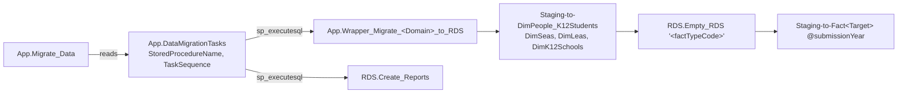

# Staging-to-RDS Migration

> [!info] Seam: both
> The wrappers and the orchestration are standard-agnostic — they schedule work by fact type. The
> `Staging-to-Dim*` and `Staging-to-Fact*` bodies are the CEDS-specific half, and are exactly what a
> second source standard replaces.

Twenty-four procedures named `App.Wrapper_Migrate_<Domain>_to_RDS` are the per-domain entry points.
Reading a domain's wrapper is the fastest way to find its real logic.



## Wrapper shape

The modern shape, from `App.Wrapper_Migrate_ChildCount_to_RDS`:

1. `EXEC Staging.Rollover_SourceSystemReferenceData` — carry the SEA's code mappings into the new year.
2. Load the shared dimensions: `Staging.[Staging-To-DimPeople_K12Students] NULL`,
   `[Staging].[Staging-to-DimSeas] 'directory', NULL, 0`, `[Staging].[Staging-to-DimLeas] 'directory', NULL, 0`,
   `[Staging].[Staging-to-DimK12Schools] NULL, 0`.
3. `exec [rds].[Empty_RDS] 'childcount'` — clear the domain's prior facts for the selected years.
4. Cursor over the school years flagged `IsSelected` in `rds.DimSchoolYearDataMigrationTypes`, and
   for each: `EXEC Staging.[Staging-to-FactK12StudentCounts_ChildCount] @submissionYear`.

Every step writes a progress row to `app.DataMigrationHistories`, and the whole body is wrapped in
`TRY`/`CATCH` that logs the failure rather than raising it — a failed domain does not abort the run.

Assessments and Directory extend step 2 with domain-specific dimensions
(`Staging-to-DimAssessments`, `-DimAssessmentAdministrations`, `-DimAssessmentPerformanceLevels`;
`Staging-to-DimCharterSchoolAuthorizers`, `-DimCharterSchoolManagementOrganizations`). Staff swaps
`DimPeople_K12Students` for `DimPeople_K12Staff`. Directory has no `Empty_RDS` call at all —
`Staging-to-FactOrganizationCounts` clears its own target.

## Two generations of wrapper

**Twenty domains** use the shape above. **Four do not.** `CTE`, `Other`, `SPPAPR`, and
`StudentCounts` are still on the previous generation:

```sql
exec [rds].[Migrate_DimK12Students]
exec [rds].[Migrate_DimSeas] 'directory', NULL, 0
exec [rds].[Migrate_DimLeas] 'directory', NULL, 0
exec [rds].[Migrate_DimK12Schools] NULL, 0
exec [rds].[Empty_RDS] 'cte'
exec [rds].[Migrate_StudentCounts] 'cte', 0
```

They call the `rds.Migrate_Dim*` reference layer directly, and their fact load is a single
1,596-line `RDS.Migrate_StudentCounts` that switches on the fact type code internally rather than a
per-domain `Staging-to-Fact*` procedure. No `Debug.vw*` lineage views exist for these four. Treat
them as legacy: still live, materially harder to trace, and the least representative of the
architecture.

**And they do not read `Staging`.** `RDS.Migrate_StudentCounts` references only `rds.*` and `dbo.*`,
never `Staging.*`; the dimensions it depends on come from `RDS.Migrate_Dim*`, 58 of whose 67
procedures read `dbo.*` — the CEDS IDS — exclusively. `RDS.Migrate_DimCteStatuses`, for instance,
reads `dbo.ProgramParticipationCte`, `dbo.PersonProgramParticipation`, and
`dbo.OrganizationPersonRole`; the CEDS-aligned `Staging.ProgramParticipationCTE` is read only by
the IDS loader and by index maintenance. The same holds for `RDS.Migrate_OrganizationStatusCounts`
(FS199–FS202), which reads `dbo.K12SchoolIndicatorStatus` and two `dbo.Ref*` tables. So for these
domains the effective inlet is `Staging → IDS (dbo.*) → RDS`, one hop longer than the seam story
implies. See [[Source-Code-Oddities]].

## The procedures

**Twenty `Staging.Staging-to-Dim*`** — four shared (`DimPeople_K12Students`, `DimSeas`, `DimLeas`,
`DimK12Schools`), one staff-shared (`DimPeople_K12Staff`), the rest domain-specific.

**Thirty-two `Staging.Staging-to-Fact*`** — thirteen `FactK12StudentCounts_<Domain>` variants plus
`FactK12StudentDisciplines`, `FactK12StudentAssessments`, `FactK12StaffCounts`,
`FactOrganizationCounts`, `FactK12StudentEnrollments`, `FactK12ProgramParticipations`,
`FactSpecialEducation`, `FactK12SeclusionsOrRestraints`, `FactK12StudentCourseSections`, the
`FactPsStudent*` family, and `FactK12AccessibleEducationMaterialAssignments`. Most carry a header
comment naming the file specs they feed — `NOTE: This Stored Procedure processes files: 002, 089`.
Three are not reachable from any wrapper: `Staging-to-FactK12StudentCounts_SpecEdExit` (superseded
by `_Exiting`), `Staging-to-FactOrganizationCounts_ComprehensiveAndTargetedSupport`, and
`RDS.Migrate_OrganizationStatusCounts`.

Internally each fact procedure follows one pattern: drop temp tables, resolve `@SchoolYearId` and
any EMAPS toggle dates from `App.ToggleQuestions` / `App.ToggleResponses`, `SELECT * INTO #vwX FROM
RDS.vwDimX WHERE SchoolYear = @SchoolYear` with a clustered index on the `*Map` columns for each
reference dimension, then one large `INSERT INTO RDS.Fact… SELECT` joining staging tables to those
temp tables.

## Dynamic orchestration

`App.Migrate_Data` is the only scheduler. It never names a procedure. It opens a pending row in
`App.DataMigrations`, then runs four cursor passes — **pre**, **source-to-staging**, **staging
validation**, **generate** (`rds` + `report`), **post** — each of which selects procedure names out
of metadata and calls them:

```sql
DECLARE dataMigrationTasks_cursor CURSOR FOR
select distinct ddt.StoredProcedureName, ddt.TaskSequence, ddt.DataMigrationTaskId
from app.GenerateReports app
inner join app.GenerateReport_FactType app_ft on app.GenerateReportId = app_ft.GenerateReportId
inner join rds.DimFactTypes ft on app_ft.FactTypeId = ft.DimFactTypeId
inner join app.DataMigrationTasks ddt on app_ft.FactTypeId = ddt.FactTypeId
inner join app.DataMigrationTypes dmt on dmt.DataMigrationTypeId = ddt.DataMigrationTypeId
inner join rds.DimSchoolYearDataMigrationTypes sydmt on dmt.DataMigrationTypeId = sydmt.DataMigrationTypeId
inner join rds.DimSchoolYears sy on sydmt.DimSchoolYearId = sy.DimSchoolYearId
where app.IsLocked = 1 and app.IsActive = 1 and ddt.IsSelected = 1
  and dmt.DataMigrationTypeCode in ('rds', 'report')
  and ddt.IsActive = 1 and RunBeforeGenerateMigration = 0 and RunAfterGenerateMigration = 0
  and sydmt.IsSelected = 1 and ddt.StoredProcedureName not like '%Source-to-Staging%'
order by ddt.TaskSequence, ddt.DataMigrationTaskId
...
EXECUTE sp_executesql @storedProcedureName
```

The source-to-staging pass passes the year (`EXECUTE sp_executesql @storedProcedureName,
N'@SchoolYear smallint', @SchoolYear = @sy`); the validation pass passes year and fact-type code.
So which wrappers run is a function of **which reports are `IsLocked` and `IsActive`, which tasks
are `IsSelected`, and which school years are `IsSelected`** — three metadata predicates, no code.
Grepping for static `EXEC` chains finds the wrapper internals and nothing above them.

## Citations

- `generate.database/StoredProcedures/Create/App.Migrate_Data.StoredProcedure.sql@develop` lines 234–270 — the generate pass
- `generate.database/StoredProcedures/Create/App.Wrapper_Migrate_ChildCount_to_RDS.StoredProcedure.sql@develop`
- `generate.database/StoredProcedures/Create/App.Wrapper_Migrate_CTE_to_RDS.StoredProcedure.sql@develop` — legacy shape
- `generate.database/StoredProcedures/Create/App.Wrapper_Migrate_Directory_to_RDS.StoredProcedure.sql@develop` — no `Empty_RDS`
- `generate.database/StoredProcedures/Create/Staging.Staging-to-FactK12StudentCounts_ChildCount.StoredProcedure.sql@develop`
- `generate.database/StoredProcedures/Create/RDS.Migrate_StudentCounts.StoredProcedure.sql@develop` — 1,596 lines, four legacy domains
- `generate.database/StoredProcedures/Create/RDS.Empty_RDS.StoredProcedure.sql@develop`
