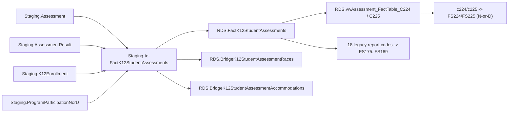

# Assessments

> [!info] Seam: both
> `Staging.Assessment`/`AssessmentResult` and their effective-dated joins are CEDS-specific;
> `RDS.FactK12StudentAssessments`, its bridge tables and the per-report-code views are standard-agnostic.

The largest domain: state assessment participation and performance, reported as general-population
results (FS175–FS189, legacy `c###` codes) and as Neglected-or-Delinquent subpart proficiency
(FS224/FS225, math and reading/language-arts only). SEA/LEA/school levels; race and accommodations
are many-to-many, the only domain with bridge tables.

## Pipeline

| Stage | Object |
|---|---|
| Wrapper | `App.Wrapper_Migrate_Assessments_to_RDS` — 9 steps, also loads `Staging-to-DimAssessments`, `-DimAssessmentAdministrations`, `-DimAssessmentPerformanceLevels` |
| Fact procedure | `Staging.Staging-to-FactK12StudentAssessments @SchoolYear` (787 lines) |
| Fact table | `RDS.FactK12StudentAssessments` + `RDS.BridgeK12StudentAssessmentRaces`/`Accommodations`; `Empty_RDS 'assessment'` clears both bridges before the fact rows |
| Current path | `c224`/`c225` → FS224/FS225, via `RDS.Insert_CountsIntoReportTable` and `RDS.vwAssessment_FactTable_C224`/`_C225` |
| Legacy path | `c050`,`c113`,`c125`,`c126`,`c137`,`c138`,`c139`,`c142`,`c157`,`c175`,`c178`,`c179`,`c185`,`c188`,`c189` → FS175–FS189, via `RDS.Create_ReportData` |
| Also dispatched, not EDFacts | `stateassessmentsperformance`, `yeartoyearprogress`, `yeartoyearattendance` |

The `c225`/`FS225` branch of `RDS.Create_Reports` gates on `ReportCode = 'c226'` (Membership's report
code per [[Report-Data-Generation]]) instead of `'c225'` — a likely copy-paste artifact, not a doc error.

## Data elements required

| Element | Source staging column(s) | Category set role |
|---|---|---|
| Student identifier | `Staging.AssessmentResult.StudentIdentifierState` | identifier |
| LEA / school identifier | `Staging.AssessmentResult.LEAIdentifierSeaAccountability` / `.SchoolIdentifierSea` | organization |
| Assessment identifier/title | `Staging.Assessment.AssessmentIdentifier`, `.AssessmentTitle` | identifier (of the instrument) |
| Academic subject | `Staging.Assessment.AssessmentAcademicSubject` | category: subject |
| Assessment type / type administered | `Staging.Assessment.AssessmentType`, `.AssessmentTypeAdministered`, `.AssessmentTypeAdministeredToEnglishLearners` | category: assessment type |
| Administration dates | `Staging.AssessmentResult.AssessmentAdministrationStartDate`, `.AssessmentAdministrationFinishDate` | filter (school-year and enrollment-span anchor) |
| Grade level when assessed | `Staging.K12Enrollment.GradeLevel` | category: grade level |
| Assessment performance level | `Staging.AssessmentResult.AssessmentPerformanceLevelIdentifier` (+ label) | category: performance level — load-bearing for the C224/C225 PROFICIENT/NOTPROFICIENT split, itself driven by an SEA-configured `App.ToggleAssessments.ProficientOrAboveLevel` cutoff, not a fixed code |
| Raw score value | `Staging.AssessmentResult.ScoreValue` | measure (scale/percentile/T/Z/ACT/SAT score columns exist on the fact table but are hardcoded `-1` — unpopulated by this procedure) |
| Participation status | `Staging.AssessmentResult.AssessmentRegistrationParticipationIndicator`, `.ReasonNotCompleting`, `.ReasonNotTested` | filter (C224/C225 require `Participated` and no reason-not-completing) |
| Race/ethnicity (many-to-many) | `Staging.K12PersonRace.RaceType`, `Staging.K12Enrollment.HispanicLatinoEthnicity` | category: RACE |
| Sex | `Staging.K12Enrollment.Sex` | category: SEX |
| IDEA indicator | `Staging.ProgramParticipationSpecialEducation.IdeaIndicator` | category: DISABSTATIDEA |
| English learner status | `Staging.PersonStatus.EnglishLearnerStatus` | category: ELSTATUS |
| Economic/foster/migrant/homeless/military status | `Staging.PersonStatus.EconomicDisadvantageStatus`, `.ProgramType_FosterCare`, `.MigrantStatus`, `.HomelessnessStatus`, `.MilitaryConnectedStudentIndicator` | category: various |
| Neglected-or-delinquent status + subpart | `Staging.ProgramParticipationNorD.NeglectedOrDelinquentStatus`, `.NeglectedOrDelinquentProgramEnrollmentSubpart` | category: NORD subpart — subpart 1 vs. 2 is exactly the C224/C225 split |
| Accommodation (many-to-many) | `RDS.BridgeK12StudentAssessmentAccommodations`, gated on `AssessmentTypeAdministeredCode = 'REGASSWACC'` | category: accommodation |
| Assessment count | one row per matched student/assessment/result | measure |

## Ed-Fi coverage (preliminary)

> [!warning] Preliminary — Ed-Fi 5.2 verdicts, not adjudicated

| Element | Verdict | Ed-Fi binding |
|---|---|---|
| Student identifier | Direct | `edFi_student.studentUniqueId` |
| LEA / school identifier | Direct | `edFi_localEducationAgency.localEducationAgencyId` / `edFi_school.schoolId` |
| Assessment identifier/title | Direct | `edFi_assessment.assessmentIdentifier` / `.assessmentTitle` |
| Academic subject | Direct | `edFi_assessmentAcademicSubject.academicSubjectDescriptor` |
| Assessment type / type administered | Derivable | `edFi_assessment.assessmentCategoryDescriptor` plus accommodations/registration context |
| Administration dates | Direct | `edFi_studentAssessment.administrationDate` / `.administrationEndDate` |
| Grade level when assessed | Direct | `edFi_studentAssessment.whenAssessedGradeLevelDescriptor` |
| Assessment performance level | Direct | `edFi_studentAssessmentPerformanceLevel.performanceLevelDescriptor` |
| Raw score value | Direct | `edFi_studentAssessmentScoreResult.result` + `.resultDatatypeTypeDescriptor` |
| Participation status | Direct | `edFi_studentAssessment.reasonNotTestedDescriptor`; participation itself is Derivable from whether a scored record exists at all |
| Race/ethnicity | Direct | `edFi_studentEducationOrganizationAssociationRace.raceDescriptor` + `.hispanicLatinoEthnicity` |
| Sex | Direct | `edFi_studentEducationOrganizationAssociation.sexDescriptor` |
| IDEA indicator | Direct | `edFi_studentSpecialEducationProgramEligibilityAssociation.ideaIndicator` |
| English learner status | Direct | `edFi_studentEducationOrganizationAssociation.limitedEnglishProficiencyDescriptor` |
| Economically disadvantaged status | Derivable | from an active `edFi_studentSchoolFoodServiceProgramAssociation`, or an extended `studentCharacteristicDescriptor` |
| Foster care status | Absent | Core 5.2.0 has no foster-care program association or characteristic; only `edFi_studentHomelessProgramAssociation.awaitingFosterCare` exists, scoped to McKinney-Vento awaiting-placement. Representable only by extending `studentCharacteristicDescriptor`, which ships no foster-care value |
| Migrant / homeless / military-connected status | Direct | presence of `edFi_studentMigrantEducationProgramAssociation` / `edFi_studentHomelessProgramAssociation` / `edFi_studentEducationOrganizationAssociation.supporterMilitaryConnectionDescriptor` |
| Neglected-or-delinquent status + subpart | Direct | `edFi_studentNeglectedOrDelinquentProgramAssociation.neglectedOrDelinquentProgramDescriptor` |
| Accommodation | Direct | `edFi_studentAssessmentAccommodation.accommodationDescriptor` |
| Assessment count | Derivable | count of matched rows; not a stored element |

## Citations

- `generate.database/StoredProcedures/Create/App.Wrapper_Migrate_Assessments_to_RDS.StoredProcedure.sql@develop`
- `generate.database/StoredProcedures/Create/Staging.Staging-to-FactK12StudentAssessments.StoredProcedure.sql@develop` lines 381–465, 517–519, 746–779
- `generate.database/Views/Create/Debug.vwAssessment_StagingTables.View.sql@develop`
- `generate.database/Views/Create/Debug.vwAssessment_FactTable.View.sql@develop`
- `generate.database/Views/Create/RDS.vwAssessment_FactTable_C224.View.sql@develop`, `.../RDS.vwAssessment_FactTable_C225.View.sql@develop`
- `generate.database/StoredProcedures/Create/RDS.Create_Reports.StoredProcedure.sql@develop` lines 855–1067
- `generate.database/StoredProcedures/Create/RDS.Empty_RDS.StoredProcedure.sql@develop` lines 46–57
