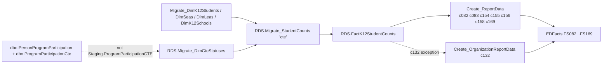

# CTE

> [!info] Seam: both
> The categorical CTE data (concentrator/participant/completer, non-traditional status) lives in Generate's own `dbo.*` operational tables, not `Staging.*`; `RDS.FactK12StudentCounts` and the report/file layers are standard-agnostic.

CTE (Career and Technical Education) counts concentrators, participants, and completers against eight file specs: exiting, graduating, graduation-rate inclusion, non-traditional-program participation/completion, placement, and placement type — plus a Section 1003 school-improvement-funds report (`c132`) that is organization- rather than student-level. It is a legacy domain: no `Staging-to-Fact*` procedure and no `Debug.vw*` lineage view exist for it; the student-count fact load is the same 1,596-line `RDS.Migrate_StudentCounts` shared by CTE, graduation, membership, and three other legacy domains. Its CTE-specific categorical data does **not** come from the CEDS `Staging.ProgramParticipationCTE` table that the brief and the stale DDL point to — it comes from Generate's own `dbo.ProgramParticipationCte` operational table (see Contradictions in the inventory).

## Pipeline

| Item | Value |
|---|---|
| Wrapper | `App.Wrapper_Migrate_CTE_to_RDS` — **legacy shape**: calls `rds.Migrate_DimK12Students`, `rds.Migrate_DimSeas`, `rds.Migrate_DimLeas`, `rds.Migrate_DimK12Schools`, then `rds.Empty_RDS 'cte'`, then `rds.Migrate_StudentCounts 'cte', 0` |
| Fact load | `RDS.Migrate_StudentCounts` (1,596 lines, shared across `cte`/`grad`/`gradrate`/`membership`/`other`/`specedexit`/`submission`) — the CTE-specific block calls `RDS.Migrate_DimCteStatuses` |
| CTE category source | `RDS.Migrate_DimCteStatuses` reads `dbo.PersonProgramParticipation` joined to `dbo.ProgramParticipationCte`, `dbo.OrganizationProgramType`, `dbo.OrganizationPersonRole` |
| Fact table | `RDS.FactK12StudentCounts` |
| Report dispatch | `RDS.Create_Reports`, branch `@factTypeCode = 'cte'` → `RDS.Create_ReportData` for seven codes; `c132` routes to `RDS.Create_OrganizationReportData` because (per the source comment) "C132 uses FactStudentCounts and the table is not populated when Migrate_OrganizationCounts run" |
| Report codes | `c082 c083 c132 c154 c155 c156 c158 c169` |
| File specs | FS082 Concentrators Exiting, FS083 Concentrator Graduates, FS132 Section 1003 Funds, FS154 Concentrators in Graduation Rate, FS155 Participants in Non-traditional Programs, FS156 Concentrators in Non-traditional Programs, FS158 Concentrators Placement, FS169 Type of Placement |

## Data elements required

| Element | Source staging column(s) | Category set role |
|---|---|---|
| Student identifier | shared `DimK12Students` load, ultimately `Staging.K12Enrollment.StudentIdentifierState` | identifier |
| LEA / School organization | shared `DimLeas`/`DimK12Schools` load | organization |
| CTE concentrator / participant status | `dbo.ProgramParticipationCte.CteConcentrator`, `.CteParticipant` | category: CTESTATUS |
| CTE completer | `dbo.ProgramParticipationCte.CteCompleter` | category: CTESTATUS |
| Single-parent / single-pregnant-woman status | `dbo.ProgramParticipationCte.SingleParentOrSinglePregnantWoman` | category: CTESUBPOP |
| Displaced-homemaker indicator | `dbo.ProgramParticipationCte.DisplacedHomemakerIndicator` | category: CTESUBPOP |
| Non-traditional gender status (participation & completion) | `dbo.ProgramParticipationCte.CteNonTraditionalCompletion`, `.RefNonTraditionalGenderStatusId` | category: CTENONTRAD |
| Graduation-rate inclusion type | `dbo.ProgramParticipationCte.InclusionType` | category: CTEGRADINCL |
| LEP-Perkins status | `dbo.PersonStatus` filtered to `RefPersonStatusType.Code = 'Perkins LEP'` | category: LEPPERKINS |
| CTE program entry/exit dates | `dbo.OrganizationPersonRole.EntryDate` / `.ExitDate` | filter |
| Section 1003 school-improvement funds (`c132`) | organization-level; routed via `Create_OrganizationReportData`, not the student-count path | measure |

## Ed-Fi coverage (preliminary)

> [!warning] Preliminary — Ed-Fi 5.2 verdicts, not adjudicated

| Element | Verdict | Ed-Fi binding |
|---|---|---|
| Student identifier | Direct | `edFi_studentReference.studentUniqueId` |
| LEA / School organization | Direct | `edFi_school.schoolId` / `edFi_localEducationAgency.localEducationAgencyId`, via `studentCTEProgramAssociation.educationOrganizationReference` |
| CTE concentrator / participant status | Derivable | from `edFi_studentCTEProgramAssociation.programParticipationStatuses[].participationStatusDescriptor` — a generic status slot; concentrator/participant thresholds are state-defined, matching the brief's expectation |
| CTE completer | Direct | `edFi_studentAcademicRecordDiploma.cteCompleter` |
| Single-parent / single-pregnant-woman status | Absent | no core property |
| Displaced-homemaker indicator | Absent | no core property |
| Non-traditional gender status | Direct | `edFi_studentCTEProgramAssociation.nonTraditionalGenderStatus` |
| Graduation-rate inclusion type | Absent | no core property ties a CTE concentrator to graduation-rate-cohort inclusion |
| LEP-Perkins status | Absent | no core property distinguishes a Perkins-specific LEP status from general English-learner status |
| CTE program entry/exit dates | Direct | `edFi_studentCTEProgramAssociation.beginDate` / `.endDate` |
| Section 1003 school-improvement funds | Absent | `edFi_localEducationAgencyFederalFunds` has fixed named categories, not a generic program-code/amount pair (same gap as Directory's federal funding) |

## Citations

- `generate.database/StoredProcedures/Create/App.Wrapper_Migrate_CTE_to_RDS.StoredProcedure.sql@develop`
- `generate.database/StoredProcedures/Create/RDS.Migrate_StudentCounts.StoredProcedure.sql@develop` lines 988–1021 — the `DimCteStatuses` block
- `generate.database/StoredProcedures/Create/RDS.Migrate_DimCteStatuses.StoredProcedure.sql@develop` — `dbo.ProgramParticipationCte` columns
- `generate.database/StoredProcedures/Create/RDS.Create_Reports.StoredProcedure.sql@develop` lines 186–273 — cte branch, including the `c132` comment
- `generate.database/Views/Create/RDS.vwDimCteStatuses.View.sql@develop`
- `generate.database/Tables/Create/Staging.ProgramParticipationCTE.Table.sql@develop` — stale/unused DDL, see Contradictions
- `generate.database/Metadata/App.CedsConnections.Metadata.sql@develop` — file-spec titles (FS082, FS083, FS132, FS154–FS156, FS158, FS169)
