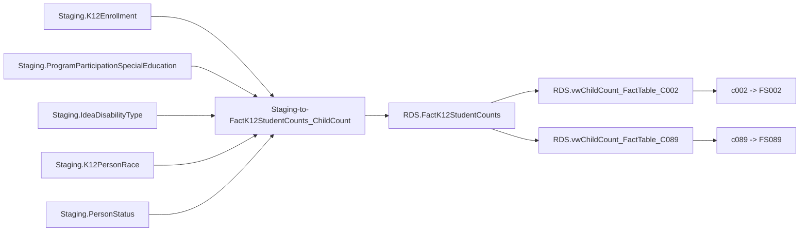

# ChildCount

> [!info] Seam: both
> Staging tables and the count-date/DD-exclusion logic in `Staging-to-FactK12StudentCounts_ChildCount`
> are CEDS-specific; `RDS.FactK12StudentCounts` and the per-report-code views are standard-agnostic.

IDEA Part B child count — the unduplicated number of children with disabilities served under IDEA
on a single count date. Feeds **FS002** (ages 6–21, school age) and **FS089** (ages 3–5, early
childhood) at SEA/LEA/school organization levels. This is the reference domain: its wrapper,
fact procedure and lineage views are the clearest example of the whole `Staging → RDS → report`
shape in the repo.

## Pipeline

| Stage | Object |
|---|---|
| Wrapper | `App.Wrapper_Migrate_ChildCount_to_RDS` (loads shared dims, `rds.Empty_RDS 'childcount'`, cursors school years) |
| Fact procedure | `Staging.Staging-to-FactK12StudentCounts_ChildCount @SchoolYear` |
| Fact table | `RDS.FactK12StudentCounts`, `FactTypeCode = 'childcount'` |
| Per-report views | `RDS.vwChildCount_FactTable_C002`, `RDS.vwChildCount_FactTable_C089`, reading `Debug.vwChildCount_FactTable` |
| Report codes → file specs | `c002` → FS002 (school age), `c089` → FS089 (early childhood) |
| Also dispatched, not EDFacts | `yeartoyearenvironmentcount`, `yeartoyearchildcount`, `yeartoyearremovalcount`, `studentssummary` |

The count date is not the school year: `App.ToggleQuestions.EmapsQuestionAbbrv = 'CHDCTDTE'` joined
to `App.ToggleResponses` gives a month/day, and the year comes from the migration's selected school
year. Every staging join is date-effective (`BETWEEN`) on that one date.

## Data elements required

| Element | Source staging column(s) | Category set role |
|---|---|---|
| Student identifier | `Staging.K12Enrollment.StudentIdentifierState` | identifier |
| LEA identifier | `Staging.K12Enrollment.LEAIdentifierSeaAccountability` | organization |
| School identifier | `Staging.K12Enrollment.SchoolIdentifierSea` | organization |
| Age at count date | `Staging.K12Enrollment.Birthdate` (vs. `CHDCTDTE` toggle date) | category: AGE |
| Sex | `Staging.K12Enrollment.Sex` | category: SEX |
| Race/ethnicity (unduplicated) | `Staging.K12PersonRace.RaceType`, `Staging.K12Enrollment.HispanicLatinoEthnicity` | category: RACE |
| IDEA indicator | `Staging.ProgramParticipationSpecialEducation.IdeaIndicator` | filter |
| IDEA educational environment | `...IDEAEducationalEnvironmentForSchoolAge` / `...ForEarlyChildhood` | category: IDEAEDUCENV |
| Primary disability type | `Staging.IdeaDisabilityType.IdeaDisabilityTypeCode` where `IsPrimaryDisability = 1` | category: DISABCATIDEA |
| English learner status | `Staging.PersonStatus.EnglishLearnerStatus` | category: ELSTATUS |
| Grade level | `Staging.K12Enrollment.GradeLevel` | filter (age-5/PK rule, C002 only) |
| Enrollment span | `Staging.K12Enrollment.EnrollmentEntryDate` / `EnrollmentExitDate` | filter (count-date membership) |
| LEA/school operational status | `Staging.K12Organization.LEA_OperationalStatus` / `School_OperationalStatus` | filter (C002 only) |
| LEA/school federal-reporting flag | `Staging.K12Organization.LEA_IsReportedFederally` / `School_IsReportedFederally` | filter (C002 only) |
| Developmental-delay age-band answer | `App.ToggleResponses` for `EmapsQuestionAbbrv = 'CHDCTAGEDD'` | filter (excludes `DD` students outside the SEA's answered ages, C002 only) |
| Student count | one row per matched student | measure |

## Ed-Fi coverage (preliminary)

> [!warning] Preliminary — Ed-Fi 5.2 verdicts, not adjudicated

| Element | Verdict | Ed-Fi binding |
|---|---|---|
| Student identifier | Direct | `edFi_student.studentUniqueId` |
| LEA identifier | Direct | `edFi_localEducationAgency.localEducationAgencyId` |
| School identifier | Direct | `edFi_school.schoolId` |
| Age at count date | Derivable | from `edFi_student.birthDate`, computed as of the count date — Ed-Fi stores no age |
| Sex | Direct | `edFi_studentEducationOrganizationAssociation.sexDescriptor` |
| Race/ethnicity | Direct | `edFi_studentEducationOrganizationAssociationRace.raceDescriptor` + `.hispanicLatinoEthnicity`; the unduplicated 7-category EDFacts bucketing stays Generate-side logic either way |
| IDEA indicator | Direct | `edFi_studentSpecialEducationProgramEligibilityAssociation.ideaIndicator` |
| IDEA educational environment | Direct | `edFi_studentSpecialEducationProgramAssociation.specialEducationSettingDescriptor` |
| Primary disability type | Derivable | `edFi_studentSpecialEducationProgramAssociationDisability.disabilityDescriptor` where `orderOfDisability = 1` |
| English learner status | Direct | `edFi_studentEducationOrganizationAssociation.limitedEnglishProficiencyDescriptor` |
| Grade level | Direct | `edFi_studentSchoolAssociation.entryGradeLevelDescriptor` |
| Enrollment span | Derivable | from `edFi_studentSchoolAssociation.entryDate` + `.exitWithdrawDate` — enrolled if the count date falls in the span |
| LEA/school operational status | Direct | `edFi_school.operationalStatusDescriptor` / `edFi_localEducationAgency.operationalStatusDescriptor` |
| LEA/school federal-reporting flag | Absent | no core boolean marks an organization as included/excluded from federal reporting |
| DD age-band policy answer | Absent | an SEA policy answer (Generate's `App.ToggleQuestions`), not a student- or org-level data element |

## Citations

- `generate.database/StoredProcedures/Create/App.Wrapper_Migrate_ChildCount_to_RDS.StoredProcedure.sql@develop`
- `generate.database/StoredProcedures/Create/Staging.Staging-to-FactK12StudentCounts_ChildCount.StoredProcedure.sql@develop`
- `generate.database/Views/Create/Debug.vwChildCount_StagingTables.View.sql@develop`
- `generate.database/Views/Create/Debug.vwChildCount_FactTable.View.sql@develop`
- `generate.database/Views/Create/RDS.vwChildCount_FactTable_C002.sql@develop`
- `generate.database/Views/Create/RDS.vwChildCount_FactTable_C089.sql@develop`
- `generate.database/Views/Create/Staging.vwChildCount_StagingTables_C002.View.sql@develop`
- `generate.database/Views/Create/Staging.vwChildCount_StagingTables_C089.View.sql@develop`
- `generate.database/StoredProcedures/Create/RDS.Empty_RDS.StoredProcedure.sql@develop`
- `generate.database/StoredProcedures/Create/RDS.Create_Reports.StoredProcedure.sql@develop` lines 86–150
- `generate.database/Metadata/App.GenerateReports.Metadata.sql@develop` lines 306–314, 537–545
