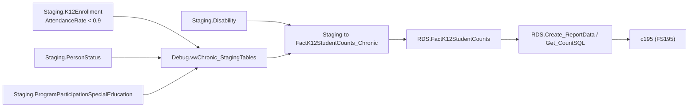

# Chronic

> [!info] Seam: both
> `Staging.K12Enrollment`'s attendance columns are replaceable; `RDS.FactK12StudentCounts` and report
> generation are standard-agnostic — but the threshold filter sits only on the replaceable side.

FS195 (Chronic Absenteeism) counts students who missed too many school days, by sex, race,
homelessness, economic disadvantage, English-learner, IDEA, and Section 504 status, at
SEA/LEA/school level. The SEA supplies a pre-computed `AttendanceRate` per enrollment rather than
raw day counts, so the domain's entire "who is chronically absent" logic is one comparison against
that rate.

## Pipeline

| | |
|---|---|
| Wrapper | `App.Wrapper_Migrate_Chronic_to_RDS` (`Empty_RDS 'Chronic'`) |
| Fact procedure | `Staging.Staging-to-FactK12StudentCounts_Chronic` — header: "Migrates Chronic Absenteeism Data ... processes files: 195" |
| Fact table | `RDS.FactK12StudentCounts` (`FactTypeCode = 'chronic'`) |
| Report code | `c195` |
| File spec | FS195 |
| Generator | Legacy path — `RDS.Create_ReportData` / `RDS.Get_CountSQL` |

**The chronic-absenteeism threshold lives in the lineage view, not the fact procedure.**
`Debug.vwChronic_StagingTables` filters `WHERE ... AND enrollment.AttendanceRate < 0.9` — attended
less than 90% of enrolled days, i.e. absent 10% or more, the conventional federal definition. But
`Staging-to-FactK12StudentCounts_Chronic` itself has **no `WHERE` clause at all** after its joins: it
inserts one fact row per enrolled student regardless of attendance rate. If the fact load runs as
written, it does not by itself limit the count to chronically absent students; that filtering, if it
happens, happens only in the debug/documentation view, not in the load path that populates
`RDS.FactK12StudentCounts`. A re-implementation must apply the `< 0.9` cut explicitly rather than
assume the fact table already reflects it.

**Two disability concepts, tracked separately.** IDEA special-education status comes from
`Staging.ProgramParticipationSpecialEducation.IDEAIndicator` (→ `IdeaStatusId`). A second, distinct
concept — Section 504 status — comes from `Staging.Disability` (→ `DisabilityStatusId`); this join is
active in the fact procedure but is commented out in the lineage view itself ("This join is causing
significant performance issues"). Neither uses `Staging.IdeaDisabilityType`.

A newer `ChronicAbsenteeism` generation (`App.Wrapper_Migrate_ChronicAbsenteeism_to_RDS`,
`Debug.vwChronicAbsenteeism_*`, `RDS.vwChronicAbsenteeism_FactTable_195`) exists under
`generate.web/DatabaseScripts/`, confirmed present in the repo's file listing but not cached locally
— out of scope here, per the brief.

## Data elements required

| Element | Source staging column(s) | Category set role |
|---|---|---|
| Student identifier | `Staging.K12Enrollment.StudentIdentifierState` | identifier |
| Organization | `LEAIdentifierSeaAccountability`, `SchoolIdentifierSea` | organization |
| Attendance rate | `Staging.K12Enrollment.AttendanceRate` (also `NumberOfDaysAbsent`, `NumberOfSchoolDays`) | filter (`< 0.9` defines "chronically absent") |
| Sex | `Staging.K12Enrollment.Sex` | category: SEX |
| Race/ethnicity | `Staging.K12PersonRace.RaceType`, `HispanicLatinoEthnicity` | category: RACEETHNIC |
| IDEA indicator | `Staging.ProgramParticipationSpecialEducation.IDEAIndicator` | category: DISABSTATIDEA |
| Section 504 status | `Staging.Disability.DisabilityStatus`, `Section504Status` | category: SEC504STATUS |
| English learner status | `Staging.PersonStatus.EnglishLearnerStatus` | category: ELSTATUS |
| Homelessness / economic disadvantage | `Staging.PersonStatus.HomelessnessStatus` / `.EconomicDisadvantageStatus` | category: HOMELESS / ECODIS |

## Ed-Fi coverage (preliminary)

> [!warning] Preliminary — Ed-Fi 5.2 verdicts, not adjudicated

| Element | Verdict | Ed-Fi binding |
|---|---|---|
| Student identifier | Direct | `edFi_student.studentUniqueId` |
| Chronic absenteeism flag | Derivable | aggregate `edFi_studentSchoolAttendanceEvent` (`attendanceEventCategoryDescriptor`, `eventDate`) per student per year; chronically absent if absence-category events ÷ total instructional days ≥ 0.10 |
| Attendance rate (pre-computed) | Absent | no stored rate element in core Ed-Fi; it is always computed from attendance events, never supplied directly |
| Section 504 status | Direct | presence of an `edFi_studentSection504ProgramAssociation` (carries `section504Eligibility`) |
| IDEA indicator | Direct | `edFi_studentSpecialEducationProgramAssociation.ideaEligibility` |

## Citations

- `generate.database/StoredProcedures/Create/App.Wrapper_Migrate_Chronic_to_RDS.StoredProcedure.sql@develop`
- `generate.database/StoredProcedures/Create/Staging.Staging-to-FactK12StudentCounts_Chronic.StoredProcedure.sql@develop` lines 156–253 — joins run straight to the final insert, no `WHERE`
- `generate.database/Views/Create/Debug.vwChronic_StagingTables.View.sql@develop` lines 57–63, 79 — commented-out `Staging.Disability` join; `AttendanceRate < 0.9`
- `generate.database/Views/Create/Debug.vwChronic_FactTable.View.sql@develop`
- `generate.database/Tables/Create/Staging.K12Enrollment.sql@develop` lines 28–30 — `NumberOfSchoolDays`, `NumberOfDaysAbsent`, `AttendanceRate`

Related: [[Membership]], [[App-Metadata-Layer]]
