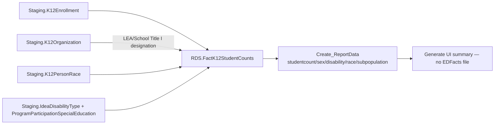

# DataPopulation

> [!info] Seam: both
> `Staging.K12Enrollment`/`K12Organization`/`K12PersonRace`/`IdeaDisabilityType` are CEDS-specific; `RDS.FactK12StudentCounts` and the report layer are standard-agnostic.

**DataPopulation has no EDFacts file spec.** It exists so an SEA can see what it has loaded before submitting anything — summary counts by sex, disability, race, and subpopulation, surfaced in the Generate UI, not written to a fixed-width file. Its report codes are descriptive strings, not `c###` codes: `studentcount`, `studentsex`, `studentdisability`, `studentrace`, `studentsubpopulation`. It uses the full [[App-Metadata-Layer]] machinery — category sets, dimensions, report tables — with no file layout at the end, making it a clean demonstration that the report layer is independent of the file layer. Despite the `studentsubpopulation` report code, the fact procedure itself only ever populates grade, race, sex, Title I status, and primary IDEA disability on `RDS.FactK12StudentCounts`; every other subpopulation column it carries (EL, homeless, migrant, foster care, economically disadvantaged, Title III, CTE, N-or-D, cohort, attendance) is hardcoded to `-1` here — those get populated by other domains' fact procedures writing into the same shared fact table.

## Pipeline

| Item | Value |
|---|---|
| Wrapper | `App.Wrapper_Migrate_DataPopulation_to_RDS` — standard shape: `Staging-to-DimPeople_K12Students`, `DimSeas`, `DimLeas`, `DimK12Schools`, `RDS.Empty_RDS 'datapopulation'`, then the fact procedure per selected school year |
| Fact procedure | `Staging.Staging-to-FactK12StudentCounts_DataPopulation` (313 lines) |
| Fact table | `RDS.FactK12StudentCounts` (shared with most student-count domains) |
| Report dispatch | `RDS.Create_Reports`, branch `@factTypeCode = 'datapopulation'` — the **first** branch in the procedure, all five codes via `RDS.Create_ReportData` |
| Report codes | `studentcount`, `studentsex`, `studentdisability`, `studentrace`, `studentsubpopulation` (no `c###` form) |
| File specs | **None** |
| Metadata rollover | `Metadata/App.Rollover_Datapopulation_StateReports.sql` copies `App.CategorySets`/`CategorySet_Categories`/`CategoryOptions` forward year-to-year for `ReportTypeCode in ('datapopulation','statereport')` |

## Data elements required

| Element | Source staging column(s) | Category set role |
|---|---|---|
| Student identifier | `Staging.K12Enrollment.StudentIdentifierState` | identifier |
| LEA / School organization | `Staging.K12Enrollment.LeaIdentifierSeaAccountability`, `.SchoolIdentifierSea` | organization |
| Sex | `Staging.K12Enrollment.Sex` | category: SEX |
| Race/ethnicity (unduplicated) | `Staging.K12Enrollment.HispanicLatinoEthnicity`, `Staging.K12PersonRace` (via `RDS.vwUnduplicatedRaceMap`) | category: RACE |
| Grade level | `Staging.K12Enrollment.GradeLevel` | category: GRADELEVEL |
| Primary IDEA disability type | `Staging.IdeaDisabilityType.IdeaDisabilityTypeCode` where `IsPrimaryDisability = 1`, joined through `Staging.ProgramParticipationSpecialEducation` | category: DISABCATIDEA |
| Title I program status | `Staging.K12Organization.LEA_TitleIProgramType`, `.LEA_TitleIinstructionalService`, `.LEA_K12LeaTitleISupportService`, `.School_TitleIPartASchoolDesignation` | category: TITLEISTATUS |

## Ed-Fi coverage (preliminary)

> [!warning] Preliminary — Ed-Fi 5.2 verdicts, not adjudicated

This table is about the underlying elements, not a file — every row here is an element some other domain also needs, so verdicts are cross-linked rather than re-derived.

| Element | Verdict | Ed-Fi binding |
|---|---|---|
| Student identifier | Direct | `edFi_studentReference.studentUniqueId` |
| LEA / School organization | Direct | `edFi_school.schoolId` / `edFi_localEducationAgency.localEducationAgencyId` |
| Sex | Direct | `edFi_student.sexDescriptor` — see [[Membership]] |
| Race/ethnicity | Direct | `edFi_studentEducationOrganizationAssociation.races[]` + `.hispanicLatinoEthnicity` — see [[Membership]] |
| Grade level | Direct | `edFi_studentSchoolAssociation.entryGradeLevelDescriptor` — see [[Membership]] |
| Primary IDEA disability type | Derivable | `edFi_studentSpecialEducationProgramAssociationDisability.disabilityDescriptor` where `orderOfDisability = 1` — the eligibility association carries `ideaIndicator` but no disability collection; see [[ChildCount]] |
| Title I program status | see [[TitleI]] | full derivation there |

## Citations

- `generate.database/StoredProcedures/Create/App.Wrapper_Migrate_DataPopulation_to_RDS.StoredProcedure.sql@develop`
- `generate.database/StoredProcedures/Create/Staging.Staging-to-FactK12StudentCounts_DataPopulation.StoredProcedure.sql@develop`
- `generate.database/StoredProcedures/Create/RDS.Create_Reports.StoredProcedure.sql@develop` lines 32–85 — datapopulation branch, first in the procedure
- `generate.database/Metadata/App.Rollover_Datapopulation_StateReports.sql@develop`
- `generate.database/Tables/Create/Staging.K12Enrollment.sql@develop` — stale DDL, see [[Staging-Layer]] for current column names
