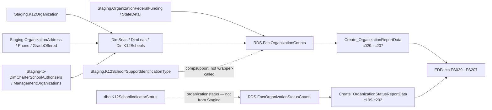

# Directory

> [!info] Seam: both
> `Staging.K12Organization` and the other organization-attribute tables are CEDS-specific; `RDS.FactOrganizationCounts`/`FactOrganizationStatusCounts` and the report/file layers are standard-agnostic.

Directory is Generate's organization-identity and status collection: SEA, LEA, and school directory records, grades offered, charter attributes, school type, comprehensive/targeted support identification, federal program funding, and organization operational status. It feeds seventeen file specs (the FS029 family) plus the related `organizationstatus` fact type (FS199–FS202). It is the only domain counting *organizations* rather than students — its identifier is a SEA/LEA/school key — and `RDS.FactOrganizationCounts` is also the organization universe every other domain's zero-count backfill cross-joins against, making Directory a de facto prerequisite for the rest of the pipeline.

## Pipeline

| Item | Value |
|---|---|
| Wrapper | `App.Wrapper_Migrate_Directory_to_RDS` — loads `DimSeas`, `DimLeas`, `DimK12Schools`, `DimCharterSchoolAuthorizers`, `DimCharterSchoolManagementOrganizations`, then per selected school year runs the fact procedure. **No `RDS.Empty_RDS` call** — the fact procedure deletes its own school-year slice inline. |
| Fact procedure | `Staging.Staging-to-FactOrganizationCounts` (450 lines) — one `INSERT` block per organization level: SEA, LEA, School |
| Related, not wrapper-called | `Staging.Staging-to-FactOrganizationCounts_ComprehensiveAndTargetedSupport` (`compsupport` fact type); `RDS.Migrate_OrganizationStatusCounts` (`organizationstatus` fact type) |
| Fact table | `RDS.FactOrganizationCounts` (+ `RDS.FactOrganizationStatusCounts`) |
| Report builders | `RDS.Create_OrganizationReportData` (`directory`), `RDS.Create_OrganizationStatusReportData` (`organizationstatus`) |
| Report codes | `c029 c035 c039 c103 c129 c130 c131 c163 c170 c190 c193 c196 c197 c198 c205 c206 c207` + `c199–c202` |
| File specs | FS029, FS035, FS039, FS103, FS129, FS130, FS131, FS163, FS170, FS190, FS193, FS196, FS197, FS198, FS205, FS206, FS207 + FS199–FS202 |

## Data elements required

| Element | Source staging column(s) | Category set role |
|---|---|---|
| SEA identifier | `Staging.StateDetail.SeaOrganizationIdentifierSea` | identifier |
| LEA identifier | `Staging.K12Organization.LeaIdentifierSea` | identifier |
| School identifier | `Staging.K12Organization.SchoolIdentifierSea` | identifier |
| Org name, address, phone, website (FS029/FS039) | `Staging.OrganizationAddress`, `Staging.OrganizationPhone`, `Staging.K12Organization.NameOfInstitution` | identifier |
| NCES ID, LEA & school (FS029/FS039) | `Staging.K12Organization.LEAIdentifierNCES` / `.SchoolIdentifierNCES` | identifier |
| Grades offered (FS039) | `Staging.OrganizationGradeOffered.GradeOffered` | category: GRADESOFFERED |
| Charter school indicator (FS190/FS198) | `Staging.K12Organization.School_CharterSchoolIndicator` | filter |
| Charter primary & secondary authorizer (FS190) | `Staging.K12Organization.School_CharterPrimaryAuthorizer` / `_CharterSecondaryAuthorizer` | category: CHARTERAUTH |
| Charter management organization & contract ID (FS196/FS197/FS198) | `Staging.CharterSchoolManagementOrganization`, `Staging.K12Organization.CharterSchoolContractIdNumber` | category: CHARTERMGMT |
| School type (FS129/FS130) | `Staging.K12Organization.SchoolTypeCode` | category: SCHOOLTYPE |
| Magnet / special-program-emphasis status (FS129/FS130) | `Staging.K12Organization.School_MagnetOrSpecialProgramEmphasisSchool` | category: MAGNET |
| NSLP, shared-time, virtual, dangerous, poverty status (FS129/FS130) | `Staging.K12Organization.School_NationalSchoolLunchProgramStatus`, `_SharedTimeIndicator`, `_VirtualSchoolStatus`, `_SchoolDangerousStatus`, `_StatePovertyDesignation` | category: SCHOOLSTATUS |
| Progress-toward-ELP indicator (FS205/FS206) | `Staging.K12Organization.School_ProgressAchievingEnglishLanguageProficiencyIndicatorType` | category: ELPPROGRESS |
| Comprehensive/targeted support identification (FS207, `compsupport`) | `Staging.K12SchoolComprehensiveSupportIdentificationType`, `.K12SchoolTargetedSupportIdentificationType` | category: CSI/TSI |
| Federal program funding: code, allocation, Title I set-aside (FS035/FS193) | `Staging.OrganizationFederalFunding.FederalProgramCode`, `.FederalProgramsFundingAllocation`, `.ParentalInvolvementReservationFunds` | measure |
| School-improvement funds (FS035) | `RDS.FactOrganizationCounts.SchoolImprovementFunds` (hardcoded -1/NULL in this procedure) | measure |
| GFSA reporting status (FS163, `organizationstatus`) | `Staging.K12Organization.School_GunFreeSchoolsActReportingStatus` | category: GFSASTATUS |
| McKinney-Vento subgrant recipient (FS170, `organizationstatus`) | `Staging.K12Organization.LEA_McKinneyVentoSubgrantRecipient` | category: MVSUBGRANT |
| Operational status (open/closed/new) & reported-federally flag | `RDS.DimLeas.LeaOperationalStatus`/`.ReportedFederally`, `RDS.DimK12Schools.SchoolOperationalStatus`/`.ReportedFederally` | category: OPSTATUS |

## Ed-Fi coverage (preliminary)

> [!warning] Preliminary — Ed-Fi 5.2 verdicts, not adjudicated

| Element | Verdict | Ed-Fi binding |
|---|---|---|
| SEA identifier | Direct | `edFi_stateEducationAgency.stateEducationAgencyId` |
| LEA identifier | Direct | `edFi_localEducationAgency.localEducationAgencyId` |
| School identifier | Direct | `edFi_school.schoolId` |
| Org name/address/phone/website | Direct | `edFi_school.nameOfInstitution` + `.addresses` + `.institutionTelephones` + `.webSite` |
| NCES ID | Derivable | from `edFi_school.identificationCodes[]` / `edFi_localEducationAgency.identificationCodes[]`, filtered to the entry whose system descriptor is NCES — a keyed collection, not a fixed field |
| Grades offered | Direct | `edFi_school.gradeLevels` |
| Charter school indicator | Direct | `edFi_school.charterStatusDescriptor` |
| Charter primary & secondary authorizer | Absent | no property in `edFi_school` names an authorizing organization |
| Charter management organization & contract ID | Absent | no property in `edFi_school`/`edFi_localEducationAgency` names a management organization or contract ID |
| School type | Direct | `edFi_school.schoolTypeDescriptor` |
| Magnet/special-program-emphasis status | Direct | `edFi_school.magnetSpecialProgramEmphasisSchoolDescriptor` |
| NSLP, shared-time, virtual, dangerous, poverty status | Absent | no core property for any of the five at the organization level |
| Progress-toward-ELP indicator | Absent | no organization-level ELP-progress property in core schemas |
| Comprehensive/targeted support identification | Derivable | from `edFi_school.indicators[]`, a generic extensibility slot (`indicatorDescriptor`/`indicatorValue`); CSI/TSI vocabulary is not built in |
| Federal program funding: code, allocation, Title I set-aside | Absent | `edFi_localEducationAgencyFederalFunds` has fixed named categories, not a generic program-code/amount pair |
| School-improvement funds | Direct | `edFi_localEducationAgencyFederalFunds.schoolImprovementAllocation` |
| GFSA reporting status | Direct | `edFi_localEducationAgencyAccountability.gunFreeSchoolsActReportingStatusDescriptor` |
| McKinney-Vento subgrant recipient | Absent | no subgrant-recipient property in core schemas |
| Operational status & reported-federally flag | Direct | operational status via `edFi_localEducationAgency`/`edFi_school.operationalStatusDescriptor`; the reported-federally flag itself is Generate-internal with no Ed-Fi equivalent |

## Citations

- `generate.database/StoredProcedures/Create/App.Wrapper_Migrate_Directory_to_RDS.StoredProcedure.sql@develop`
- `generate.database/StoredProcedures/Create/Staging.Staging-to-FactOrganizationCounts.StoredProcedure.sql@develop`
- `generate.database/StoredProcedures/Create/Staging.Staging-to-FactOrganizationCounts_ComprehensiveAndTargetedSupport.StoredProcedure.sql@develop`
- `generate.database/StoredProcedures/Create/RDS.Migrate_OrganizationStatusCounts.StoredProcedure.sql@develop`
- `generate.database/StoredProcedures/Create/RDS.Create_Reports.StoredProcedure.sql@develop` lines 1133–1351 — directory and organizationstatus branches
- `generate.database/StoredProcedures/Create/RDS.Create_OrganizationReportData.StoredProcedure.sql@develop`
- `generate.database/StoredProcedures/Create/RDS.Create_OrganizationStatusReportData.StoredProcedure.sql@develop`
- `generate.database/Views/Create/Debug.vwDirectorySEA_FactTable.View.sql@develop`
- `generate.database/Views/Create/Debug.vwDirectoryLEA_FactTable.View.sql@develop`
- `generate.database/Views/Create/Debug.vwDirectorySCH_FactTable.View.sql@develop`
- `generate.database/Views/Create/Debug.vwDirectoryLiteSEA_FactTable.View.sql@develop` — filename/object-name mismatch, see inventory
- `generate.database/StoredProcedures/Create/Staging.Staging-to-DimLeas.StoredProcedure.sql@develop` and `Staging.Staging-to-DimK12Schools.StoredProcedure.sql@develop` — NCES ID source columns
