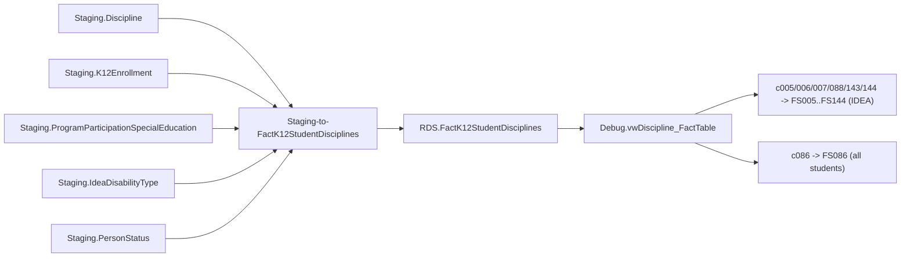

# Discipline

> [!info] Seam: both
> `Staging.Discipline` and the effective-dated joins in `Staging-to-FactK12StudentDisciplines` are
> CEDS-specific; `RDS.FactK12StudentDisciplines` and its per-report views are standard-agnostic.

IDEA and Gun-Free-Schools-Act discipline reporting — the widest fan-out of any domain, one fact
table feeding **seven** file specs: FS005 (removal to interim alternative setting), FS006
(suspension/expulsion), FS007 (reasons for unilateral removal), FS086 (students involved with
firearms, general population), FS088 (unduplicated disciplinary removals), FS143 (total removal
events), FS144 (educational services during expulsion). All but FS086 are IDEA-gated. SEA/LEA levels.

## Pipeline

| Stage | Object |
|---|---|
| Wrapper | `App.Wrapper_Migrate_Discipline_to_RDS` (`rds.Empty_RDS 'discipline'` — the only place that names the fact table explicitly) |
| Fact procedure | `Staging.Staging-to-FactK12StudentDisciplines @SchoolYear` |
| Fact table | `RDS.FactK12StudentDisciplines`, `FactTypeCode = 'discipline'` |
| Report codes → file specs | `c005`→FS005, `c006`→FS006, `c007`→FS007, `c086`→FS086, `c088`→FS088, `c143`→FS143, `c144`→FS144 |
| Also dispatched, not EDFacts | `studentdiscipline` (on-screen); `indicator4a`/`indicator4b` (SPP/APR indicators, via `Create_CustomReportData`); `disciplinaryremovals` (state report, read back by `Get_StudentDisciplinaryRemovalsReportData`) |
| Uninvoked | `Staging.Staging-To-FactK12SeclusionsOrRestraints.StoredProcedure.sql` exists but this wrapper never calls it |

## Data elements required

| Element | Source staging column(s) | Category set role |
|---|---|---|
| Student identifier | `Staging.Discipline.StudentIdentifierState` | identifier |
| LEA / school identifier | `Staging.Discipline.LeaIdentifierSeaAccountability` / `.SchoolIdentifierSea` | organization |
| Incident identifier | `Staging.Discipline.IncidentIdentifier` | identifier (incident-level, secondary) |
| Disciplinary action start date | `Staging.Discipline.DisciplinaryActionStartDate` | filter (anchors every effective-dated join) |
| Duration of disciplinary action | `Staging.Discipline.DurationOfDisciplinaryAction` | measure (decimal days, stored on the fact row itself) |
| Disciplinary action taken | `Staging.Discipline.DisciplinaryActionTaken` | category: action type (FS006) |
| IDEA interim removal + reason | `Staging.Discipline.IdeaInterimRemoval`, `.IdeaInterimRemovalReason` | category: interim removal (FS005/FS007) |
| Discipline method for children with disabilities | `Staging.Discipline.DisciplineMethodOfCwd` | category: CWD removal setting (FS088/FS143) |
| Educational services after removal | `Staging.Discipline.EducationalServicesAfterRemoval` | category: services during removal (FS144) |
| Firearm/weapon type | `Staging.Discipline.FirearmType` | category: firearm type (FS086) |
| Firearm discipline method | `Staging.Discipline.DisciplineMethodFirearm`, `.IDEADisciplineMethodFirearm` | category: firearm discipline method (FS086) |
| Primary disability type | `Staging.IdeaDisabilityType.IdeaDisabilityTypeCode` where `IsPrimaryDisability = 1` | category: DISABCATIDEA |
| IDEA indicator | `Staging.ProgramParticipationSpecialEducation.IdeaIndicator` | filter (gates the six IDEA specs; FS086 is not IDEA-gated) |
| Race/ethnicity (unduplicated) | `Staging.K12PersonRace.RaceType`, `Staging.K12Enrollment.HispanicLatinoEthnicity` | category: RACE |
| Sex | `Staging.K12Enrollment.Sex` | category: SEX |
| Age at count date | `Staging.K12Enrollment.Birthdate` | category: AGE |
| Grade level | `Staging.K12Enrollment.GradeLevel` | filter |
| English learner status | `Staging.PersonStatus.EnglishLearnerStatus` | category: ELSTATUS |
| Discipline count | one row per matched discipline action | measure |

## Ed-Fi coverage (preliminary)

> [!warning] Preliminary — Ed-Fi 5.2 verdicts, not adjudicated

| Element | Verdict | Ed-Fi binding |
|---|---|---|
| Student identifier | Direct | `edFi_student.studentUniqueId` |
| LEA / school identifier | Direct | `edFi_localEducationAgency.localEducationAgencyId` / `edFi_school.schoolId` |
| Incident identifier | Direct | `edFi_disciplineIncident.incidentIdentifier` |
| Disciplinary action start date | Direct | `edFi_disciplineAction.disciplineDate` |
| Duration of disciplinary action | Direct | `edFi_disciplineAction.disciplineActionLength` (also `.actualDisciplineActionLength`) |
| Disciplinary action taken | Direct | `edFi_disciplineActionDiscipline.disciplineDescriptor` |
| IDEA interim removal + reason | Absent | no interim-alternative-educational-setting concept anywhere in core Ed-Fi |
| Discipline method for CWD | Derivable | from `disciplineDescriptor` plus an active `edFi_studentSpecialEducationProgramAssociation` on the same date — no CWD-specific split field |
| Educational services after removal | Absent | no property represents continued-service status during/after a removal |
| Firearm/weapon type | Direct | `edFi_disciplineIncidentWeapon.weaponDescriptor` |
| Firearm discipline method | Derivable | same derivation as CWD method, scoped to incidents with a weapon association |
| Primary disability type | Derivable | `edFi_studentSpecialEducationProgramAssociationDisability.disabilityDescriptor` where `orderOfDisability = 1` |
| IDEA indicator | Direct | `edFi_studentSpecialEducationProgramEligibilityAssociation.ideaIndicator` |
| Race/ethnicity | Direct | `edFi_studentEducationOrganizationAssociationRace.raceDescriptor` + `.hispanicLatinoEthnicity` |
| Sex | Direct | `edFi_studentEducationOrganizationAssociation.sexDescriptor` |
| Age at count date | Derivable | from `edFi_student.birthDate` |
| Grade level | Direct | `edFi_studentSchoolAssociation.entryGradeLevelDescriptor` |
| English learner status | Direct | `edFi_studentEducationOrganizationAssociation.limitedEnglishProficiencyDescriptor` |
| Discipline count | Derivable | count of matched rows; not a stored element |

## Citations

- `generate.database/StoredProcedures/Create/App.Wrapper_Migrate_Discipline_to_RDS.StoredProcedure.sql@develop`
- `generate.database/StoredProcedures/Create/Staging.Staging-to-FactK12StudentDisciplines.StoredProcedure.sql@develop` lines 172–375
- `generate.database/Views/Create/Debug.vwDiscipline_StagingTables.View.sql@develop`
- `generate.database/Views/Create/Debug.vwDiscipline_FactTable.View.sql@develop`
- `generate.database/StoredProcedures/Create/RDS.Create_Reports.StoredProcedure.sql@develop` lines 744–854
- `generate.database/StoredProcedures/Create/RDS.Create_CustomReportData.StoredProcedure.sql@develop`
- `generate.database/StoredProcedures/Create/RDS.Get_StudentDisciplinaryRemovalsReportData.StoredProcedure.sql@develop`
- `generate.database/Metadata/App.CedsConnections.Metadata.sql@develop` — FS005/006/007/086/088/143/144 titles
- `generate.database/StoredProcedures/Create/RDS.Empty_RDS.StoredProcedure.sql@develop` lines 30–37
