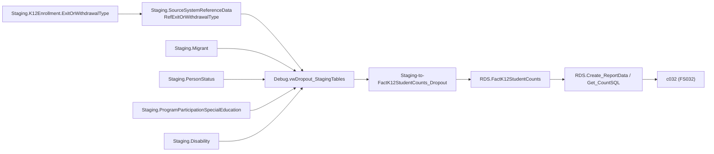

# Dropout

> [!info] Seam: both
> `Staging.K12Enrollment` plus the SEA's local exit-code translation are replaceable; the fact table
> and report generator downstream of `Debug.vwDropout_StagingTables` are standard-agnostic.

FS032 counts students who left school for reasons EDFacts classifies as dropping out, by grade, sex,
race, and a handful of status categories, at SEA/LEA/school level. The entire domain rests on one
column, `Staging.K12Enrollment.ExitOrWithdrawalType`, translated from the SEA's local codes to CEDS
option codes through `Staging.SourceSystemReferenceData`. Cross-link [[Membership]]: a dropout rate
needs Membership's count as its denominator, and this domain supplies only the numerator.

## Pipeline

| | |
|---|---|
| Wrapper | `App.Wrapper_Migrate_Dropout_to_RDS` (same 6-step template as [[Membership]], `Empty_RDS 'Dropout'`) |
| Fact procedure | `Staging.Staging-to-FactK12StudentCounts_Dropout` |
| Fact table | `RDS.FactK12StudentCounts` (`FactTypeCode = 'dropout'`) |
| Report code | `c032` |
| File spec | FS032 |
| Generator | Legacy path — `RDS.Create_ReportData` / `RDS.Get_CountSQL` (no per-report-code view exists) |

**The exit-code translation is narrower in the fact procedure than in the lineage view — the
procedure is authoritative.** `Debug.vwDropout_StagingTables` joins `Staging.SourceSystemReferenceData`
(`TableName = 'RefExitOrWithdrawalType'`) and accepts three CEDS output codes as "dropout":
`01925` (expelled/involuntarily withdrawn), `01927` (discontinued schooling), `01931` (not enrolled,
unknown status). The fact procedure itself looks up only **one** code — it resolves
`@ExitOrWithdrawalTypeMap` from `rds.vwDimK12EnrollmentStatuses` where `ExitOrWithdrawalTypeCode =
'01927'`, then filters `WHERE ske.ExitOrWithdrawalType = @ExitOrWithdrawalTypeMap`. As implemented,
only "discontinued schooling" produces a dropout fact row; the other two codes the debug view
suggests are eligible never reach the fact table.

## Data elements required

| Element | Source staging column(s) | Category set role |
|---|---|---|
| Student identifier | `Staging.K12Enrollment.StudentIdentifierState` | identifier |
| Organization | `LEAIdentifierSeaAccountability`, `SchoolIdentifierSea` | organization |
| Exit/withdrawal reason | `ExitOrWithdrawalType` → `Staging.SourceSystemReferenceData` (`RefExitOrWithdrawalType`) | filter (defines "dropout") |
| Grade level (exit) | `Staging.K12Enrollment.GradeLevel` | category: GRADELDROP |
| Sex | `Staging.K12Enrollment.Sex` | category: SEX |
| Race/ethnicity | `Staging.K12PersonRace.RaceType`, `HispanicLatinoEthnicity` | category: RACEETHNIC |
| IDEA indicator | `Staging.ProgramParticipationSpecialEducation.IDEAIndicator` | category: DISABSTATIDEA |
| Section 504 status | `Staging.Disability.DisabilityStatus`, `Section504Status` | category: SEC504STATUS |
| Migrant status | `Staging.PersonStatus.MigrantStatus` | category: MIGRNTSTATUS |
| English learner status | `Staging.PersonStatus.EnglishLearnerStatus` | category: ELSTATUS |
| Economic disadvantage | `Staging.PersonStatus.EconomicDisadvantageStatus` | category: ECODIS |
| Homelessness | `Staging.PersonStatus.HomelessnessStatus` | category: HOMELESS |

## Ed-Fi coverage (preliminary)

> [!warning] Preliminary — Ed-Fi 5.2 verdicts, not adjudicated

| Element | Verdict | Ed-Fi binding |
|---|---|---|
| Student identifier | Direct | `edFi_student.studentUniqueId` |
| Exit/withdrawal reason | Direct | `edFi_studentSchoolAssociation.exitWithdrawTypeDescriptor` |
| "Is this a dropout" | Derivable | which descriptor values count as a dropout is a state convention layered on top of `exitWithdrawTypeDescriptor`, exactly as CEDS's SSRD translation is today |
| Grade level | Direct | `edFi_studentSchoolAssociation.entryGradeLevelDescriptor` (exit grade needs `nextYearGradeLevelDescriptor` or the prior year's entry grade) |
| IDEA indicator | Direct | `edFi_studentSpecialEducationProgramAssociation.ideaEligibility` |
| Section 504 status | Direct | presence of an `edFi_studentSection504ProgramAssociation` (carries `section504Eligibility`) |
| Migrant status | Direct | active `edFi_studentMigrantEducationProgramAssociation` |

## Citations

- `generate.database/StoredProcedures/Create/App.Wrapper_Migrate_Dropout_to_RDS.StoredProcedure.sql@develop`
- `generate.database/StoredProcedures/Create/Staging.Staging-to-FactK12StudentCounts_Dropout.StoredProcedure.sql@develop` lines 42–64, 365 — exit-code resolution and filter
- `generate.database/Views/Create/Debug.vwDropout_StagingTables.View.sql@develop` lines 76–86 — SSRD translation and the three candidate codes
- `generate.database/Views/Create/Debug.vwDropout_FactTable.View.sql@develop`
- `generate.database/Metadata/App.Categories.Metadata.sql@develop` line 530 — `GRADELDROP`

Related: [[Membership]], [[App-Metadata-Layer]], [[Staging-Layer]]
