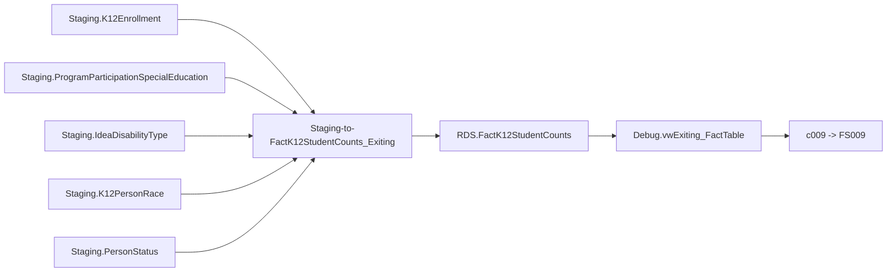

# Exiting

> [!info] Seam: both
> Staging tables and the exit-date-driven join logic in `Staging-to-FactK12StudentCounts_Exiting`
> are CEDS-specific; `RDS.FactK12StudentCounts` and its lineage views are standard-agnostic.

IDEA Part B exiting — children with disabilities aged 3–21 who exited special education during the
reporting period, and the reason they exited. Feeds **FS009** at SEA/LEA organization levels. One
row per student per exit event, keyed off `Staging.ProgramParticipationSpecialEducation.ProgramParticipationEndDate`
rather than a single as-of date the way [[ChildCount]] is.

## Pipeline

| Stage | Object |
|---|---|
| Wrapper | `App.Wrapper_Migrate_Exiting_to_RDS` (loads shared dims, `rds.Empty_RDS 'exiting'`, cursors school years) |
| Fact procedure | `Staging.Staging-to-FactK12StudentCounts_Exiting @SchoolYear` |
| Fact table | `RDS.FactK12StudentCounts`, `FactTypeCode = 'exiting'` |
| Report codes → file specs | `c009` → FS009 |
| Also dispatched, not EDFacts | `exitspecialeducation`, `yeartoyearexitcount` (on-screen reports) |

`Staging.Staging-to-FactK12StudentCounts_SpecEdExit.StoredProcedure.sql` is near-identical logic and
also claims file 009; `specedexit` still appears as a fact type in the commented-out legacy block of
`RDS.Get_FactTypeByReport`. **The wrapper calls only `_Exiting`.** Treat `_SpecEdExit` as superseded
dead code, not a second source of truth.

## Data elements required

| Element | Source staging column(s) | Category set role |
|---|---|---|
| Student identifier | `Staging.K12Enrollment.StudentIdentifierState` | identifier |
| LEA identifier | `Staging.K12Enrollment.LEAIdentifierSeaAccountability` | organization |
| School identifier | `Staging.K12Enrollment.SchoolIdentifierSea` | organization |
| Exit date | `Staging.ProgramParticipationSpecialEducation.ProgramParticipationEndDate` | filter (drives the reporting-period and age-reference-date logic; required not null) |
| Age at exit | `Staging.K12Enrollment.Birthdate` (vs. the count date on either side of the exit) | category: AGEEXITSPED |
| Sex | `Staging.K12Enrollment.Sex` | category: SEX |
| Race/ethnicity (unduplicated) | `Staging.K12PersonRace.RaceType`, `Staging.K12Enrollment.HispanicLatinoEthnicity` | category: RACE |
| Exit reason | `Staging.ProgramParticipationSpecialEducation.SpecialEducationExitReason` | category: BASISEXIT |
| Primary disability type | `Staging.IdeaDisabilityType.IdeaDisabilityTypeCode` where `IsPrimaryDisability = 1` | category: DISABCATIDEAEXIT |
| English learner status | `Staging.PersonStatus.EnglishLearnerStatus` | category: ELSTATUS |
| IDEA indicator (eligibility gate) | `Staging.ProgramParticipationSpecialEducation.IdeaIndicator` (must resolve to `IdeaIndicatorCode = 'Yes'`) | filter |
| Student count | one row per matched exit | measure |

## Ed-Fi coverage (preliminary)

> [!warning] Preliminary — Ed-Fi 5.2 verdicts, not adjudicated

| Element | Verdict | Ed-Fi binding |
|---|---|---|
| Student identifier | Direct | `edFi_student.studentUniqueId` |
| LEA identifier | Direct | `edFi_localEducationAgency.localEducationAgencyId` |
| School identifier | Direct | `edFi_school.schoolId` |
| Exit date | Direct | `edFi_studentSpecialEducationProgramAssociation.specialEducationExitDate` |
| Age at exit | Derivable | from `edFi_student.birthDate`, computed as of the exit date |
| Sex | Direct | `edFi_studentEducationOrganizationAssociation.sexDescriptor` |
| Race/ethnicity | Direct | `edFi_studentEducationOrganizationAssociationRace.raceDescriptor` + `.hispanicLatinoEthnicity` |
| Exit reason | Direct | `edFi_studentSpecialEducationProgramAssociation.specialEducationExitReasonDescriptor` |
| Primary disability type | Derivable | `edFi_studentSpecialEducationProgramAssociationDisability.disabilityDescriptor` where `orderOfDisability = 1` |
| English learner status | Direct | `edFi_studentEducationOrganizationAssociation.limitedEnglishProficiencyDescriptor` |
| IDEA indicator | Direct | `edFi_studentSpecialEducationProgramEligibilityAssociation.ideaIndicator` |
| Student count | Derivable | count of one row per matched exit; not a stored element |

`specialEducationExitReasonDescriptor` is purpose-built for this concept, but the swagger only proves
the property exists — it does not enumerate descriptor values, so whether every IDEA-specific reason
(e.g. "reached maximum age", "moved, known to be continuing") survives as a distinct code needs a
descriptor-value check against a live ODS, not just the schema.

## Citations

- `generate.database/StoredProcedures/Create/App.Wrapper_Migrate_Exiting_to_RDS.StoredProcedure.sql@develop`
- `generate.database/StoredProcedures/Create/Staging.Staging-to-FactK12StudentCounts_Exiting.StoredProcedure.sql@develop`
- `generate.database/StoredProcedures/Create/Staging.Staging-to-FactK12StudentCounts_SpecEdExit.StoredProcedure.sql@develop`
- `generate.database/Views/Create/Debug.vwExiting_StagingTables.View.sql@develop`
- `generate.database/Views/Create/Debug.vwExiting_FactTable.View.sql@develop`
- `generate.database/Views/Create/RDS.vwDimIdeaStatuses.View.sql@develop`
- `generate.database/Functions/Create/RDS.Get_FactTypeByReport.UserDefinedFunction.sql@develop` lines 41–44
- `generate.database/Metadata/App.Categories.Metadata.sql@develop` lines 142, 274, 2746
- `generate.database/StoredProcedures/Create/RDS.Create_Reports.StoredProcedure.sql@develop` lines 150–184
