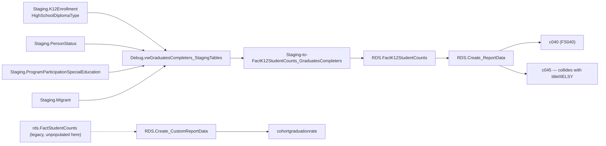

# GraduatesCompleters

> [!info] Seam: both
> `Staging.K12Enrollment` is replaceable; `RDS.FactK12StudentCounts` and the report generators are
> standard-agnostic. The `cohortgraduationrate` custom report is a partial exception — see below.

FS040 counts high school graduates and other completers (regular diploma vs. other credential) for
the reporting year 10/1–9/30, by grade, sex, race, and program status, at SEA/LEA/school level. The
reportable fact is simply "did this enrollment record carry a diploma/credential type" — there is no
separate completion event. Cross-link [[Graduationrate]]: that domain's ACGR is a *rate* computed
from cohorts tracked over years, not this domain's single-year completer count, though readers
routinely conflate the two.

## Pipeline

| | |
|---|---|
| Wrapper | `App.Wrapper_Migrate_GraduatesCompleters_to_RDS` (`Empty_RDS 'graduatescompleters'`) |
| Fact procedure | `Staging.Staging-to-FactK12StudentCounts_GraduatesCompleters` — header names file 040 only |
| Fact table | `RDS.FactK12StudentCounts` (`FactTypeCode = 'graduatescompleters'`) |
| Report codes | `c040`, `c045`, `cohortgraduationrate` |
| File spec | FS040 |
| Generator | `c040`/`c045` via `RDS.Create_ReportData`; `cohortgraduationrate` via `RDS.Create_CustomReportData` |

The fact procedure's only filter is `WHERE ... AND ISNULL(ske.HighSchoolDiplomaType, '') <> ''` — any
non-blank diploma/credential type qualifies a row, over the fixed reporting window
`[SchoolYear-1]-10-01` to `[SchoolYear]-09-30`. `HighSchoolDiplomaType` distinguishes regular diploma
from other completer credential downstream, in `RDS.DimK12AcademicAwardStatuses`.

**`cohortgraduationrate` does not read the columns this brief expects.** It reads
`rds.DimStudents.Cohort` (a `SUBSTRING`-parsed entry/exit year string) joined off `rds.FactStudentCounts`
— a table name distinct from `RDS.FactK12StudentCounts`. Neither `rds.FactStudentCounts` nor
`rds.DimStudents` has DDL or a populating procedure anywhere under `sources/generate`; the cohort
columns this fact procedure *does* populate (`CohortYear`, `CohortGraduationYear` on
`Staging.K12Enrollment`) belong to [[Graduationrate]], not here. See Contradictions in the inventory.

**`c045` is dispatched under two fact types.** `RDS.Create_Reports` runs it under
`graduatescompleters` (lines 339–347) *and* under `titleIIIELSY` (lines 408–416); neither block is
commented out. Three sources then disagree about what FS045 is: the `titleIIIELSY` fact procedure's
header calls 045 retired, `App.CedsConnections` titles FS045 "Immigrant", and this branch treats it
as live. Only `App.GenerateReport_FactType` decides at runtime — `RDS.Get_FactTypeByReport` returns
exactly one fact type per report code — so whichever row that table holds wins, and the other branch
counts the wrong slice of `RDS.FactK12StudentCounts`. Unresolved; see [[TitleIIIELSY]] and
[[Source-Code-Oddities]].

## Data elements required

| Element | Source staging column(s) | Category set role |
|---|---|---|
| Student identifier | `Staging.K12Enrollment.StudentIdentifierState` | identifier |
| Organization | `LEAIdentifierSeaAccountability`, `SchoolIdentifierSea` | organization |
| Diploma/credential type | `Staging.K12Enrollment.HighSchoolDiplomaType` | identifier (defines "completer") + category: DIPLCREDTYPE |
| Sex | `Staging.K12Enrollment.Sex` | category: SEX |
| Race/ethnicity | `Staging.K12PersonRace.RaceType`, `HispanicLatinoEthnicity` | category: RACEETHNIC |
| IDEA indicator | `Staging.ProgramParticipationSpecialEducation.IDEAIndicator` | category: DISABSTATIDEA |
| English learner status | `Staging.PersonStatus.EnglishLearnerStatus` | category: ELSTATUS |
| Homelessness | `Staging.PersonStatus.HomelessnessStatus` | category: HOMELESS |
| Migrant status | `Staging.Migrant` / `PersonStatus.MigrantStatus` | category: MIGRNTSTATUS |
| Economic disadvantage | `Staging.PersonStatus.EconomicDisadvantageStatus` | category: ECODIS |

## Ed-Fi coverage (preliminary)

> [!warning] Preliminary — Ed-Fi 5.2 verdicts, not adjudicated

| Element | Verdict | Ed-Fi binding |
|---|---|---|
| Student identifier | Direct | `edFi_student.studentUniqueId` |
| Diploma/credential type | Direct | `edFi_studentAcademicRecordDiploma.diplomaTypeDescriptor` |
| Diploma award date | Direct | `edFi_studentAcademicRecordDiploma.diplomaAwardDate` |
| CTE completer flag | Direct | `edFi_studentAcademicRecordDiploma.cteCompleter` |
| IDEA indicator | Direct | `edFi_studentSpecialEducationProgramAssociation.ideaEligibility` |
| English learner status | Direct | `edFi_studentEducationOrganizationAssociation.limitedEnglishProficiencyDescriptor` |
| Cohort membership (for `cohortgraduationrate`) | Absent | no cohort-year concept on the diploma record itself; would need `edFi_studentEducationOrganizationAssociationCohortYear` (`cohortYearTypeDescriptor` + `schoolYearTypeReference`), assembled per student |

## Citations

- `generate.database/StoredProcedures/Create/App.Wrapper_Migrate_GraduatesCompleters_to_RDS.StoredProcedure.sql@develop`
- `generate.database/StoredProcedures/Create/Staging.Staging-to-FactK12StudentCounts_GraduatesCompleters.StoredProcedure.sql@develop` lines 43–45, 302–304 — reporting window and diploma filter
- `generate.database/Views/Create/Debug.vwGraduatesCompleters_StagingTables.View.sql@develop`
- `generate.database/StoredProcedures/Create/RDS.Create_CustomReportData.StoredProcedure.sql@develop` lines 909–1005 — `cohortgraduationrate` reads `rds.FactStudentCounts`/`rds.DimStudents.Cohort`
- `generate.database/StoredProcedures/Create/RDS.Create_Reports.StoredProcedure.sql@develop` lines 327–360, 395–415 — `c045` dispatched under both `graduatescompleters` and `titleIIIELSY`
- `generate.database/Metadata/App.CedsConnections.Metadata.sql@develop` — FS045's CEDS Connect title is "Immigrant", not Graduates/Completers or Title III (see Contradictions)

