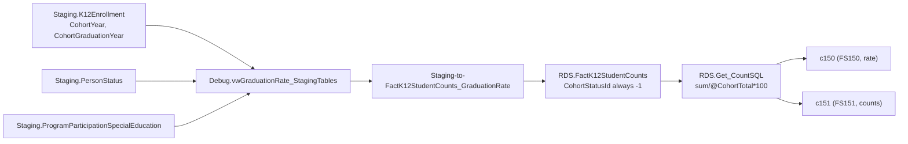

# Graduationrate

> [!info] Seam: both
> `Staging.K12Enrollment`'s cohort columns are replaceable; `RDS.FactK12StudentCounts` and
> `RDS.Get_CountSQL`'s rate arithmetic are standard-agnostic — but see the gap noted below.

FS150/FS151 report the four-year Adjusted Cohort Graduation Rate (ACGR): FS150 is the rate itself,
FS151 the underlying cohort counts, both by SEA/LEA/school and by sex, race, IDEA, English-learner,
homelessness, foster-care, and economic-disadvantage categories. A cohort is the set of first-time
9th graders in a given year, "adjusted" for students who transfer in or out before graduating.
Cross-link [[GraduatesCompleters]]: that domain counts any-year diploma recipients; this one tracks a
named cohort across years to a rate.

## Pipeline

| | |
|---|---|
| Wrapper | `App.Wrapper_Migrate_Graduationrate_to_RDS` (`Empty_RDS 'graduationrate'`) |
| Fact procedure | `Staging.Staging-to-FactK12StudentCounts_GraduationRate` — note the capital R; the wrapper is `Graduationrate` |
| Fact table | `RDS.FactK12StudentCounts` (`FactTypeCode = 'graduationrate'`) |
| Report codes | `c150`, `c151` |
| File specs | FS150, FS151 |
| Generator | Legacy path — `RDS.Create_ReportData` / `RDS.Get_CountSQL`; no per-report-code view exists |

**The cohort-status mapping is an open TODO in the source.** The fact procedure resolves
`CohortYearId`/`CohortGraduationYearId` by matching `Staging.K12Enrollment.CohortYear` /
`.CohortGraduationYear` to `RDS.DimSchoolYears`, but hardcodes `CohortStatusId = -1` for every row;
the join to `RDS.DimCohortStatuses` is commented out with the note *"Mapping above needs research...
I believe Cohort is supposed to be in AcademicAwardStatuses but the dimension doesn't exist yet."*
`CohortDescription` is carried in the staging read but never consumed. **The "adjusted" part of ACGR
is not visibly implemented either**: `RDS.Get_CountSQL` computes `ADJUSTEDCOHORTGRADUATIONRATE` as
`sum(<numerator>) / @CohortTotal * 100`, where `@CohortTotal` is a plain sum of
`RDS.FactK12StudentCounts.StudentCount` for the cohort — no join or adjustment for students who
transferred into or out of the cohort is visible in either the fact procedure or the count SQL.
Report-generation also restricts to 12th grade via `RDS.BridgeLeaGradeLevels` /
`BridgeK12SchoolGradeLevels` in `Debug.vwGraduationRate_FactTable`.

## Data elements required

| Element | Source staging column(s) | Category set role |
|---|---|---|
| Student identifier | `Staging.K12Enrollment.StudentIdentifierState` | identifier |
| Organization | `LEAIdentifierSeaAccountability`, `SchoolIdentifierSea` | organization |
| Cohort entry year | `Staging.K12Enrollment.CohortYear` | identifier (defines the cohort) |
| Cohort graduation year | `Staging.K12Enrollment.CohortGraduationYear` | measure (numerator/denominator window) |
| Cohort description | `Staging.K12Enrollment.CohortDescription` | category: COHSTATUS (declared, unused — see above) |
| Sex | `Staging.K12Enrollment.Sex` | category: SEX |
| Race/ethnicity | `Staging.K12PersonRace.RaceType`, `HispanicLatinoEthnicity` | category: RACEETHNIC |
| IDEA indicator | `Staging.ProgramParticipationSpecialEducation.IDEAIndicator` | category: DISABSTATIDEA |
| Homelessness / foster care / economic disadvantage | `Staging.PersonStatus.*` | category: HOMELESS / filter / ECODIS |

## Ed-Fi coverage (preliminary)

> [!warning] Preliminary — Ed-Fi 5.2 verdicts, not adjudicated

| Element | Verdict | Ed-Fi binding |
|---|---|---|
| Student identifier | Direct | `edFi_student.studentUniqueId` |
| Cohort entry/graduation year | Derivable | `edFi_studentEducationOrganizationAssociationCohortYear` (`cohortYearTypeDescriptor` + `schoolYearTypeReference`) names a year per student but not a numerator/denominator role |
| Adjusted cohort membership (transfers in/out) | Absent | no maintained four-year adjusted-cohort concept in core Ed-Fi; a re-implementation computes it from `edFi_studentSchoolAssociation` entry/exit spans across the cohort's four years |
| Graduation with regular diploma | Direct | `edFi_studentAcademicRecordDiploma.diplomaTypeDescriptor` + `.diplomaAwardDate` |
| IDEA indicator | Direct | `edFi_studentSpecialEducationProgramAssociation.ideaEligibility` |

## Citations

- `generate.database/StoredProcedures/Create/App.Wrapper_Migrate_Graduationrate_to_RDS.StoredProcedure.sql@develop`
- `generate.database/StoredProcedures/Create/Staging.Staging-to-FactK12StudentCounts_GraduationRate.StoredProcedure.sql@develop` lines 137, 163, 176–177, 206–210, 247–254 — cohort year joins and the unfinished `CohortStatusId` mapping
- `generate.database/Views/Create/Debug.vwGraduationRate_StagingTables.View.sql@develop`
- `generate.database/Views/Create/Debug.vwGraduationRate_FactTable.View.sql@develop` lines 40–41, 57–58 — 12th-grade bridge filter
- `generate.database/Functions/Create/RDS.Get_CountSQL.UserDefinedFunction.sql@develop` lines 5766–5820, 6310–6364 — `@CohortTotal` and `ADJUSTEDCOHORTGRADUATIONRATE`
- `generate.database/Tables/Create/Staging.K12Enrollment.sql@develop` lines 16–18 — `CohortYear`, `CohortGraduationYear`, `CohortDescription`

Related: [[GraduatesCompleters]], [[Membership]], [[Report-Data-Generation]]
