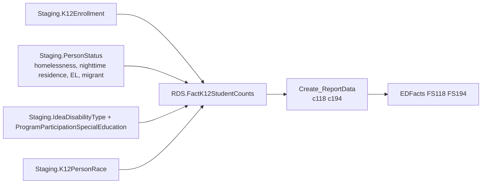

# Homeless

> [!info] Seam: both
> `Staging.K12Enrollment`, `Staging.PersonStatus`, and the other student-attribute staging tables are CEDS-specific; `RDS.FactK12StudentCounts` and the report/file layers are standard-agnostic.

Homeless counts students identified as homeless under McKinney-Vento, at SEA/LEA/school level, against two file specs: FS118 (Homeless Students Enrolled, an unduplicated count with demographic and program-status subgroups) and FS194 (Young Homeless Children Served — birth through age 5, served under McKinney-Vento Subtitle VII-B subgrants). The domain carries four **separate** homelessness elements on one dimension row — a plain yes/no homelessness flag, the student's primary nighttime residence type (shelter, doubled-up, unsheltered, hotel/motel), an unaccompanied-youth flag, and a "serviced" flag distinct from all three — plus the usual race/grade/age/IDEA/EL/migrant cross-tabs. Unaccompanied-youth status and nighttime-residence type are not the same element as the homelessness flag and must not be collapsed into it.

## Pipeline

| Item | Value |
|---|---|
| Wrapper | `App.Wrapper_Migrate_Homeless_to_RDS` — standard shape: `Staging-to-DimPeople_K12Students`, `DimSeas`, `DimLeas`, `DimK12Schools`, `RDS.Empty_RDS 'Homeless'` (capitalized, unlike other wrappers' lowercase calls — harmless under SQL Server's default case-insensitive collation), then the fact procedure per selected school year |
| Fact procedure | `Staging.Staging-to-FactK12StudentCounts_Homeless` (400 lines); header names files 118, 194 |
| Fact table | `RDS.FactK12StudentCounts` |
| Report dispatch | `RDS.Create_Reports`, branch `@factTypeCode = 'homeless'` → `RDS.Create_ReportData` |
| Report codes | `c118`, `c194` |
| File specs | FS118 Homeless Students Enrolled, FS194 Young Homeless Children Served (McKinney-Vento subgrants, ages birth–5) |

## Data elements required

| Element | Source staging column(s) | Category set role |
|---|---|---|
| Student identifier | `Staging.K12Enrollment.StudentIdentifierState` | identifier |
| LEA / School organization | `Staging.K12Enrollment.LeaIdentifierSeaAccountability`, `.SchoolIdentifierSea` | organization |
| Homelessness status | `Staging.PersonStatus.HomelessnessStatus` | filter — fact procedure requires `= 1` |
| Homeless primary nighttime residence type | `Staging.PersonStatus.HomelessNightTimeResidence` | category: NIGHTRESIDENCE |
| Homeless unaccompanied-youth status | `Staging.PersonStatus.HomelessUnaccompaniedYouth` | category: UNACCOMPANIED |
| Homeless serviced indicator (FS194) | `Staging.PersonStatus.HomelessServicedIndicator` | category: SERVICED |
| IDEA indicator & primary disability type | `Staging.ProgramParticipationSpecialEducation.IDEAIndicator`, `Staging.IdeaDisabilityType.IdeaDisabilityTypeCode` | category: DISABSTATIDEA / DISABCATIDEA |
| English learner status | `Staging.PersonStatus.EnglishLearnerStatus` | category: ELSTATUS |
| Migrant status | `Staging.PersonStatus.MigrantStatus` | category: MIGRANTSTATUS |
| Race/ethnicity (unduplicated) | `Staging.K12Enrollment.HispanicLatinoEthnicity`, `Staging.K12PersonRace` | category: RACE |
| Grade level | `Staging.K12Enrollment.GradeLevel` | category: GRADELEVEL |
| Age | `Staging.K12Enrollment.Birthdate` (via `RDS.Get_Age`) | category: AGE |

## Ed-Fi coverage (preliminary)

> [!warning] Preliminary — Ed-Fi 5.2 verdicts, not adjudicated

| Element | Verdict | Ed-Fi binding |
|---|---|---|
| Student identifier | Direct | `edFi_studentReference.studentUniqueId` |
| LEA / School organization | Direct | `edFi_school.schoolId` / `edFi_localEducationAgency.localEducationAgencyId` |
| Homelessness status | Direct | presence of an `edFi_studentHomelessProgramAssociation` record spanning the count date |
| Homeless primary nighttime residence type | Direct | `edFi_studentHomelessProgramAssociation.homelessPrimaryNighttimeResidenceDescriptor` |
| Homeless unaccompanied-youth status | Direct | `edFi_studentHomelessProgramAssociation.homelessUnaccompaniedYouth` |
| Homeless serviced indicator | Derivable | from `edFi_studentHomelessProgramAssociation.homelessProgramServices[]` being non-empty, or the linked `programReference`'s funding source being a McKinney-Vento subgrant |
| IDEA indicator | Direct | `edFi_studentSpecialEducationProgramEligibilityAssociation.ideaIndicator` |
| Primary disability type | Derivable | `edFi_studentSpecialEducationProgramAssociationDisability.disabilityDescriptor` where `orderOfDisability = 1` — no disability collection on the eligibility association |
| English learner status | Direct | `edFi_studentEducationOrganizationAssociation.limitedEnglishProficiencyDescriptor` |
| Migrant status | Direct | presence of an `edFi_studentMigrantEducationProgramAssociation` record |
| Race/ethnicity | Direct | `edFi_studentEducationOrganizationAssociation.races[]` + `.hispanicLatinoEthnicity` |
| Grade level | Direct | `edFi_studentSchoolAssociation.entryGradeLevelDescriptor` |
| Age | Derivable | from `edFi_student.birthDate` vs. the count date |

## Citations

- `generate.database/StoredProcedures/Create/App.Wrapper_Migrate_Homeless_to_RDS.StoredProcedure.sql@develop` line 43 — capitalized `Empty_RDS 'Homeless'` call
- `generate.database/StoredProcedures/Create/Staging.Staging-to-FactK12StudentCounts_Homeless.StoredProcedure.sql@develop`
- `generate.database/Views/Create/Debug.vwHomeless_StagingTables.View.sql@develop` — the four homelessness elements traced to `Staging.PersonStatus`
- `generate.database/Views/Create/Debug.vwHomeless_FactTable.View.sql@develop`
- `generate.database/Views/Create/RDS.vwDimHomelessnessStatuses.View.sql@develop` — the composite `DimHomelessnessStatusId` grain
- `generate.database/StoredProcedures/Create/RDS.Create_Reports.StoredProcedure.sql@develop` line 620 — homeless branch
- `generate.database/Metadata/App.CedsConnections.Metadata.sql@develop` — FS118/FS194 titles
