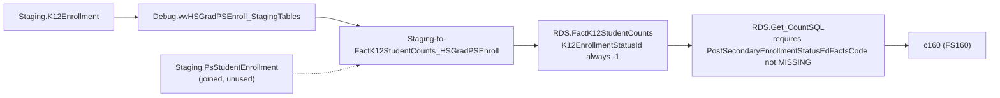

# HsGradPSEnroll

> [!info] Seam: both
> `Staging.K12Enrollment` is replaceable; `RDS.FactK12StudentCounts` and report generation are
> standard-agnostic — but the two halves do not visibly connect for this file spec (see below).

FS160 counts high school graduates who enrolled in postsecondary education, by SEA/LEA/school. It is
the narrowest domain in the repo: `Debug.vwHSGradPSEnroll_StagingTables` selects five identifier
columns from one table and nothing else — no diploma, no enrollment flag, no dates.

## Pipeline

| | |
|---|---|
| Wrapper | `App.Wrapper_Migrate_HsGradPSEnroll_to_RDS` (`Empty_RDS 'hsgradpsenroll'`) |
| Fact procedure | `Staging.Staging-to-FactK12StudentCounts_HSGradPSEnroll` — capital-S "HSGradPSEnroll"; wrapper spells it `HsGradPSEnroll` |
| Fact table | `RDS.FactK12StudentCounts` (`FactTypeCode = 'hsgradpsenroll'`) |
| Report code | `c160` |
| File spec | FS160 |
| Generator | Legacy path — `RDS.Create_ReportData` / `RDS.Get_CountSQL` |

**The fact procedure does not use the elements this brief expected, and does not filter its
population at all.** `Staging.K12Enrollment.PostSecondaryEnrollment` (bit) and
`DiplomaOrCredentialAwardDate` exist in the DDL but neither is referenced anywhere in
`Staging-to-FactK12StudentCounts_HSGradPSEnroll`. The procedure instead `LEFT JOIN`s a second,
undocumented staging table, `Staging.PsStudentEnrollment` (matched only by name and birthdate), but
projects none of its columns — and has no `WHERE` clause narrowing the population at all, so as
written it inserts one fact row per enrolled student, not per postsecondary-enrolled graduate.
Report generation (`RDS.Get_CountSQL`, `@reportCode = 'c160'`) expects eligibility to come from
`fact.K12EnrollmentStatusId` joined to `RDS.DimK12EnrollmentStatuses.PostSecondaryEnrollmentStatusEdFactsCode
<> 'MISSING'` — but the fact procedure hardcodes `K12EnrollmentStatusId = -1` for every row. The
dimension that would carry a real "enrolled"/"not enrolled" value is populated only by
`RDS.Migrate_DimK12EnrollmentStatuses`, an IDS-oriented procedure this fact load never calls. Follow
the source, not the brief's assumption: see Contradictions in the inventory.

## Data elements required

| Element | Source staging column(s) | Category set role |
|---|---|---|
| Student identifier | `Staging.K12Enrollment.StudentIdentifierState` | identifier |
| Organization | `LEAIdentifierSeaAccountability`, `SchoolIdentifierSea` | organization |
| Postsecondary enrollment flag | `Staging.K12Enrollment.PostSecondaryEnrollment` (declared, unused by the fact procedure) | identifier (intended) |
| Diploma award date | `Staging.K12Enrollment.DiplomaOrCredentialAwardDate` (declared, unused) | filter (intended) |
| Enrollment status (report-time filter) | `RDS.DimK12EnrollmentStatuses.PostSecondaryEnrollmentStatusEdFactsCode` | filter (never populated for this fact type) |

## Ed-Fi coverage (preliminary)

> [!warning] Preliminary — Ed-Fi 5.2 verdicts, not adjudicated

| Element | Verdict | Ed-Fi binding |
|---|---|---|
| Student identifier | Direct | `edFi_student.studentUniqueId` |
| Postsecondary enrollment | Derivable | `edFi_postSecondaryEvent` (`postSecondaryEventCategoryDescriptor` + `eventDate` + `postSecondaryInstitutionReference`) models postsecondary events per student/institution; whether the descriptor's value set distinguishes "enrolled" from "applied"/"accepted" can't be confirmed from the swagger schema alone |
| Diploma award date | Direct | `edFi_studentAcademicRecordDiploma.diplomaAwardDate` |

## Citations

- `generate.database/StoredProcedures/Create/App.Wrapper_Migrate_HsGradPSEnroll_to_RDS.StoredProcedure.sql@develop`
- `generate.database/StoredProcedures/Create/Staging.Staging-to-FactK12StudentCounts_HSGradPSEnroll.StoredProcedure.sql@develop` line 136 (hardcoded `K12EnrollmentStatusId`), lines 159–162 (unused `PsStudentEnrollment` join), lines 217–226 (last join runs straight into the insert — no `WHERE`)
- `generate.database/Views/Create/Debug.vwHSGradPSEnroll_StagingTables.View.sql@develop`
- `generate.database/Tables/Create/Staging.K12Enrollment.sql@develop` lines 31–32 — `PostSecondaryEnrollment`, `DiplomaOrCredentialAwardDate`
- `generate.database/Functions/Create/RDS.Get_CountSQL.UserDefinedFunction.sql@develop` lines 4011–4048 — `c160` eligibility join
- `generate.database/StoredProcedures/Create/RDS.Migrate_DimK12EnrollmentStatuses.StoredProcedure.sql@develop` lines 30–36 — where `PostSecondaryEnrollmentStatusCode` actually gets set

Related: [[Membership]], [[GraduatesCompleters]]
