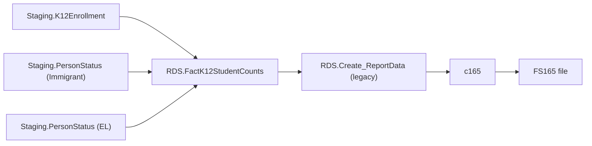

# Immigrant

> [!info] Seam: both
> `Staging.PersonStatus` and its `Staging-to-Fact*` join are CEDS-specific; `RDS.FactK12StudentCounts`
> and report generation downstream are standard-agnostic.

**FS165 — immigrant children and youth enrolled**, under the Title III statutory definition (age
3–21, not born in a US state, attended US schools fewer than three full academic years). The
narrowest domain in this batch: the fact procedure reads only two staging tables,
`Staging.K12Enrollment` and `Staging.PersonStatus`. Reported down to LEA/school level as an
unduplicated student count.

`App.CedsConnections.Metadata.sql` labels FS165 **"Migratory Data"** in every cached school-year
snapshot (SY2017-18 through SY2021-22). This conflicts with both the fact procedure's own header
("Migrates Immigrant Data... processes files: 165") and `RDS.Create_Reports`, which dispatches
`c165` only under `@factTypeCode = 'immigrant'` — never under `migranteducationprogram`. Both code
sources agree with each other and with this brief, so they are treated as authoritative here; the
CedsConnections text is flagged as a likely mislabeled historical CEDS Connect entry (see the
inventory's Contradictions section).

## Pipeline

| | |
|---|---|
| Wrapper | `App.Wrapper_Migrate_Immigrant_to_RDS` |
| Fact procedure | `Staging.Staging-to-FactK12StudentCounts_Immigrant` (`@SchoolYear`) |
| Fact table | `RDS.FactK12StudentCounts`, `FactTypeCode = 'immigrant'` (`DimFactTypeId = 14`) |
| Report code | `c165` — legacy only, `RDS.Create_ReportData` |
| File spec | FS165 |

## Data elements required

| Element | Source staging column(s) | Category set role |
|---|---|---|
| Student identifier | `Staging.K12Enrollment.StudentIdentifierState` | identifier |
| LEA / School identifier | `Staging.K12Enrollment.LEAIdentifierSeaAccountability` / `SchoolIdentifierSea` | organization |
| Immigrant program participation | `Staging.PersonStatus.ProgramType_Immigrant` + start/end dates | filter — defines the counted population |
| English learner status | `Staging.PersonStatus.EnglishLearnerStatus` | category: ELSTATUS |
| Native language | `Staging.PersonStatus.ISO_639_2_NativeLanguage` | category: LANGUAGE |
| Grade level | `Staging.K12Enrollment.GradeLevel` | category: GRADELEVEL |

*Category-set codes for c165 are not present in the cached `App.CategorySets*` seeds; roles above
are inferred from `Debug.vwImmigrant_FactTable`'s column list. `Staging.PersonStatus` carries only
the computed `ProgramType_Immigrant` flag, not the underlying statutory facts (age, birth
jurisdiction, years of US schooling) — Generate itself pushes that derivation upstream of Staging.*

## Ed-Fi coverage (preliminary)

> [!warning] Preliminary — Ed-Fi 5.2 verdicts, not adjudicated

| Element | Verdict | Ed-Fi binding |
|---|---|---|
| Student identifier | Direct | `edFi_studentReference.studentUniqueId` |
| Immigrant program participation | Absent | No `immigrant`-named property in any of the 471 core `edFi_*` schemas |
| Underlying statutory facts (age, birth jurisdiction, years in US schools) | Derivable | `edFi_student.birthDate` (age) + `.birthCountryDescriptor` (not born in a US state) + earliest `edFi_studentSchoolAssociation.entryDate` across a student's US enrollments (approximates years of US schooling) — approximation only; no stored "years in US schools" field exists in core |
| English learner status | Direct | `edFi_studentEducationOrganizationAssociation.limitedEnglishProficiencyDescriptor` |
| Native language | Direct | `edFi_studentEducationOrganizationAssociation.languages` |
| Grade level | Direct | `edFi_studentSchoolAssociation.entryGradeLevelDescriptor` |

## Citations

- `generate.database/StoredProcedures/Create/App.Wrapper_Migrate_Immigrant_to_RDS.StoredProcedure.sql@develop`
- `generate.database/StoredProcedures/Create/Staging.Staging-to-FactK12StudentCounts_Immigrant.StoredProcedure.sql@develop` lines 1–7, 149–169
- `generate.database/Views/Create/Debug.vwImmigrant_StagingTables.View.sql@develop`
- `generate.database/Views/Create/Debug.vwImmigrant_FactTable.View.sql@develop`
- `generate.database/StoredProcedures/Create/RDS.Create_Reports.StoredProcedure.sql@develop` lines 520–531
- `generate.database/Metadata/App.GenerateReports.Metadata.sql@develop` line 65 — `c165` file-spec seed
- `generate.database/Metadata/App.CedsConnections.Metadata.sql@develop` lines 7488, 11610, 13194, 14400, 15732 — the "Migratory Data" mislabel
