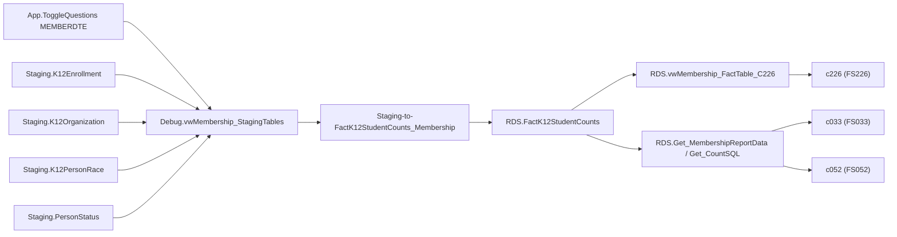

# Membership

> [!info] Seam: both
> `Staging.K12Enrollment` and its CEDS-coded companions are replaceable; `RDS.FactK12StudentCounts`,
> the fact-type dispatch, and the report generators are standard-agnostic and reusable as-is.

Membership is EDFacts' fall student-count collection: how many students were enrolled, as of one
snapshot date per year, sliced by grade (**FS052**), free/reduced lunch eligibility (**FS033**), and
economic disadvantage (**FS226**). All three file specs share one fact procedure and one fact table;
they differ only in which categories and organization levels get reported. Counts run at SEA, LEA,
and school level. Membership is the denominator most other collections (dropout rate, chronic
absenteeism rate) are built against — see [[Dropout]].

## Pipeline

| | |
|---|---|
| Wrapper | `App.Wrapper_Migrate_Membership_to_RDS` (6 steps: DimPeople, DimSeas, DimLeas, DimK12Schools, `Empty_RDS 'membership'`, fact load per selected year) |
| Fact procedure | `Staging.Staging-to-FactK12StudentCounts_Membership` |
| Fact table | `RDS.FactK12StudentCounts` (`FactTypeCode = 'membership'`) |
| Report codes | `c033` "Free and Reduced Price Lunch", `c052` "Membership", `c226` "Economically Disadvantaged Students" |
| File specs | FS033, FS052, FS226 |
| Generator | `c226` uses the current path, `RDS.Insert_CountsIntoReportTable` off `RDS.vwMembership_FactTable_C226`; `c033`/`c052` use the legacy `RDS.Get_CountSQL`, read via `RDS.Get_MembershipReportData` |

**The count date is a snapshot, not a span.** `Debug.vwMembership_StagingTables` computes one
`MembershipDate` per school year from the EMAPS toggle answer `MEMBERDTE` (month/day, applied to
`SchoolYear - 1`) — this is the "as of October 1" style count date. The fact procedure then keeps only
enrollment rows where `stage.MembershipDate BETWEEN stage.EnrollmentEntryDate AND
ISNULL(stage.EnrollmentExitDate, '1/1/9999')`: a student counts only if enrolled on that single date.

## Data elements required

| Element | Source staging column(s) | Category set role |
|---|---|---|
| Student identifier | `Staging.K12Enrollment.StudentIdentifierState` | identifier |
| Organization | `LEAIdentifierSeaAccountability`, `SchoolIdentifierSea` (+ SEA from `RDS.DimSeas`) | organization |
| Count date | EMAPS toggle `MEMBERDTE` vs. `EnrollmentEntryDate`/`EnrollmentExitDate` | filter |
| Sex | `Staging.K12Enrollment.Sex` | category: SEX |
| Grade level | `Staging.K12Enrollment.GradeLevel` | category: GRADELVMEM |
| Race/ethnicity | `Staging.K12PersonRace.RaceType`, `HispanicLatinoEthnicity` | category: RACEETHNIC |
| Economic disadvantage | `Staging.PersonStatus.EconomicDisadvantageStatus` | category: ECODIS (feeds c226) |
| FRL eligibility / direct cert | `EligibilityStatusForSchoolFoodServicePrograms`, `NationalSchoolLunchProgramDirectCertificationIndicator` | category: LUNCHPROG (feeds c033) |
| Title I program type | `Staging.K12Organization.LEA_TitleIProgramType` | category: TITLEIPROG |
| School operational status/type | `Staging.K12Organization.School_OperationalStatus`, `School_Type` | filter (c226 only) |

## Ed-Fi coverage (preliminary)

> [!warning] Preliminary — Ed-Fi 5.2 verdicts, not adjudicated

| Element | Verdict | Ed-Fi binding |
|---|---|---|
| Student identifier | Direct | `edFi_student.studentUniqueId` |
| Membership (as-of) count | Derivable | from `edFi_studentSchoolAssociation.entryDate` + `.exitWithdrawDate` — enrolled if the configured count date falls in the span |
| Sex | Direct | `edFi_studentEducationOrganizationAssociation.sexDescriptor` |
| Grade level | Direct | `edFi_studentSchoolAssociation.entryGradeLevelDescriptor` |
| Race/ethnicity | Direct | `edFi_studentEducationOrganizationAssociation.races`, `.hispanicLatinoEthnicity` |
| NSLP direct certification | Direct | `edFi_studentSchoolFoodServiceProgramAssociation.directCertification` |
| Economic disadvantage (overall) | Derivable | from active `edFi_studentSchoolFoodServiceProgramAssociation` participation; no single boolean equivalent |
| School operational status/type | Direct | `edFi_school.operationalStatusDescriptor`, `.schoolTypeDescriptor` |

## Citations

- `generate.database/StoredProcedures/Create/App.Wrapper_Migrate_Membership_to_RDS.StoredProcedure.sql@develop`
- `generate.database/StoredProcedures/Create/Staging.Staging-to-FactK12StudentCounts_Membership.StoredProcedure.sql@develop` lines 32–58, 249 — count-date toggle and filter
- `generate.database/Views/Create/Debug.vwMembership_StagingTables.View.sql@develop` lines 34–45 — `MembershipDate` derivation
- `generate.database/Views/Create/Debug.vwMembership_FactTable.View.sql@develop`
- `generate.database/Views/Create/RDS.vwMembership_FactTable_C226.View.sql@develop`
- `generate.database/Views/Create/Staging.vwMembership_StagingTables_C226.View.sql@develop`
- `generate.database/StoredProcedures/Create/RDS.Get_MembershipReportData.StoredProcedure.sql@develop`
- `generate.database/Metadata/App.GenerateReports.Metadata.sql@develop` lines 394, 461, 1136 — report names
- `generate.database/Metadata/App.Categories.Metadata.sql@develop` line 554 — `GRADELVMEM`

Related: [[Dropout]], [[GraduatesCompleters]], [[App-Metadata-Layer]], [[Staging-Layer]]
