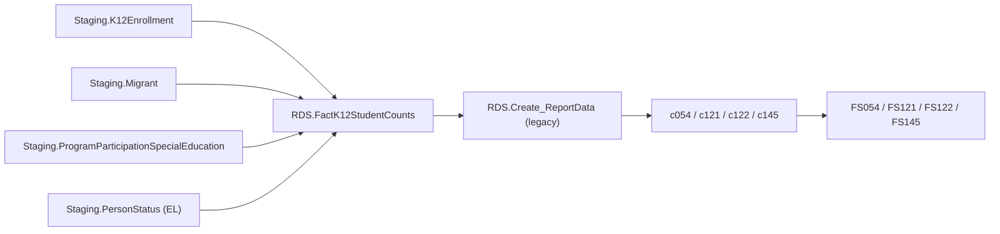

# MigrantEducationProgram

> [!info] Seam: both
> `Staging.Migrant` and its `Staging-to-Fact*` join are CEDS-specific; `RDS.FactK12StudentCounts`
> and report generation downstream are standard-agnostic.

Title I, Part C — the Migrant Education Program (MEP). Four file specs, one fact procedure:
**FS121** (Migratory Students Eligible), **FS054** (MEP Students Served), **FS122** (MEP Eligible
and Served — Summer/Intersession), and **FS145** (MEP Services). Together they split the MEP
population into eligibility, services-received, and priority-for-services axes. All four count
K-12 students at SEA/LEA level over the MEP performance period — 12 months, September 1 to August
31 of `@SchoolYear`, per the age-calculation comment in the lineage view.

## Pipeline

| | |
|---|---|
| Wrapper | `App.Wrapper_Migrate_MigrantEducationProgram_to_RDS` |
| Fact procedure | `Staging.Staging-to-FactK12StudentCounts_MigrantEducationProgram` (`@SchoolYear`) |
| Fact table | `RDS.FactK12StudentCounts`, `FactTypeCode = 'migranteducationprogram'` (`DimFactTypeId = 13`) |
| Report codes | `c054`, `c121`, `c122`, `c145` — all legacy, `RDS.Create_ReportData` |
| File specs | FS054, FS121, FS122, FS145 |

Of the six domains in this batch, this one maps to Ed-Fi's data model the most cleanly:
`edFi_studentMigrantEducationProgramAssociation` is a near 1:1 semantic match for
`Staging.Migrant`, down to individual field names.

## Data elements required

| Element | Source staging column(s) | Category set role |
|---|---|---|
| Student identifier | `Staging.K12Enrollment.StudentIdentifierState` | identifier |
| LEA / School identifier | `Staging.K12Enrollment.LEAIdentifierSeaAccountability` / `SchoolIdentifierSea` | organization |
| Migrant status (eligibility) | `Staging.Migrant.MigrantStatus` | filter |
| Qualifying arrival date | `Staging.Migrant.MigrantStudentQualifyingArrivalDate` | filter |
| Last qualifying move date | `Staging.Migrant.LastQualifyingMoveDate` | filter |
| Continuation-of-services reason | `Staging.Migrant.ContinuationOfServicesReason` | category: MEPCONTSERV |
| Priority for services | `Staging.Migrant.MigrantPrioritizedForServices` | category: MEPPRIORITY |
| MEP enrollment / services type | `Staging.Migrant.MigrantEducationProgramEnrollmentType` / `ServicesType` | category: MEPSERVICE |
| Age (MEP performance-period) | `Staging.K12Enrollment.BirthDate` via `RDS.Get_Age` | category: AGE |

*Category-set codes for c054/c121/c122/c145 are not present in the cached `App.CategorySets*`
seeds; roles above are inferred from `Debug.vwMigrantEducationProgram_FactTable`'s column list.*

## Ed-Fi coverage (preliminary)

> [!warning] Preliminary — Ed-Fi 5.2 verdicts, not adjudicated

| Element | Verdict | Ed-Fi binding |
|---|---|---|
| Student identifier | Direct | `edFi_studentReference.studentUniqueId` |
| Migrant status / eligibility | Direct | Presence of `edFi_studentMigrantEducationProgramAssociation` (+ `.eligibilityExpirationDate`) |
| Qualifying arrival date | Direct | `edFi_studentMigrantEducationProgramAssociation.qualifyingArrivalDate` |
| Last qualifying move date | Direct | `edFi_studentMigrantEducationProgramAssociation.lastQualifyingMove` |
| Continuation-of-services reason | Direct | `edFi_studentMigrantEducationProgramAssociation.continuationOfServicesReasonDescriptor` |
| Priority for services | Direct | `edFi_studentMigrantEducationProgramAssociation.priorityForServices` |
| MEP services type | Direct | `edFi_studentMigrantEducationProgramAssociationMigrantEducationProgramService.migrantEducationProgramServiceDescriptor` |
| MEP enrollment type (e.g. currently/formerly migratory) | Absent | Only the generic `programParticipationStatuses` collection exists; no MEP-specific enrollment-type descriptor |
| Age | Derivable | computed from `edFi_student.birthDate` at the MEP performance-period reference date; `birthDate` itself is Direct, age is not stored |

## Citations

- `generate.database/StoredProcedures/Create/App.Wrapper_Migrate_MigrantEducationProgram_to_RDS.StoredProcedure.sql@develop`
- `generate.database/StoredProcedures/Create/Staging.Staging-to-FactK12StudentCounts_MigrantEducationProgram.StoredProcedure.sql@develop`
- `generate.database/Views/Create/Debug.vwMigrantEducationProgram_StagingTables.View.sql@develop` lines 12–14, 30–36 (performance-period age rule)
- `generate.database/Views/Create/Debug.vwMigrantEducationProgram_FactTable.View.sql@develop`
- `generate.database/StoredProcedures/Create/RDS.Create_Reports.StoredProcedure.sql@develop` lines 479–518
- `generate.database/Metadata/App.CedsConnections.Metadata.sql@develop` — FS054/FS121/FS122/FS145 titles
