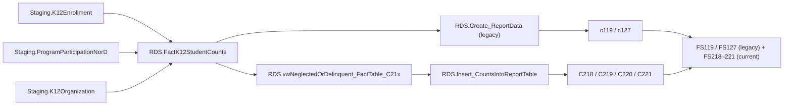

# NeglectedOrDelinquent

> [!info] Seam: both
> `Staging.ProgramParticipationNorD`/`K12Organization` and the `Staging-to-Fact*` join are
> CEDS-specific; `RDS.FactK12StudentCounts` and report generation downstream are standard-agnostic.

Title I, Part D — Neglected or Delinquent programs. Legacy specs **FS119** (state-agency
Neglected/Delinquent participation) and **FS127** (LEA Delinquent/At-Risk participation) run on
`RDS.Create_ReportData`; the current specs **C218–C221** run on `RDS.Insert_CountsIntoReportTable`
and split two independent axes — Subpart 1 (state agency) vs. Subpart 2 (LEA), and in-program vs.
post-exit outcomes:

| Report | Subpart | Outcome window |
|---|---|---|
| C218 | 1 — State agency | Academic/CTE outcome while enrolled |
| C219 | 2 — LEA | Academic/CTE outcome while enrolled |
| C220 | 1 — State agency | Academic/CTE outcome within 90 days after exit |
| C221 | 2 — LEA | Academic/CTE outcome within 90 days after exit |

## Pipeline

| | |
|---|---|
| Wrapper | `App.Wrapper_Migrate_NeglectedOrDelinquent_to_RDS` |
| Fact procedure | `Staging.Staging-to-FactK12StudentCounts_NeglectedOrDelinquent` (`@SchoolYear`) |
| Fact table | `RDS.FactK12StudentCounts`, `FactTypeCode = 'neglectedordelinquent'` (`DimFactTypeId = 15`) |
| Report codes | `c119`, `c127` — legacy; `C218`, `C219`, `C220`, `C221` — current, each off its own `RDS.vwNeglectedOrDelinquent_FactTable_C2xx` |
| File specs | FS119, FS127 (legacy; FS180/FS181 also appear in `RDS.Get_FactTypeByReport`'s legacy map); FS218–FS221 (current) |

The fine-grained `NeglectedProgramType`/`DelinquentProgramType`/`NeglectedOrDelinquentProgramType`
columns matter only on the legacy FS119/FS127 path — the fact procedure's own comment says the
current C218–C221 rows default all three to `'MISSING'` and key solely on
`NeglectedOrDelinquentProgramEnrollmentSubpart` (state agency vs. LEA).

## Data elements required

| Element | Source staging column(s) | Category set role |
|---|---|---|
| Student identifier | `Staging.K12Enrollment.StudentIdentifierState` | identifier |
| LEA identifier | `Staging.K12Enrollment.LEAIdentifierSeaAccountability` | organization |
| N or D status flag | `Staging.ProgramParticipationNorD.NeglectedOrDelinquentStatus` | filter |
| Subpart (state agency vs. LEA) | `Staging.ProgramParticipationNorD.NeglectedOrDelinquentProgramEnrollmentSubpart` | filter — selects C218/C220 vs. C219/C221 |
| N or D program type (legacy only) | `Staging.ProgramParticipationNorD.NeglectedOrDelinquentProgramType` (+ `NeglectedProgramType`, `DelinquentProgramType`) | category — FS119/FS127 only |
| Academic/CTE outcome type | `Staging.ProgramParticipationNorD.EdFactsAcademicOrCareerAndTechnicalOutcomeType` | category — C218/C219's disaggregation |
| Academic/CTE outcome exit type | `Staging.ProgramParticipationNorD.EdFactsAcademicOrCareerAndTechnicalOutcomeExitType` | category — C220/C221's disaggregation |
| Reading/Math progress level | `Staging.ProgramParticipationNorD.ProgressLevel_Reading` / `_Math` | category |
| LEA operational status | `Staging.K12Organization.LEA_OperationalStatus` (via `SourceSystemReferenceData`) | filter — excludes closed/inactive/future LEAs |

## Ed-Fi coverage (preliminary)

> [!warning] Preliminary — Ed-Fi 5.2 verdicts, not adjudicated

| Element | Verdict | Ed-Fi binding |
|---|---|---|
| Student identifier | Direct | `edFi_studentReference.studentUniqueId` |
| N or D program participation (existence) | Direct | Presence of `edFi_studentNeglectedOrDelinquentProgramAssociation` |
| Subpart / program type | Direct | `.neglectedOrDelinquentProgramDescriptor` — description explicitly covers "Subpart 1 (state programs) or Subpart 2 (LEA)" |
| Academic/CTE outcome services | Direct | `.neglectedOrDelinquentProgramServices` → `...NeglectedOrDelinquentProgramService.neglectedOrDelinquentProgramServiceDescriptor` |
| Reading progress level | Direct | `edFi_studentNeglectedOrDelinquentProgramAssociation.elaProgressLevelDescriptor` |
| Math progress level | Direct | `edFi_studentNeglectedOrDelinquentProgramAssociation.mathematicsProgressLevelDescriptor` |
| Facility/institution type (state institution vs. adult correctional vs. juvenile detention) | Absent | No facility or institution concept anywhere in core 5.2.0 (471 schemas searched) |
| LEA operational status | Direct | `edFi_localEducationAgency.operationalStatusDescriptor` |

## Citations

- `generate.database/StoredProcedures/Create/App.Wrapper_Migrate_NeglectedOrDelinquent_to_RDS.StoredProcedure.sql@develop`
- `generate.database/StoredProcedures/Create/Staging.Staging-to-FactK12StudentCounts_NeglectedOrDelinquent.StoredProcedure.sql@develop` lines 1–37 (file-spec map), 255–265 (current path defaults program type to MISSING), 310–312
- `generate.database/Functions/Create/RDS.Get_FactTypeByReport.UserDefinedFunction.sql@develop` line 85 — `c180`/`c181` in the legacy fact-type map
- `generate.database/Views/Create/Debug.vwNeglectedOrDelinquent_StagingTables.View.sql@develop`
- `generate.database/Views/Create/Debug.vwNeglectedOrDelinquent_FactTable.View.sql@develop`
- `generate.database/Views/Create/RDS.vwNeglectedOrDelinquent_FactTable_C218.View.sql@develop`
- `generate.database/Views/Create/RDS.vwNeglectedOrDelinquent_FactTable_C219.View.sql@develop`
- `generate.database/Views/Create/RDS.vwNeglectedOrDelinquent_FactTable_C220.View.sql@develop`
- `generate.database/Views/Create/RDS.vwNeglectedOrDelinquent_FactTable_C221.View.sql@develop`
- `generate.database/StoredProcedures/Create/RDS.Create_Reports.StoredProcedure.sql@develop` lines 532–619
- `generate.database/Metadata/App.GenerateReports.Metadata.sql@develop` lines 896–988 — C218–C221 report names
