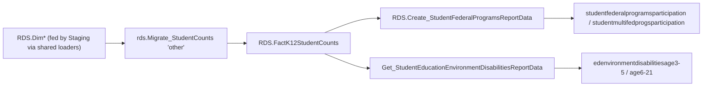

# Other

> [!info] Seam: both
> Same shape as [[SPPAPR]]: no staging procedure of its own. It cross-tabulates statuses already
> captured in `Staging.*` for other domains (CEDS-specific) through the generic, metadata-driven
> report builders below (standard-agnostic).

Generate's cross-program analysis reports — not EDFacts file submissions, so **no FS### applies**.
Two report families: federal-program participation cross-tabs, and IDEA educational-environment by
disability, split by age band. Because there is no file layout to document, the Ed-Fi coverage table
below is about the underlying elements, not a column-by-column file spec.

## Pipeline

| Stage | Object |
|---|---|
| Wrapper | `App.Wrapper_Migrate_Other_to_RDS` — legacy shape, same as [[SPPAPR]]: calls `rds.Migrate_DimK12Students`/`DimSeas`/`DimLeas`/`DimK12Schools` directly, then `rds.Empty_RDS 'other'`, then `rds.Migrate_StudentCounts 'other', 0` |
| Fact table | `RDS.FactK12StudentCounts` |
| Federal programs | `studentfederalprogramsparticipation`, `studentmultifedprogsparticipation` → `RDS.Create_ReportData` + `RDS.Create_StudentFederalProgramsReportData`; read back by `RDS.Get_StudentFederalProgramsReportData` |
| Ed. environment | `edenvironmentdisabilitiesage3-5`, `edenvironmentdisabilitiesage6-21` → `RDS.Create_ReportData`, read back by `RDS.Get_StudentEducationEnvironmentDisabilitiesReportData` |

Both report builders resolve their cross-tab dimensions from `app.Dimensions`/`Category_Dimensions`/
`CategorySets` at run time — the fixed temp-table schema in `Create_StudentFederalProgramsReportData`
is the ceiling of what it can hold, not a per-run guarantee.

## Data elements required

| Element | Source staging column(s) | Category set role |
|---|---|---|
| Organization identifiers (SEA/LEA) | `RDS.Dim*` (fed by `Staging.K12Organization` via shared loaders) | organization |
| Title I school status | see [[TitleI]] | category: TITLEISCHOOLSTATUS |
| Title III immigrant participation status | see [[Immigrant]] | category: TITLEIIIIMMIGRANTPARTICIPATIONSTATUS |
| Migrant status | see [[MigrantEducationProgram]] | category: MIGRANTSTATUS |
| CTE program participation | see [[CTE]] | category: CTEPROGRAM |
| School food service eligibility (NSLP) | `Staging.PersonStatus` (column outside this domain's assigned reads) | category: ELIGIBILITYSTATUSFORSCHOOLFOODSERVICEPROGRAM |
| Section 504 status | `Staging.PersonStatus` (column outside this domain's assigned reads) | category: SECTION504STATUS |
| Foster care status | `Staging.PersonStatus.ProgramType_FosterCare` | category: FOSTERCAREPROGRAM |
| Homelessness status | see [[Homeless]] | category: HOMELESSNESSSTATUS |
| English learner status | `Staging.PersonStatus.EnglishLearnerStatus` | category: ELSTATUS |
| IDEA indicator | `Staging.ProgramParticipationSpecialEducation.IdeaIndicator` | filter (`WDIS`/`WODIS`; excluded from the cross-tab dimension list itself) |
| IDEA educational environment (age 3–5 / 6–21) | same as [[ChildCount]] | category: IDEAEDUCENV, pivoted by age band |
| Primary disability type | same as [[ChildCount]] | category: DISABCATIDEA |
| Student count | one row per matched combination | measure |

## Ed-Fi coverage (preliminary)

> [!warning] Preliminary — Ed-Fi 5.2 verdicts, not adjudicated

| Element | Verdict | Ed-Fi binding |
|---|---|---|
| Organization identifiers | Direct | `edFi_localEducationAgency.localEducationAgencyId` / `edFi_school.schoolId` |
| Title I school status | Direct | presence of `edFi_studentTitleIPartAProgramAssociation` |
| Title III immigrant participation status | Absent | no "immigrant" property or schema anywhere in core Ed-Fi 5.2.0 |
| Migrant status | Direct | presence of `edFi_studentMigrantEducationProgramAssociation` |
| CTE program participation | Direct | presence of `edFi_studentCTEProgramAssociation` |
| School food service eligibility | Direct | presence of `edFi_studentSchoolFoodServiceProgramAssociation` |
| Section 504 status | Direct | presence of an `edFi_studentSection504ProgramAssociation` (carries `section504Eligibility`) |
| Foster care status | Absent | Core 5.2.0 has no foster-care program association or characteristic; only `edFi_studentHomelessProgramAssociation.awaitingFosterCare` exists, scoped to McKinney-Vento awaiting-placement. Representable only by extending `studentCharacteristicDescriptor`, which ships no foster-care value |
| Homelessness status | Direct | presence of `edFi_studentHomelessProgramAssociation` |
| English learner status | Direct | `edFi_studentEducationOrganizationAssociation.limitedEnglishProficiencyDescriptor` |
| IDEA indicator | Direct | `edFi_studentSpecialEducationProgramEligibilityAssociation.ideaIndicator` |
| IDEA educational environment | Direct | `edFi_studentSpecialEducationProgramAssociation.specialEducationSettingDescriptor` |
| Primary disability type | Derivable | `edFi_studentSpecialEducationProgramAssociationDisability.disabilityDescriptor` where `orderOfDisability = 1` |
| Student count | Derivable | count of matched rows; not a stored element |

## Citations

- `generate.database/StoredProcedures/Create/App.Wrapper_Migrate_Other_to_RDS.StoredProcedure.sql@develop`
- `generate.database/StoredProcedures/Create/RDS.Create_StudentFederalProgramsReportData.StoredProcedure.sql@develop` lines 32–48, 190–260
- `generate.database/StoredProcedures/Create/RDS.Get_StudentFederalProgramsReportData.StoredProcedure.sql@develop`
- `generate.database/StoredProcedures/Create/RDS.Get_StudentEducationEnvironmentDisabilitiesReportData.StoredProcedure.sql@develop` lines 48–63, 278, 387
- `generate.database/StoredProcedures/Create/RDS.Create_Reports.StoredProcedure.sql@develop` — `if @factTypeCode = 'other'` branch
