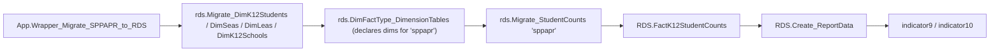

# SPPAPR

> [!info] Seam: both
> SPPAPR has no staging procedure of its own — it consumes already-populated `RDS.Dim*` tables
> (themselves fed from `Staging.*` by shared dimension loaders) through a generic, metadata-driven
> counting engine. The dimension data is CEDS-sourced; the counting engine is standard-agnostic.

IDEA State Performance Plan / Annual Performance Report indicators 9 and 10: the percent of
districts with disproportionate representation of racial/ethnic groups in special education overall
(9) and in specific disability categories (10), attributable to inappropriate identification.
Submitted to OSEP separately from EDFacts file specs — **no FS### applies**. LEA level.

## Pipeline

This wrapper is on the **previous architecture** — one of only four domains like this (with
[[Other]], CTE, and StudentCounts). There is no `Staging-to-Fact*` procedure and no `Debug.vw*`
lineage view.

| Stage | Object |
|---|---|
| Wrapper | `App.Wrapper_Migrate_SPPAPR_to_RDS` — calls the shared dim loaders directly (`rds.Migrate_DimK12Students`, `Migrate_DimSeas`, `Migrate_DimLeas`, `Migrate_DimK12Schools`), not the `Staging.Staging-to-Dim*` wrappers the other domains use |
| Fact load | `rds.Empty_RDS 'sppapr'` then `rds.Migrate_StudentCounts 'sppapr', 0` |
| Fact table | `RDS.FactK12StudentCounts` |
| Report codes | `indicator9`, `indicator10`, both via `RDS.Create_ReportData` (legacy path) |

`RDS.Migrate_StudentCounts` contains no `Staging.*` reference at all — it reads only `RDS.Dim*`
tables, choosing which dimensions to join per fact type from `rds.DimFactType_DimensionTables` (a
metadata table, not a hardcoded branch). Its per-fact-type behavior is declared, matching the
[[App-Metadata-Layer]] pattern, even though the procedure predates the `Staging-to-Fact*` generation.

## Data elements required

| Element | Source staging column(s) | Category set role |
|---|---|---|
| Student identifier | `RDS.DimPeople` (from `Staging.K12Enrollment`, via shared dim loader) | identifier |
| LEA identifier | `RDS.DimLeas` (from `Staging.K12Organization`, via shared dim loader) | organization |
| IDEA indicator | `RDS.DimIdeaStatuses` (from `Staging.ProgramParticipationSpecialEducation.IdeaIndicator`) | filter (scopes both indicators to IDEA-eligible students) |
| Primary disability type | `RDS.DimIdeaDisabilityTypes` (from `Staging.IdeaDisabilityType.IdeaDisabilityTypeCode`, `IsPrimaryDisability = 1`) | category: DISABCATIDEA (indicator10 only) |
| Race/ethnicity | `RDS.DimRaces` (from `Staging.K12PersonRace.RaceType`, `Staging.K12Enrollment.HispanicLatinoEthnicity`) | category: RACE |
| Disproportionate-representation ratio | not a stored column — computed at report-generation time | measure (percent of LEAs, not a headcount) |

## Ed-Fi coverage (preliminary)

> [!warning] Preliminary — Ed-Fi 5.2 verdicts, not adjudicated

| Element | Verdict | Ed-Fi binding |
|---|---|---|
| Student identifier | Direct | `edFi_student.studentUniqueId` |
| LEA identifier | Direct | `edFi_localEducationAgency.localEducationAgencyId` |
| IDEA indicator | Direct | `edFi_studentSpecialEducationProgramEligibilityAssociation.ideaIndicator` |
| Primary disability type | Derivable | `edFi_studentSpecialEducationProgramAssociationDisability.disabilityDescriptor` where `orderOfDisability = 1` |
| Race/ethnicity | Direct | `edFi_studentEducationOrganizationAssociationRace.raceDescriptor` + `.hispanicLatinoEthnicity` |
| Disproportionate-representation ratio | Absent | a computed policy metric (districts crossing a statistical threshold); no standard stores it directly |

## Citations

- `generate.database/StoredProcedures/Create/App.Wrapper_Migrate_SPPAPR_to_RDS.StoredProcedure.sql@develop`
- `generate.database/StoredProcedures/Create/RDS.Migrate_StudentCounts.StoredProcedure.sql@develop` lines 1–60, 380–390
- `generate.database/StoredProcedures/Create/RDS.Create_Reports.StoredProcedure.sql@develop` — `if @factTypeCode = 'sppapr'` branch
- `generate.database/Metadata/App.CedsConnections.Metadata.sql@develop` — Indicator 9/10 descriptions
- `generate.database/StoredProcedures/Create/RDS.Empty_RDS.StoredProcedure.sql@develop`
