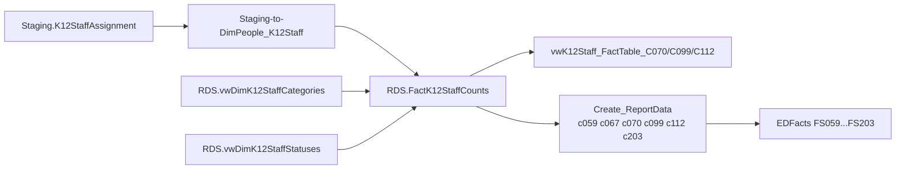

# Staff

> [!info] Seam: both
> `Staging.K12StaffAssignment` is CEDS-specific; `RDS.FactK12StaffCounts` and the report/file layers are standard-agnostic.

Staff counts K-12 staff FTE and, for one spec, headcount: general staff FTE by classification (FS059), special-education teacher/related-services/paraprofessional FTE by IDEA age group (FS070/FS099/FS112), all-teacher FTE (FS203), and Title III teacher headcount (FS067). It is the only person-level domain that is not about students, and — unusually for this pipeline — it reads exactly one staging table, `Staging.K12StaffAssignment`. `RDS.FactK12StaffCounts` carries both a `StaffCount` and a `StaffFullTimeEquivalency` column; which one a report sums depends on the spec, not the table.

## Pipeline

| Item | Value |
|---|---|
| Wrapper | `App.Wrapper_Migrate_Staff_to_RDS` — loads `DimPeople_K12Staff` (not `_K12Students`), `DimSeas`, `DimLeas`, `DimK12Schools`, then `RDS.Empty_RDS 'staff'`, then the fact procedure per selected school year |
| Fact procedure | `Staging.Staging-to-FactK12StaffCounts` (189 lines) |
| Fact table | `RDS.FactK12StaffCounts` — carries both `StaffCount` (always 1) and `StaffFullTimeEquivalency` |
| Per-report-code views | `RDS.vwK12Staff_FactTable_C070/C099/C112` state each spec's FTE-floor and category filters directly, but `RDS.Create_Reports` still routes all six staff report codes through the legacy `RDS.Create_ReportData`/`Get_CountSQL` builder, not through these views |
| Report codes | `c059 c067 c070 c099 c112 c203` |
| File specs | FS059 Staff FTE, FS070 Special Ed Teachers FTE, FS099 Special Ed Related-Services Personnel FTE, FS112 Special Ed Paraprofessionals FTE, FS203 Teachers FTE, FS067 Title III Teachers — **unduplicated headcount, not FTE** |

## Data elements required

| Element | Source staging column(s) | Category set role |
|---|---|---|
| Staff identifier | `Staging.K12StaffAssignment.StaffMemberIdentifierState` | identifier |
| LEA identifier | `Staging.K12StaffAssignment.LeaIdentifierSea` | organization |
| School identifier | `Staging.K12StaffAssignment.SchoolIdentifierSea` | organization |
| Staff name & birthdate (DimPeople match key) | `Staging.K12StaffAssignment.FirstName`, `.LastOrSurname`, `.MiddleName`, `.BirthDate` | identifier |
| Full-time equivalency | `Staging.K12StaffAssignment.FullTimeEquivalency` | measure |
| Staff classification | `Staging.K12StaffAssignment.K12StaffClassification` | category: K12STAFFCLASS |
| Special education staff category | `Staging.K12StaffAssignment.SpecialEducationStaffCategory` | category: SPECEDSTAFFCAT |
| Title I program staff category | `Staging.K12StaffAssignment.TitleIProgramStaffCategory` | category: TITLEISTAFFCAT |
| Special education age group taught | `Staging.K12StaffAssignment.SpecialEducationAgeGroupTaught` | category: AGEGROUP |
| EdFacts certification status | `Staging.K12StaffAssignment.EdFactsCertificationStatus` | category: CERTSTATUS |
| Special education teacher qualification status | `Staging.K12StaffAssignment.SpecialEducationTeacherQualificationStatus` | category: QUALSTATUS |
| Paraprofessional qualification status | `Staging.K12StaffAssignment.ParaprofessionalQualificationStatus` | category: PARAQUALSTATUS |
| Teaching credential type + issuance/expiration dates | `Staging.K12StaffAssignment.TeachingCredentialType`, `.CredentialIssuanceDate`, `.CredentialExpirationDate` | category: CREDTYPE |
| Highly-qualified teacher indicator | `Staging.K12StaffAssignment.HighlyQualifiedTeacherIndicator` | category: HQSTATUS |
| Teacher inexperienced & out-of-field status | `Staging.K12StaffAssignment.EdFactsTeacherInexperiencedStatus`, `.EDFactsTeacherOutOfFieldStatus` | category: EXPERIENCE |
| Assignment start/end date | `Staging.K12StaffAssignment.AssignmentStartDate`, `.AssignmentEndDate` | filter |
| Title III teacher status (FS067) | `RDS.FactK12StaffCounts.TitleIIIStatusId` (hardcoded -1 by this procedure — no populating source) | category: TITLEIIISTATUS |

## Ed-Fi coverage (preliminary)

> [!warning] Preliminary — Ed-Fi 5.2 verdicts, not adjudicated

| Element | Verdict | Ed-Fi binding |
|---|---|---|
| Staff identifier | Direct | `edFi_staff.staffUniqueId` |
| LEA/School identifier | Direct | `edFi_localEducationAgency.localEducationAgencyId` / `edFi_school.schoolId`, via `staffEducationOrganizationAssignmentAssociation.educationOrganizationReference` |
| Staff name & birthdate | Direct | `edFi_staff.firstName` + `.lastSurname` + `.middleName` + `.birthDate` |
| Full-time equivalency | Direct | `edFi_staffEducationOrganizationAssignmentAssociation.fullTimeEquivalency` |
| Staff classification | Direct | `edFi_staffEducationOrganizationAssignmentAssociation.staffClassificationDescriptor` |
| Special education staff category | Absent | no special-education staff sub-category property in core |
| Title I program staff category | Absent | no Title I staff-role property in core |
| Special education age group taught | Absent | no age-band-served property for staff in core |
| EdFacts certification status | Absent | `credentialTypeDescriptor` names a credential type, not a certified/not-certified determination |
| Special education teacher qualification status | Absent | no qualification-status property in core |
| Paraprofessional qualification status | Absent | no paraprofessional-specific property in core |
| Teaching credential type + issuance/expiration dates | Direct | `edFi_credential.teachingCredentialDescriptor`, `.issuanceDate`, `.expirationDate`, via `staffEducationOrganizationAssignmentAssociation.credentialReference` |
| Highly-qualified teacher indicator | Direct | `edFi_staff.highlyQualifiedTeacher` |
| Teacher inexperienced & out-of-field status | Derivable | inexperienced status from `edFi_staff.yearsOfPriorTeachingExperience` vs. a state-defined threshold; out-of-field has no core property at all |
| Assignment start/end date | Direct | `edFi_staffEducationOrganizationAssignmentAssociation.beginDate` / `.endDate` |
| Title III teacher status | Derivable | from `edFi_staffProgramAssociation.programReference` → `edFi_program.programTypeDescriptor` (Title III/Language Instruction), combined with `staffClassificationDescriptor` = Teacher |

## Citations

- `generate.database/StoredProcedures/Create/App.Wrapper_Migrate_Staff_to_RDS.StoredProcedure.sql@develop`
- `generate.database/StoredProcedures/Create/Staging.Staging-to-FactK12StaffCounts.StoredProcedure.sql@develop`
- `generate.database/Views/Create/Debug.vwK12Staff_StagingTables.View.sql@develop` — full staging column list
- `generate.database/Views/Create/Debug.vwK12Staff_FactTable.View.sql@develop`
- `generate.database/Views/Create/RDS.vwK12Staff_FactTable_C070.View.sql@develop`, `_C099.View.sql@develop`, `_C112.View.sql@develop` — FTE-floor and category rules per spec
- `generate.database/Views/Create/RDS.vwDimK12StaffCategories.View.sql@develop`
- `generate.database/Views/Create/RDS.vwDimK12StaffStatuses.View.sql@develop`
- `generate.database/StoredProcedures/Create/RDS.Create_Reports.StoredProcedure.sql@develop` lines 1069–1130 — staff branch
- `generate.database/Metadata/App.CedsConnections.Metadata.sql@develop` — file-spec titles (FS059, FS067, FS070, FS099, FS112, FS203)
