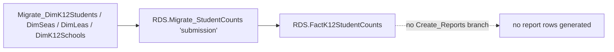

# StudentCounts

> [!info] Seam: both
> Whatever staging tables end up feeding it are CEDS-specific; `RDS.FactK12StudentCounts` is standard-agnostic. In practice almost nothing is wired to this fact type.

`submission` is the catch-all fact type, not a named EDFacts collection. Per the commented-out legacy block in `RDS.Get_FactTypeByReport`, it is the `else` fallback for any report code that matches none of the other fact types' lists. Confirmed directly: `RDS.Create_Reports` has **no** `if @factTypeCode = 'submission'` branch anywhere in the 1,368-line procedure, so even if facts were migrated under this fact type, nothing would ever turn them into report rows. It is a legacy-shaped wrapper — same pattern as [[CTE]] — calling the same shared `RDS.Migrate_StudentCounts`. Which dimensions that shared procedure populates for a given fact type is itself metadata-driven, via `rds.DimFactType_DimensionTables`; nothing in this cache confirms any dimension is registered for `submission`, so treat its per-student output as the bare identifier/organization/count-date skeleton every fact type gets, with every categorical column defaulted to `-1`/`MISSING`.

## Pipeline

| Item | Value |
|---|---|
| Wrapper | `App.Wrapper_Migrate_StudentCounts_to_RDS` — **legacy shape**, same as CTE/SPPAPR/Other |
| Empty call | `exec [rds].[Empty_RDS] 'submission', 'studentcounts'` — **two arguments**, but `RDS.Empty_RDS` declares only one parameter (`@factTypeCode`) — an arity mismatch, see Contradictions |
| Fact load | `exec [rds].[Migrate_StudentCounts] 'submission', 0` |
| Fact table | `RDS.FactK12StudentCounts` |
| Report dispatch | **None.** No `if @factTypeCode = 'submission'` branch in `RDS.Create_Reports.StoredProcedure.sql` |
| Report codes | **None** |
| File specs | **None** |

## Data elements required

| Element | Source staging column(s) | Category set role |
|---|---|---|
| Student identifier | not separately declared — resolved through the shared `Migrate_DimK12Students` load `RDS.Migrate_StudentCounts` always runs | identifier |
| LEA / School organization | not separately declared — shared `DimLeas`/`DimK12Schools` load | organization |
| Count date | not separately declared — the fact type's count-date rule, if any, is metadata-driven and unconfirmed for `submission` | filter |

## Ed-Fi coverage (preliminary)

> [!warning] Preliminary — Ed-Fi 5.2 verdicts, not adjudicated

| Element | Verdict | Ed-Fi binding |
|---|---|---|
| Student identifier | Direct | `edFi_studentReference.studentUniqueId` |
| LEA / School organization | Direct | `edFi_school.schoolId` / `edFi_localEducationAgency.localEducationAgencyId` |
| Count date | n/a | no confirmed staging source to bind — see prose above |

## Citations

- `generate.database/StoredProcedures/Create/App.Wrapper_Migrate_StudentCounts_to_RDS.StoredProcedure.sql@develop` line 43 — the two-argument `Empty_RDS` call
- `generate.database/StoredProcedures/Create/RDS.Empty_RDS.StoredProcedure.sql@develop` line 2 — single-parameter declaration
- `generate.database/StoredProcedures/Create/RDS.Create_Reports.StoredProcedure.sql@develop` — grepped in full for `submission`; no fact-type branch exists
- `generate.database/Functions/Create/RDS.Get_FactTypeByReport.UserDefinedFunction.sql@develop` lines 113–116 — the commented-out `else` fallback to `submission`
- `generate.database/StoredProcedures/Create/RDS.Migrate_StudentCounts.StoredProcedure.sql@develop` lines 380–389 — `@factDimensions` is metadata-driven per fact type; no literal `'submission'` string appears anywhere in the 1,596-line procedure
