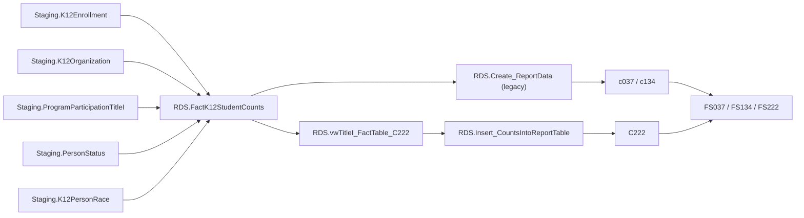

# TitleI

> [!info] Seam: both
> `Staging.ProgramParticipationTitleI`/`K12Organization` and the `Staging-to-Fact*` join logic are
> CEDS-specific; `RDS.FactK12StudentCounts` and the report/category-set shaping downstream are
> standard-agnostic.

Title I, Part A of ESEA. One fact procedure feeds three file specs: **FS037** (Title I Part A
SWP/TAS Participation), **FS134** (Title I Part A Participation), and **FS222** (Foster Care
Enrolled — foster-care students enrolled at a Title I schoolwide/targeted-assistance school). All
three count K-12 students at LEA level; FS222 additionally keys on school Title I eligibility. See
[[Staging-Layer]] for the staging contract and [[App-Metadata-Layer]] for how report codes resolve
to fact types.

## Pipeline

| | |
|---|---|
| Wrapper | `App.Wrapper_Migrate_TitleI_to_RDS` |
| Fact procedure | `Staging.Staging-to-FactK12StudentCounts_TitleI` (`@SchoolYear`) |
| Fact table | `RDS.FactK12StudentCounts`, `FactTypeCode = 'titleI'` (`DimFactTypeId = 12`) |
| Report codes | `c037`, `c134` — legacy, [[Report-Data-Generation|RDS.Create_ReportData]]; `C222` — current, `RDS.Insert_CountsIntoReportTable` off `RDS.vwTitleI_FactTable_C222`; `studentswdtitle1` — legacy, on-screen only, not a file |
| File specs | FS037, FS134, FS222 |

`c037`/`c134` count every Title I participant off the shared fact rows; `C222` narrows those same
rows to `ProgramParticipationFosterCareEdFactsCode = 'FOSTERCARE'` — a fixed filter value, not a
disaggregation, so C222 is best read as "Title I's foster-care slice," not a separate collection.
The fact procedure itself restricts the whole domain to schools whose `TitleISchoolStatusCode` is
`SWELIGSWPROG` / `SWELIGTGPROG` / `TGELGBTGPROG` — an attribute of `Staging.K12Organization`, i.e.
a school property, not a per-student one.

## Data elements required

| Element | Source staging column(s) | Category set role |
|---|---|---|
| Student identifier | `Staging.K12Enrollment.StudentIdentifierState` | identifier |
| LEA identifier | `Staging.K12Enrollment.LEAIdentifierSeaAccountability` | organization |
| School identifier | `Staging.K12Enrollment.SchoolIdentifierSea` | organization |
| Title I participation | `Staging.ProgramParticipationTitleI.TitleIIndicator` | filter |
| School Title I status (SWP/TAS) | `Staging.K12Organization.School_TitleISchoolStatus` | filter |
| Foster care status | `Staging.PersonStatus.ProgramType_FosterCare` + start/end dates | filter — C222's defining criterion |
| IDEA indicator | `Staging.ProgramParticipationSpecialEducation.IDEAIndicator` | category: DISABSTATIDEA |
| English learner status | `Staging.PersonStatus.EnglishLearnerStatus` | category: ELSTATUS |
| Race/ethnicity | `Staging.K12PersonRace.RaceType` + `K12Enrollment.HispanicLatinoEthnicity` | category: RACE |

*Category-set codes for c037/c134/C222 are not present in the cached `App.CategorySets*` seeds;
roles above are inferred from the `Debug.vwTitleI_FactTable` / `RDS.vwTitleI_FactTable_C222` column
lists, not confirmed against `App.CategorySets`.*

## Ed-Fi coverage (preliminary)

> [!warning] Preliminary — Ed-Fi 5.2 verdicts, not adjudicated

| Element | Verdict | Ed-Fi binding |
|---|---|---|
| Student identifier | Direct | `edFi_studentReference.studentUniqueId` |
| LEA / School identifier | Direct | `edFi_localEducationAgencyReference.localEducationAgencyId`, `edFi_schoolReference.schoolId` |
| Title I participation | Direct | `edFi_studentTitleIPartAProgramAssociation.titleIPartAParticipantDescriptor` |
| School Title I status (SWP/TAS) | Direct | `edFi_school.titleIPartASchoolDesignationDescriptor` — core, not an extension |
| Foster care status | Absent | Core 5.2.0 has only `edFi_studentHomelessProgramAssociation.awaitingFosterCare`, scoped to McKinney-Vento awaiting-placement, not a general foster-care program |
| IDEA indicator | Direct | `edFi_studentEducationOrganizationAssociationDisability.designations` (IDEA vs. Section 504 vs. other) |
| English learner status | Direct | `edFi_studentEducationOrganizationAssociation.limitedEnglishProficiencyDescriptor` |
| Race/ethnicity | Direct | `edFi_studentEducationOrganizationAssociation.races`, `.hispanicLatinoEthnicity` |

## Citations

- `generate.database/StoredProcedures/Create/App.Wrapper_Migrate_TitleI_to_RDS.StoredProcedure.sql@develop`
- `generate.database/StoredProcedures/Create/Staging.Staging-to-FactK12StudentCounts_TitleI.StoredProcedure.sql@develop`
- `generate.database/Views/Create/Debug.vwTitleI_StagingTables.View.sql@develop`
- `generate.database/Views/Create/Debug.vwTitleI_FactTable.View.sql@develop`
- `generate.database/Views/Create/RDS.vwTitleI_FactTable_C222.View.sql@develop`
- `generate.database/Views/Create/Staging.vwTitleI_StagingTables_C222.View.sql@develop`
- `generate.database/StoredProcedures/Create/RDS.Create_Reports.StoredProcedure.sql@develop` lines 429–478
- `generate.database/Metadata/App.GenerateReports.Metadata.sql@develop` lines 1006–1022 — `C222: Foster Care Enrolled`
- `generate.database/Metadata/App.CedsConnections.Metadata.sql@develop` — FS037/FS134 titles
