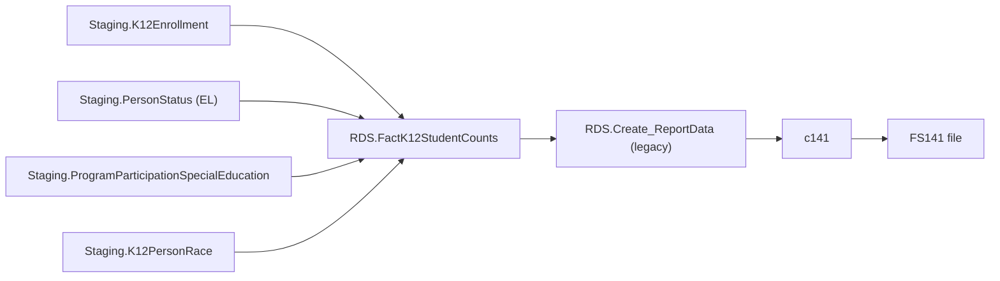

# TitleIIIELOct

> [!info] Seam: both
> `Staging.PersonStatus`/`ProgramParticipationTitleIII` and the `Staging-to-Fact*` join are
> CEDS-specific; `RDS.FactK12StudentCounts` and the report generation downstream are
> standard-agnostic (see [[Staging-Layer]], [[Report-Data-Generation]]).

**FS141 — "LEP Enrolled."** A point-in-time (October) unduplicated count of English learners
enrolled, reported down to LEA/school level. This is the Title III companion to
[[ChildCount]]'s child-count-date pattern, and contrasts directly with [[TitleIIIELSY]], which
counts the same population over the full school year rather than on one date.

The reporting date is the closest school day to October 1 of the calendar year before
`@SchoolYear` (shifted off Saturday/Sunday). A student counts if `Staging.PersonStatus` shows
`EnglishLearnerStatus = 1` on that date and enrollment spans it — Title III program participation
is not required by the fact procedure. `Debug.vwTitleIIIELOct_StagingTables`, by contrast,
additionally inner-joins `Staging.ProgramParticipationTitleIII` on `EnglishLearnerParticipation =
1`; the two artifacts disagree on whether Title III participation gates FS141. Per the source
hierarchy, the fact procedure is authoritative.

## Pipeline

| | |
|---|---|
| Wrapper | `App.Wrapper_Migrate_TitleIIIELOct_to_RDS` |
| Fact procedure | `Staging.Staging-to-FactK12StudentCounts_TitleIIIELOct` (`@SchoolYear`) |
| Fact table | `RDS.FactK12StudentCounts`, `FactTypeCode = 'TitleIIIELOct'` (`DimFactTypeId = 9`) |
| Report code | `c141` — legacy only, `RDS.Create_ReportData` |
| File spec | FS141 (LEP Enrolled) |

## Data elements required

| Element | Source staging column(s) | Category set role |
|---|---|---|
| Student identifier | `Staging.K12Enrollment.StudentIdentifierState` | identifier |
| LEA / School identifier | `Staging.K12Enrollment.LEAIdentifierSeaAccountability` / `SchoolIdentifierSea` | organization |
| English learner status (Oct-1 snapshot) | `Staging.PersonStatus.EnglishLearnerStatus` + start/end dates | filter |
| Native language | `Staging.PersonStatus.ISO_639_2_NativeLanguage` | category: LANGUAGE |
| IDEA indicator | `Staging.ProgramParticipationSpecialEducation.IDEAIndicator` | category: DISABSTATIDEA |
| Race/ethnicity | `Staging.K12PersonRace.RaceType` + `K12Enrollment.HispanicLatinoEthnicity` | category: RACE |
| Grade level | `Staging.K12Enrollment.GradeLevel` | category: GRADELEVEL |

*Category-set codes for c141 are not present in the cached `App.CategorySets*` seeds; roles above
are inferred from `Debug.vwTitleIIIELOct_FactTable`'s column list.*

## Ed-Fi coverage (preliminary)

> [!warning] Preliminary — Ed-Fi 5.2 verdicts, not adjudicated

| Element | Verdict | Ed-Fi binding |
|---|---|---|
| Student identifier | Direct | `edFi_studentReference.studentUniqueId` |
| English learner status | Direct | `edFi_studentEducationOrganizationAssociation.limitedEnglishProficiencyDescriptor` |
| Native language | Direct | `edFi_studentEducationOrganizationAssociation.languages` → `edFi_studentEducationOrganizationAssociationLanguage.languageDescriptor` |
| IDEA indicator | Direct | `edFi_studentEducationOrganizationAssociationDisability.designations` |
| Race/ethnicity | Direct | `edFi_studentEducationOrganizationAssociation.races` |
| Grade level | Direct | `edFi_studentSchoolAssociation.entryGradeLevelDescriptor` |
| Title III program participation (separate concept from EL status) | Direct | `edFi_studentLanguageInstructionProgramAssociation.englishLearnerParticipation` |

## Citations

- `generate.database/StoredProcedures/Create/App.Wrapper_Migrate_TitleIIIELOct_to_RDS.StoredProcedure.sql@develop`
- `generate.database/StoredProcedures/Create/Staging.Staging-to-FactK12StudentCounts_TitleIIIELOct.StoredProcedure.sql@develop` lines 37–46 (reporting-date rule), 197–203 (EL gate)
- `generate.database/Views/Create/Debug.vwTitleIIIELOct_StagingTables.View.sql@develop` lines 42–46, 66–68 (Title III inner join)
- `generate.database/Views/Create/Debug.vwTitleIIIELOct_FactTable.View.sql@develop`
- `generate.database/StoredProcedures/Create/RDS.Create_Reports.StoredProcedure.sql@develop` lines 383–394
- `generate.database/Metadata/App.CedsConnections.Metadata.sql@develop` — `FS141: LEP Enrolled`
