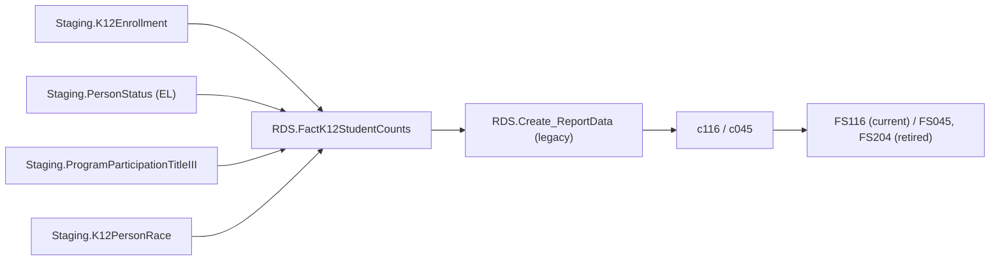

# TitleIIIELSY

> [!info] Seam: both
> `Staging.PersonStatus`/`ProgramParticipationTitleIII` and the `Staging-to-Fact*` join are
> CEDS-specific; `RDS.FactK12StudentCounts` and report generation downstream are standard-agnostic.

**FS116 — "Title III Students Served"** (current): the unduplicated count of English learners
served by a Title III language-instruction program *at any point in the school year* — the 'SY'
in the name. This is the direct contrast to [[TitleIIIELOct]]'s single-date October snapshot; link
the two when reading either. **FS045** and **FS204** are retired: FS204's dispatch block in
`RDS.Create_Reports` is commented out (never executes); FS045 still runs, but only because its
`ReportCode` is reused — see Contradictions in the inventory for the collision with
[[GraduatesCompleters]].

The fact procedure changed its own date logic at SY2023: before 2023 it used the same
closest-to-October-1 date as [[TitleIIIELOct]]; from 2023 on it switched to a full fiscal-year
overlap test (`@SYStartDate`/`@SYEndDate`), i.e. FS116 only became a true "any time in the year"
count starting SY2023. `Debug.vwTitleIIIELSY_StagingTables` inner-joins
`ProgramParticipationTitleIII` on `EnglishLearnerParticipation = 1`; the fact procedure only
left-joins it and does not gate the count on it — the same view-vs-procedure disagreement as
[[TitleIIIELOct]].

## Pipeline

| | |
|---|---|
| Wrapper | `App.Wrapper_Migrate_TitleIIIELSY_to_RDS` |
| Fact procedure | `Staging.Staging-to-FactK12StudentCounts_TitleIIIELSY` (`@SchoolYear`) |
| Fact table | `RDS.FactK12StudentCounts`, `FactTypeCode = 'TitleIIIELSY'` (`DimFactTypeId = 10`) |
| Report codes | `c116` (current spec), `c045` (retired, also dispatched under `graduatescompleters`) — both legacy, `RDS.Create_ReportData`; `c204` coded but commented out |
| File specs | FS116 (current); FS045, FS204 (retired) |

Note that "current" here is about file-spec currency only: FS116 still runs on the legacy
`RDS.Create_ReportData` / `Get_CountSQL` generator, unlike e.g. [[TitleI]]'s C222 or
[[NeglectedOrDelinquent]]'s C218–C221, which are on `RDS.Insert_CountsIntoReportTable`.

**`c045` is dispatched under two fact types.** `RDS.Create_Reports` runs it under `titleIIIELSY`
(lines 408–416) *and* under `graduatescompleters` (lines 339–347); neither block is commented out —
only `c204` is, under a `-- This report is retired --` comment. Three sources disagree about what
FS045 is: this fact procedure's header calls 045 retired, `App.CedsConnections` titles FS045
"Immigrant", and both dispatch branches treat it as live. Only `App.GenerateReport_FactType` decides
at runtime — `RDS.Get_FactTypeByReport` returns exactly one fact type per report code — so whichever
row that table holds wins, and the other branch counts the wrong slice of
`RDS.FactK12StudentCounts`. Unresolved; see [[GraduatesCompleters]] and [[Source-Code-Oddities]].

## Data elements required

| Element | Source staging column(s) | Category set role |
|---|---|---|
| Student identifier | `Staging.K12Enrollment.StudentIdentifierState` | identifier |
| LEA / School identifier | `Staging.K12Enrollment.LEAIdentifierSeaAccountability` / `SchoolIdentifierSea` | organization |
| English learner status (any time in SY) | `Staging.PersonStatus.EnglishLearnerStatus` + start/end dates | filter |
| Title III language instruction program type | `Staging.ProgramParticipationTitleIII.TitleIIILanguageInstructionProgramType` | category: LANGINSTPROG |
| Title III EL participation flag | `Staging.ProgramParticipationTitleIII.EnglishLearnerParticipation` | filter (per lineage view; not enforced by the fact procedure — see above) |
| Race/ethnicity | `Staging.K12PersonRace.RaceType` | category: RACE |
| Grade level | `Staging.K12Enrollment.GradeLevel` | category: GRADELEVEL |

*Category-set codes for c116/c045 are not present in the cached `App.CategorySets*` seeds; roles
above are inferred from `Debug.vwTitleIIIELSY_FactTable`'s column list.*

## Ed-Fi coverage (preliminary)

> [!warning] Preliminary — Ed-Fi 5.2 verdicts, not adjudicated

| Element | Verdict | Ed-Fi binding |
|---|---|---|
| Student identifier | Direct | `edFi_studentReference.studentUniqueId` |
| English learner status | Direct | `edFi_studentEducationOrganizationAssociation.limitedEnglishProficiencyDescriptor` |
| Title III language instruction program type | Direct | `edFi_studentLanguageInstructionProgramAssociationLanguageInstructionProgramService.languageInstructionProgramServiceDescriptor` |
| Title III EL participation flag | Direct | `edFi_studentLanguageInstructionProgramAssociation.englishLearnerParticipation` |
| Race/ethnicity | Direct | `edFi_studentEducationOrganizationAssociation.races` |
| Grade level | Direct | `edFi_studentSchoolAssociation.entryGradeLevelDescriptor` |

## Citations

- `generate.database/StoredProcedures/Create/App.Wrapper_Migrate_TitleIIIELSY_to_RDS.StoredProcedure.sql@develop`
- `generate.database/StoredProcedures/Create/Staging.Staging-to-FactK12StudentCounts_TitleIIIELSY.StoredProcedure.sql@develop` lines 1–6, 41–56 (SY2023 date-rule change), 216–228
- `generate.database/Views/Create/Debug.vwTitleIIIELSY_StagingTables.View.sql@develop`
- `generate.database/Views/Create/Debug.vwTitleIIIELSY_FactTable.View.sql@develop`
- `generate.database/StoredProcedures/Create/RDS.Create_Reports.StoredProcedure.sql@develop` lines 395–428 (`c204` commented out at 419–427)
- `generate.database/Metadata/App.CedsConnections.Metadata.sql@develop` — FS116/FS045/FS204 titles
